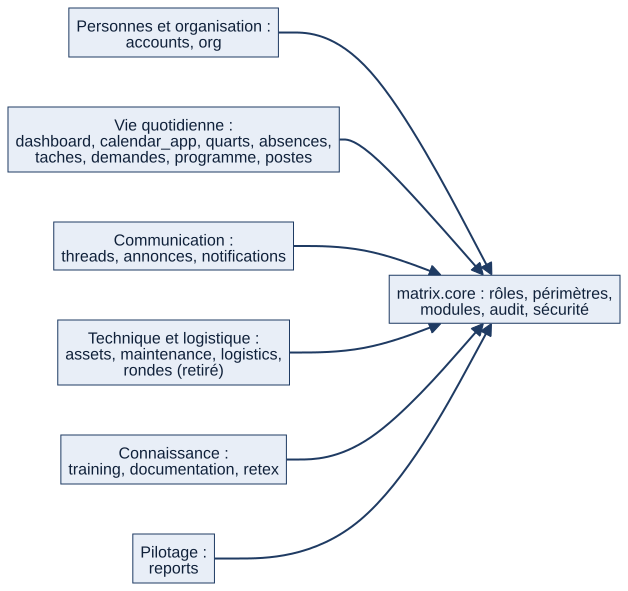

# Chapitre 2 — Vue d'ensemble : modules, acteurs et parcours-types

> **Pour qui :** tous. **Diffusion :** générale.
> **Ce que vous y trouverez :** la carte de Matrix (ce qu'il contient, qui s'en sert), et trois journées-types pour comprendre comment les pièces s'assemblent. Chaque domaine est détaillé dans les chapitres suivants.
> **État décrit :** état B, non fusionné dans `main` (voir le chapitre 3).

---

## 2.1 La carte des modules

Matrix est composé de **22 ensembles de code**, appelés *paquets* : 21 applications fonctionnelles et un noyau commun (`matrix.core`) qui porte les règles partagées (rôles, périmètres, modules, sécurité). Le schéma ci-dessous les regroupe par grande fonction ; le menu de l'application, lui, est organisé en sept groupes de navigation (§2.2).

*Schéma S02 — Les paquets de Matrix regroupés par domaine. Tous s'appuient sur le noyau commun.*

| Domaine | Ce qu'il fait | Paquets | Chapitre |
|---|---|---|---|
| Personnes et organisation | Comptes, rôles, grades, bâtiments, services, secteurs, sections, double équipage | `accounts`, `org` | 4, 5 |
| Accueil et pilotage | Page « Aujourd'hui », tableaux de bord par niveau, bilans et exports | `dashboard`, `reports` | 6 |
| Calendrier | Calendrier central du marin et du bâtiment | `calendar_app` | 7 |
| Quarts et services | Listes de quarts et de gardes, feuille de service, échanges, absences | `quarts`, `absences` | 8 |
| Communication | Discussions attachées aux objets, annonces, notifications, recherche | `threads`, `annonces`, `notifications` | 9 |
| Tâches et vie du bâtiment | Tâches, difficultés signalées, programme du bâtiment, postes du bord | `taches`, `demandes`, `programme`, `postes` | 10 |
| Matériel et maintenance | Matériels, installations, plans de maintenance, anomalies, tickets, stocks | `assets`, `maintenance`, `logistics` | 11, 12, 13 |
| Connaissance | Formations et qualifications, documentation, retours d'expérience | `training`, `documentation`, `retex` | 14, 15 |
| Appareillage | Préparation et signature du prêt à appareiller | `dashboard` | 16 |
| Rondes de contrôle | Module retiré fonctionnellement ; code conservé | `rondes` | 12 |
| Noyau | Rôles, périmètres, seuils, modules activables, double équipage, audit, sécurité | `matrix.core` | 5, 18, 22 |

**Mesures de l'état B** (inventaire généré, `couverture/etat_B/INVENTAIRE.md`) : 135 modèles de données, 721 routes (pages et points d'API), 20 tâches planifiées, 18 commandes de gestion.

## 2.2 Ce que voit le marin : le menu

Le menu latéral est le même pour tous dans sa structure, mais chacun ne voit que ce qu'il a le droit d'ouvrir et que le bâtiment a activé. Sept groupes, dont seul le premier est ouvert par défaut :

| Groupe | Entrées |
|---|---|
| Mon quotidien | Aujourd'hui, Calendrier |
| Équipements | Matériels, Installations, Catalogue, Plan du navire |
| Maintenance | Maintenance, Tickets correctifs, Anomalies, Logistique |
| Activité | Tâches, Annonces, Programme du bâtiment, Difficultés signalées, Quarts et tours de service, Feuille de service, Absences |
| Compétences | Formations, Postes du bord, Documentation, RETEX |
| Supervision | Prêt à appareiller, Flotte, Vue COMANAV, Spécialités, Classes de navire |
| Administration | Annuaire, Paramètres |

Deux mécanismes décident de ce qui apparaît (détaillés au chapitre 5) :
1. **Les modules activés pour le bâtiment.** Un bâtiment peut masquer, par exemple, « Postes du bord » : l'entrée de menu et les pages disparaissent, mais **aucune donnée n'est supprimée** ; réactiver le module fait tout réapparaître.
2. **Les droits de la personne.** Par exemple, « Annuaire » n'apparaît qu'à partir du niveau commandant en second ; « Flotte » à partir de chef de section. Le menu masque ; c'est toujours le serveur qui décide, à chaque action.

## 2.3 Les acteurs

Matrix distingue cinq notions qu'il ne faut pas confondre : le **grade** (rang de la personne), la **fonction exercée** (ce qu'elle fait réellement : chef de liste, BSC, COMAEQ…), le **périmètre** (où elle agit : sa section, son secteur, son service, son bâtiment), l'**habilitation** (ce qu'on l'autorise à faire dans Matrix) et le **brevet** (ce qu'elle sait faire). Les droits viennent de la fonction et du périmètre, jamais du seul grade.

| Acteur | Ce qu'il fait dans Matrix |
|---|---|
| **Équipier / marin** | Consulte sa journée, exécute ses tâches, déclare un blocage, signale une anomalie, demande un échange de tour |
| **Chef de section** | Attribue les tâches de sa section, suit son équipe |
| **Chef de secteur** | Supervise le secteur, attribue et réaffecte, décide des suites des anomalies |
| **Chef de service** | Supervise son service, approuve les circuits de son niveau |
| **Commandant adjoint** (COMAEQ, COMOPS, COMANAV, COMAVIA) | Compétent pour les services qui lui sont rattachés ; le COMAEQ vise la feuille de service ; le COMANAV signe le prêt à appareiller |
| **Commandant, commandant en second** | Vision globale du bâtiment ; le second supplée le commandant pour la relève |
| **BSC** | Prépare et imprime la feuille de service |
| **Chef de liste** | Prépare les listes de quarts et de gardes |
| **Administrateur d'unité / administrateur général** | Administre la plateforme et le bâtiment (comptes, structure, réglages) |
| **Équipage à terre (B)** | Consulte son bâtiment en lecture seule ; tient sa propre feuille de service |
| **Soutien à terre** (responsable de classe ≈ IRB, responsable de spécialité ≈ ALFAN Exploitation) | Consulte les bâtiments qu'il suit et commente ; n'agit que dans les circuits prévus |

🔵 Le rôle de **suppléant** (exercer temporairement une fonction d'un autre) est validé en principe mais **non développé** : aujourd'hui, seul le chef de liste est suppléable (chapitre 25).

## 2.4 Trois journées-types

> ⚪ Ces parcours sont reconstitués d'après le code et les écrans décrits ; ils n'ont **pas été rejoués dans un navigateur** pour cette édition. Les captures viendront avec la recette navigateur (chapitre 17). Les données de l'exemple sont fictives.

### Le marin

1. Il ouvre **Aujourd'hui**. La page lui présente un « À faire » trié par urgence (retard, attente de validation, le reste), une frise « Ma journée » avec ses quarts, services, tâches et formations, et ses notifications.
2. Il ouvre sa **tâche** de la matinée : il y trouve la consigne, la checklist, le fil de discussion attaché. Il pose une question à un collègue dans ce fil ; la discussion reste liée à la tâche.
3. Il **exécute** une maintenance guidée. Un relevé sort de la normale : un **ticket correctif** est créé et notifié au chef.
4. Il consulte son **calendrier** : un quart demain à 06 h. Un collègue lui propose un **échange de tour** : il accepte, puis la demande est validée par la personne qui gère la liste. 🔵 Règle cible validée par le PO : le chef de liste ou le BSC instruit, et le COMAEQ (ou son suppléant) décide ; elle n'est pas encore en place (chapitres 8 et 25). ⚪ L'effet de l'échange sur les deux calendriers est décrit au chapitre 8.
5. Le soir, il reçoit le récapitulatif « Ma journée de demain ».

### Le chef de section ou de secteur

1. Sur **Aujourd'hui**, un bloc « Supervision » (à partir du niveau chef de secteur par défaut) affiche les retards et les validations en attente de son périmètre.
2. Il **attribue** des tâches à ses marins, suit leur avancement, traite une anomalie remontée.
3. Il consulte la **Vue flotte** limitée à son périmètre (section, secteur, bâtiment ou flotte selon son rôle).
4. Il ne voit et ne modifie que ce qui relève de **son périmètre** ; toute modification importante est tracée.

### L'acteur à terre

1. Un responsable de classe ou de spécialité, sans rattachement à un bâtiment, arrive sur une page « Aujourd'hui » adaptée : les **bâtiments qu'il suit**, avec ce qui demande son attention.
2. Il **consulte** et **commente** (par exemple un ticket) ; il ne modifie pas les données du bord.
3. L'équipage B à terre, lui, voit son propre bâtiment en lecture seule, mais garde sa feuille de service propre.

## 2.5 Comment les modules s'enchaînent

Matrix n'est pas une juxtaposition de silos : une donnée créée dans un module alimente les autres. Quelques enchaînements concrets (détail au chapitre 21) :

- une **exécution de maintenance** non conforme crée un **ticket correctif** (maintenance → logistique) ;
- les **quarts, services, tâches, formations et absences** alimentent le **calendrier** unique du marin ;
- presque tous les modules émettent des **notifications** (rappels, validations attendues, alertes de stock) ;
- une **discussion** s'attache à un objet de n'importe quel module (tâche, équipement, ticket, formation…).

## 2.6 Limites et éléments non vérifiés

- ⚪ Les parcours du §2.4 n'ont pas été rejoués dans un navigateur.
- ⚪ La correspondance « responsable de classe ≈ IRB » et « responsable de spécialité ≈ ALFAN Exploitation » vient de la page Notion « 13 — Décisions » ; elle n'est pas modélisée dans le code au-delà des deux désignations `ResponsableClasseNavire` et `ResponsableSpecialite`.
- 🔵 Les échanges entre le bord et la terre (chat contextuel, procédures officielles de type PÉPIN/CRAT) sont des orientations validées, non développées, et dont les circuits exacts ne sont pas encore validés.

---

**Sources (état B).** `matrix/core/navigation.py:56` (groupes du menu), `matrix/core/modules.py:66` (modules activables), `dashboard/aujourdhui.py:91` (« À faire »), `dashboard/aujourdhui.py:211` (« Ma journée »), `dashboard/aujourdhui.py:277` (supervision), `dashboard/aujourdhui_terre.py:18` (bâtiments suivis), `matrix/core/scopes.py:40` (soutien à terre), `matrix/settings.py:115` (chaîne de middlewares). Notion : « Organigramme et rôles », « 13 — Décisions Matrix et gouvernance fonctionnelle ».
