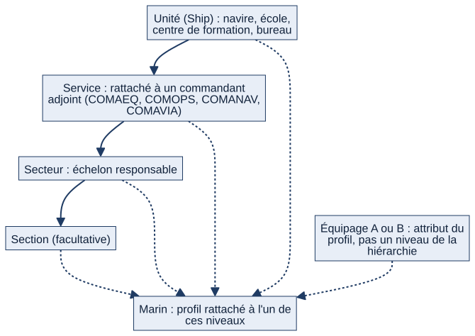
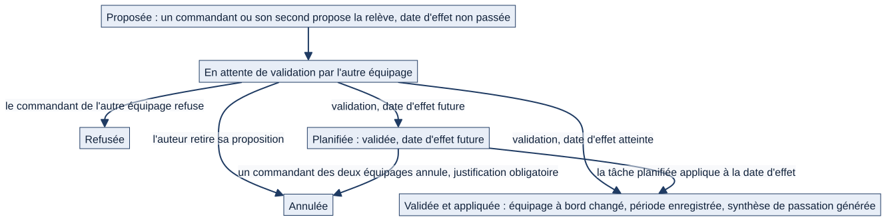
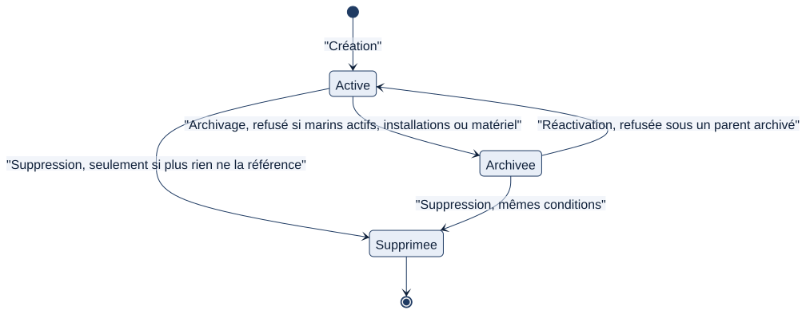

# Chapitre 4 — L'organisation : bâtiments, équipages, services, secteurs, sections

> **Pour qui :** responsables, administrateurs, développeurs. **Diffusion :** générale (le détail technique est dans `restreint/04_organisation_technique.md`).
> **Ce que vous y trouverez :** comment Matrix représente un bâtiment et son personnel, comment fonctionne le double équipage et la relève, comment une unité s'archive ou se supprime, et comment un bâtiment choisit les modules qu'il utilise.
> **État décrit :** état B (`6d6d0be`), non fusionné dans `main`.

---

## 4.1 À quoi sert l'organisation dans Matrix

Presque tout dans Matrix dépend de **l'endroit où se trouve une personne dans l'organisation** : ses tâches, ce qu'elle voit, ce qu'elle peut modifier, les listes de quart auxquelles elle appartient. L'organisation est donc le socle commun : elle décide du *périmètre* de chacun (chapitre 5).

## 4.2 La hiérarchie des unités

Matrix modélise une unité en quatre niveaux emboîtés.

*Schéma S03 — Du bâtiment à la section. Un marin est rattaché à l'un de ces niveaux ; l'équipage est une caractéristique de la personne, pas un niveau.*

| Niveau | Ce que c'est | À retenir |
|---|---|---|
| **Unité** (bâtiment) | Le navire, mais aussi une école, un centre de formation ou un bureau (type d'unité) | Porte la classe de navire, le fuseau horaire de référence, le double équipage |
| **Service** | Un grand service du bord | Peut être **rattaché à un commandant adjoint** : COMAEQ, COMOPS, COMANAV ou COMAVIA |
| **Secteur** | Subdivision d'un service | C'est l'**échelon responsable** quand il n'y a pas de section |
| **Section** | Subdivision d'un secteur | **Facultative** |

Quelques précisions importantes :

- **Rien n'impose la même organisation à tous les bâtiments.** Les noms, le nombre de services, la présence de sections sont des données saisies, pas des règles du programme. Une FREMM, une FDA, une BRF peuvent être organisées différemment.
- **Le rattachement d'un service à son commandant adjoint est explicite.** Quand une validation exige « le COMA du service », Matrix retrouve le titulaire à partir de ce rattachement, et non d'un rôle « état-major » générique. En double équipage, le titulaire doit appartenir à l'équipage concerné.
- **Une unité n'est pas forcément un navire.** Les types « école », « centre de formation » et « bureau » existent déjà ; ils réutilisent la même hiérarchie. 🔵 L'extension aux organismes à terre (divisions, bureaux, cellules) est une orientation validée par le PO le 21/10/2026, non développée : il s'agit de réutiliser cette hiérarchie, sans créer de modèle parallèle.
- **Un référentiel de bâtiments** (catalogue des bâtiments de la Marine, avec numéro de coque et statut) existe à côté des unités réellement utilisées. Il sert de liste de référence ; il n'est pas lui-même une unité.

## 4.3 Le double équipage

Certains bâtiments (frégates multi-missions, patrouilleurs, bâtiments de soutien) fonctionnent avec **deux équipages**, désignés par un code libre, en pratique « A » et « B ». Un seul est à bord à un instant donné.

**Principes retenus (décision du PO) :**
- le bâtiment **n'est pas dupliqué** : il n'y a qu'une seule organisation ;
- l'équipage est une **caractéristique de la personne** (champ « équipage » de son profil), pas un niveau de la hiérarchie ;
- l'équipage **à terre consulte le bâtiment en lecture seule** : cela protège l'équipage embarqué contre des modifications faites à distance ;
- chaque équipage, à bord ou à terre, **tient sa propre feuille de service** ;
- sur un bâtiment à double équipage, l'équipage de chaque marin est **obligatoire**, et **nul ne change son propre équipage** (sauf l'administrateur général).

**La lecture seule en pratique.** Le marin de l'équipage à terre peut continuer à consulter, à modifier ses réglages personnels (thème, préférences, heure de notification), à commenter les tâches, et à gérer sa propre feuille de service ; les pages des demandes et des annonces restent ouvertes en écriture (chaque page revérifie les droits de la personne). Toute autre écriture est refusée avec le message : « Lecture seule : votre équipage est à terre, cette action est réservée à l'équipage à bord. » La règle est un **refus par défaut** : une nouvelle page d'écriture est protégée sans qu'il y ait quoi que ce soit à déclarer.

### La relève

La relève est le changement de l'équipage à bord. Elle suit le principe « proposer, valider, publier » : un équipage ne change pas l'autre de sa propre autorité.

*Schéma S04 — Les états d'une relève.*

1. **Proposition.** Seul un commandant (ou le commandant en second, qui supplée le commandant) de l'un des deux équipages propose la relève, avec une **date et une heure d'effet** qui ne peuvent pas être dans le passé. Une seule relève peut être ouverte à la fois par bâtiment.
2. **Validation par l'autre équipage.** Le commandant (ou en second) **de l'autre équipage** valide ou refuse. Personne ne valide sa propre proposition.
3. **Application.** Si la date d'effet est atteinte au moment de la validation, la relève s'applique tout de suite ; sinon elle est **planifiée** et appliquée automatiquement à la date d'effet. Une relève planifiée peut être annulée par un commandant de l'un des deux équipages, avec **justification obligatoire** ; l'autre équipage est prévenu.
4. **Effets.** L'équipage à bord change ; l'historique des périodes d'équipage est enregistré (jamais reconstitué rétroactivement) ; la **synthèse de passation** est générée ; les feuilles de service et visas historiques restent inchangés (décision du PO, ⚪ non rejouée ici).
5. **Secours.** Si l'équipage chargé de valider n'a ni commandant ni commandant en second, **l'administrateur général** peut valider à sa place, avec un motif obligatoire, tracé.

Tout est écrit dans le journal d'audit : proposition, validation, refus, annulation, application, secours.

> 🔵 **Décision plus ancienne, non retenue.** D'anciennes notes parlaient d'« organisations en miroir » et d'un modèle d'équipage dédié ; ces éléments ont été **retirés** et ne sont pas des consignes : la mise en œuvre retenue est « codes A/B, relève validée, lecture seule à terre ». Toute reprise exigerait une nouvelle décision du PO.

## 4.4 Archiver ou supprimer une unité

Une unité (bâtiment, service, secteur, section) a trois destins possibles, à connaître pour comprendre ce qui est « perdu » ou non.

*Schéma S05 — Cycle de vie d'une unité.*

**Archiver** (lot L02) — la voie normale pour retirer une unité de la vie courante :
- l'unité n'est plus proposée pour de **nouveaux** rattachements ; ce qui s'y rapporte déjà reste lisible (listes, annonces, documents, tâches) ;
- **archiver une unité occupée est refusé**, avec le détail : marins actifs, installations, matériel (sous-unités comprises). Un compte désactivé ne bloque pas. L'occupation par le matériel et les installations compte : c'est une décision confirmée du PO ;
- archiver ne modifie ni le rattachement des marins ni leur périmètre ;
- on peut **réactiver**, sauf sous un parent archivé ; créer ou déplacer une unité sous un parent archivé est refusé ;
- une valeur déjà portée reste modifiable (renommer une unité archivée, éditer la fiche d'un marin qui lui est rattaché).

**Supprimer** (lot L03) — réservé à l'unité vide :
- une unité **n'est jamais supprimée tant que quelque chose la référence** : marins, matériel, installations, listes de quart, annonces, documents, fiches, désignations, relevés d'équipage, configuration du bâtiment ;
- le refus indique le détail (« encore référencé par 4 profils de marins… ») et propose d'archiver ;
- une unité sans aucune référence peut être supprimée, avec ses sous-unités vides ;
- le refus comme la suppression réussie sont tracés.

**Pourquoi ?** Un marin, un matériel ou une liste rattachés à une unité ne doivent pas disparaître, ni se retrouver sans rattachement (donc sans périmètre), parce qu'on a supprimé l'unité. C'est le principe « jamais d'écrasement silencieux ».

## 4.5 Les modules activables par bâtiment

Chaque bâtiment choisit les modules qu'il utilise, parmi 14 : matériels et installations, maintenance, logistique et anomalies, formations, quarts, absences, tâches, RETEX, documentation, postes du bord, programme du bâtiment, annonces, difficultés signalées, bilans et rapports.

- **Par défaut, tout est activé.** Sans réglage explicite, rien ne change.
- Désactiver un module **masque son entrée de menu et bloque ses pages web**, sur ce bâtiment, pour tout le monde. **Aucune donnée n'est supprimée ni modifiée** ; réactiver le module restitue tout.
- Certains ensembles ne sont **jamais** désactivables, car le reste en dépend : comptes, organisation, notifications, tableau de bord, calendrier, discussions.
- Qui active ou désactive : par défaut à partir du commandant en second ; le seuil est lui-même un réglage (chapitre 5).
- La désactivation concerne l'**interface web**. Les automatismes (tâches planifiées, enchaînements entre modules) continuent de fonctionner ; ainsi, une anomalie détectée par un module actif n'est jamais perdue parce qu'un autre module est masqué.

## 4.6 Plusieurs bâtiments, un seul serveur

Un administrateur général, un responsable de spécialité ou de classe peut suivre plusieurs bâtiments. Un **sélecteur de bâtiment** lui permet de choisir celui qu'il regarde. Le choix est mémorisé, mais **le périmètre est revalidé à chaque demande** : un bâtiment sorti du périmètre n'est plus accessible, même s'il était mémorisé.

## 4.7 Fonctionnement cible 🔵

| Sujet | Décision | Lot | État |
|---|---|---|---|
| Structure du bord modifiée par une fonction habilitée | Aujourd'hui, réservée à l'administrateur d'unité par défaut ; cible : fonction habilitée | L12 | Non lancé |
| Organismes et bureaux à terre comme unités à part entière | Réutiliser la hiérarchie existante (division, bureau, cellule) | — | Orientation, non développée |
| Mutation de personnel entre bâtiments | Le nouveau bâtiment demande, l'ancien est informé et confirme ; les formations suivent le marin, l'historique d'activité reste à l'ancien bâtiment | L25 | **Reporté** : dépend de l'architecture bord–terre |
| Synchronisation bord–terre | Fonctionnement local si la liaison est coupée, puis synchronisation | phase 7 | Non développée |

## 4.8 Limites et éléments non vérifiés

- 🟢 Le comportement décrit pour la relève, l'archivage et la suppression est couvert par des tests de l'état B ; la suite complète (3 963 tests, SQLite) passe. ⚪ **Non vérifié** : PostgreSQL (20 tests propres à ce moteur sont ignorés sur SQLite), Windows, navigateur réel.
- ⚪ Relations génériques (fils de discussion, notifications) attachées à une unité : non vérifiées lors de L03 (à contrôler avant production, chapitre 23).
- ⚪ En l'absence de circuit de transfert de matériel (lot L13), un secteur équipé ne peut pas encore être archivé ; le matériel se réaffecte entre-temps par l'affectation en masse.
- ⚪ L'archivage d'un **bâtiment** passe par l'API ou l'administration, pas par l'écran Réglages.
- ⚪ Les pages Notion « 02 — RH, postes… » et « 11 — Modèle de données cible » décrivent un vocabulaire cible (poste, qualification, capacité, mission) plus riche que ce qui existe ; il n'est pas présenté ici comme du fonctionnement actuel.

## 4.9 Comparaison avec `main` (état A)

Sur `main`, l'archivage d'une unité est un simple indicateur : le module de règles d'archivage (`org/archivage.py`) n'existe pas, donc aucune vérification d'occupation. La suppression d'une unité n'est pas refusée : le rattachement des marins est simplement remis à vide (les profils perdent alors leur périmètre) et les sous-unités sont supprimées avec elle. Les lots L02 et L03 changent ces deux comportements ; ils ne sont pas dans `main`. Le double équipage et la relève sont présents dans les deux états.

---

**Sources (état B).** `org/models.py:18` (Ship), `:166` (Service), `:185` (Sector), `:201` (Section), `:409` (ReleveEquipage), `:447` (PeriodeEquipage), `:322` (ModuleActivation), `:91` (ReferenceBatiment) ; `matrix/core/equipage.py:170` (proposition), `:219` (décision), `:275` (secours), `:66` (application planifiée), `:445` (annulation) ; `matrix/core/middleware.py:310` (lecture seule à terre), `:210` (modules) ; `matrix/core/modules.py:66` ; `org/archivage.py:30`, `org/structure_services.py:35` ; `matrix/core/contexte_batiment.py:35`. Tests : `org/tests/test_archivage.py`, `org/tests/test_suppression_unites.py`. Notion : « 13 — Décisions Matrix et gouvernance fonctionnelle », « Organigramme et rôles ». Comptes rendus L02 (`P`) et L03 (`Q`).
