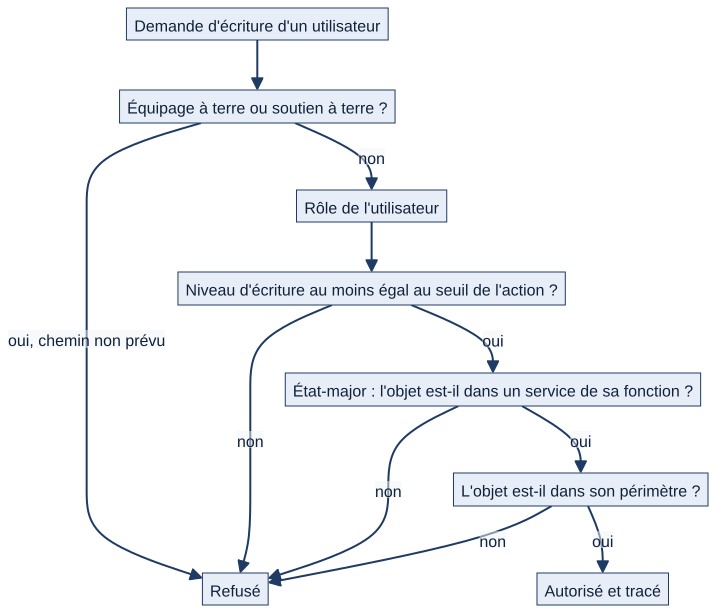
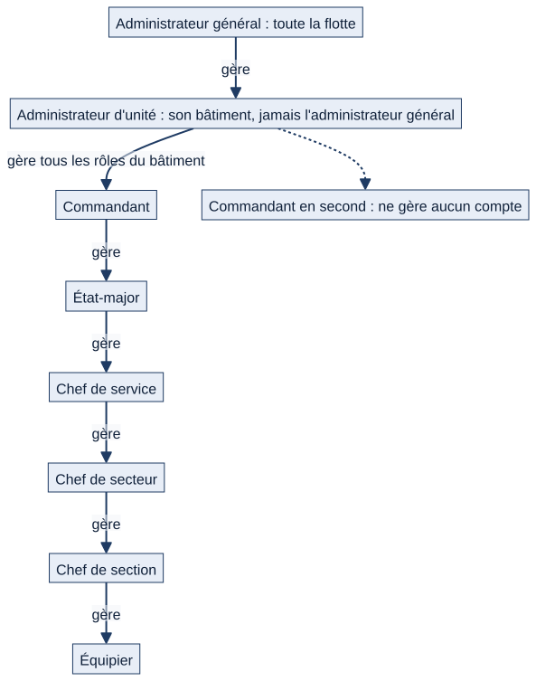

# Chapitre 5 — Comptes, fonctions, grades, rôles et autorisations

> **Pour qui :** responsables, administrateurs, développeurs. **Diffusion :** générale (mécanismes détaillés et matrice des droits dans `restreint/05_comptes_autorisations_technique.md` et `restreint/annexes/B_matrice_role_action.md`).
> **Ce que vous y trouverez :** ce qu'est un compte Matrix, la différence entre grade, fonction, rôle, périmètre et brevet, comment Matrix décide si une action est permise, comment se règlent les droits, et comment on gère les comptes.
> **État décrit :** état B (`6d6d0be`), non fusionné dans `main`.

---

## 5.1 Le compte et le profil

Chaque marin possède un **compte** (identifiant de connexion) auquel est attaché un **profil**. Le profil est créé automatiquement avec le compte, avec le rôle le plus bas (équipier). Il porte :

| Donnée | Rôle dans Matrix |
|---|---|
| **Rôle** | Profil d'accès (neuf possibles, §5.3) |
| **Rattachement** | Unité, service, secteur, section : **définit le périmètre** du marin |
| **Équipage** | « A », « B »… sur un bâtiment à double équipage (obligatoire dans ce cas) |
| **Grade**, **spécialité**, **fonction de service**, **matricule**, date de naissance | Informations d'identification, choisies dans des listes configurables |
| **Fonction de commandant adjoint** | Pour un état-major : COMAEQ, COMOPS, COMANAV ou COMAVIA ; sert à aiguiller les visas |
| **Préférences** | Thème clair ou sombre, menu replié, heures des notifications du matin (08 h par défaut) et du soir (18 h) ; **jamais un contrôle d'accès** |
| **Mot de passe provisoire** | Indicateur : le marin doit en choisir un nouveau à sa prochaine connexion |

L'identifiant est construit sous la forme `prenom.nom` (accents retirés), avec un numéro en cas d'homonyme.

## 5.2 Cinq notions à ne jamais confondre

C'est le cœur du modèle de droits de Matrix, repris de la directive du PO : **le grade n'ouvre aucun droit à lui seul.**

| Notion | Question | Exemple | Dans Matrix |
|---|---|---|---|
| **Grade** | Quel est son rang ? | Matelot, maître… | Information d'identification. 🔵 Un « rang » configurable du grade est prévu pour désigner le coordinateur d'une tâche collective (lot L16) |
| **Fonction exercée** | Que fait-elle réellement ? | Chef de liste, BSC, COMAEQ | Désignations dans les modules (chef de liste, titulaire de COMA, référent de formation) et fonction de service du profil |
| **Rôle** | Quel profil d'accès a-t-elle dans Matrix ? | Chef de secteur | Neuf rôles ordonnés ; détermine un niveau |
| **Périmètre** | Sur quoi agit-elle ? | Sa section, son secteur… | Déduit du rattachement |
| **Brevet / qualification** | Que sait-elle faire ? | BHT, C-CDM… | Module formation (chapitre 14) ; informatif pour les tâches ordinaires |

Le cahier des charges parlait d'un modèle combinant rôle, attributs, périmètre et responsabilité. L'état B en réalise **le rôle, le périmètre, des attributs ciblés (équipage, fonction de commandant adjoint) et les désignations de responsabilité**, pas un moteur d'attributs général.

## 5.3 Les neuf rôles

Les rôles sont ordonnés du plus bas au plus haut. Le niveau numérique sert à comparer ; il n'est pas affiché.

| Niveau | Rôle | Ce qu'il est |
|---|---|---|
| 1 | **Équipier** | Marin d'exécution |
| 2 | **Chef de section** | Encadre une section |
| 3 | **Chef de secteur** | Encadre un secteur |
| 4 | **Chef de service** | Encadre un service |
| 5 | **État-major** | Commandant adjoint (COMAEQ, COMOPS, COMANAV, COMAVIA) ; n'écrit que dans les services de sa fonction |
| 6 | **Commandant en second** | Vision globale, suppléant du commandant ; écritures limitées aux responsabilités attribuées |
| 7 | **Commandant** | Commandement du bâtiment (ou de l'équipage) |
| 8 | **Administrateur d'unité** | Administre le bâtiment : comptes, structure, réglages |
| 9 | **Administrateur général** | Administre toute la flotte ; équivalent du superutilisateur |

Deux désignations **ne sont pas des rôles** : le **chef de liste** (désigné dans le module quarts) et le **référent de formation**. Elles ouvrent des droits dans leur domaine sans toucher au rôle. De même, le responsable de spécialité et le responsable de classe sont des désignations à l'échelle de la flotte.

## 5.4 Comment Matrix décide si une action est permise

À chaque action d'écriture, le serveur pose trois questions, dans cet ordre. L'écran peut masquer un bouton, mais **c'est toujours le serveur qui décide**, jamais l'affichage.

*Schéma S06 — Les contrôles successifs appliqués à une demande d'écriture.*

1. **Mon statut m'autorise-t-il à écrire ?** L'équipage à terre et le soutien à terre sont en lecture seule, sauf quelques actions explicitement prévues (chapitre 4).
2. **Mon niveau est-il suffisant ?** Chaque action a un **seuil** : le rôle minimal requis. Le seuil dépend du bâtiment (§5.5).
3. **L'objet est-il dans mon périmètre ?** Une action n'est possible que sur des objets rattachés à mon unité, mon service, mon secteur ou ma section.

Pour l'état-major, un contrôle supplémentaire s'applique : il n'écrit que sur les services rattachés à sa fonction de commandant adjoint ; ailleurs, il garde la lecture et les droits d'un équipier.

Enfin, certains circuits exigent une **fonction précise**, quel que soit le niveau : par exemple le visa de la feuille de service revient au COMAEQ compétent du service et de l'équipage concerné, et non à « un état-major ». Un administrateur désigne le titulaire d'une fonction, **sans pouvoir viser à sa place**.

## 5.5 Les seuils par action : la configuration plutôt que le code

Plutôt que de coder « un chef de section peut créer un matériel » dans le programme, Matrix tient un **registre de 35 actions**, chacune avec un rôle minimal par défaut. Exemples (valeurs par défaut) :

| Action | Seuil par défaut |
|---|---|
| Créer ou modifier un matériel | Chef de section |
| Supprimer un matériel, lancer une action groupée | Chef de service |
| Corriger un compte rendu de maintenance terminé | Chef de secteur |
| Publier une liste de quarts ou de gardes | Chef de service |
| Activer ou désactiver un module | Commandant en second |
| Modifier la structure du bâtiment | Administrateur d'unité |
| Modifier les grades, spécialités, rôles disponibles (toute la flotte) | Administrateur général |

La **matrice complète** est l'annexe B (restreinte).

- **Qui règle ?** L'administrateur d'unité règle chaque seuil de **son** bâtiment, dans Réglages › Sécurité. Les actions de portée « flotte » (référentiels communs) ne se règlent que par l'administrateur général.
- **Tant que rien n'est réglé, le comportement est celui des valeurs par défaut**, qui reproduisent les droits d'origine.
- **Prise en compte immédiate.** Un changement est vu dès la requête suivante, sur tous les processus du serveur.
- Les seuils sont une **condition**, pas une autorisation : le périmètre reste vérifié.

## 5.6 Ce que chacun voit : le périmètre de lecture

Le périmètre est **le niveau de rattachement le plus fin renseigné** sur le profil : un chef de section rattaché à sa section voit celle-ci ; un chef de secteur rattaché à son secteur voit le secteur. Un profil qui n'est rattaché qu'à un secteur (sans renseigner l'unité) est tout de même rattaché à son bâtiment, par la hiérarchie.

Cas particuliers :
- **Administrateur général** : toute la flotte (ou le bâtiment choisi dans le sélecteur).
- **Responsable de spécialité ou de classe, sans bâtiment** : les bâtiments qu'il suit, en consultation.
- **Sans aucun rattachement** : Matrix ne montre rien plutôt que de montrer ce qui n'est pas dans le périmètre.

## 5.7 Les cas particuliers à connaître

| Cas | Règle appliquée |
|---|---|
| **Commandant en second** | Vision globale, mais **l'écriture n'est pas héritée de son grade** : ses actions passent par des responsabilités attribuées et des circuits explicites (la publication d'annonces sur son bâtiment lui est ouverte). Il supplée le commandant pour la validation de la relève. |
| **État-major** | Écrit uniquement dans les services dont le commandant adjoint est sa fonction. Un service dont le commandant adjoint n'est pas configuré n'est rattaché à aucune fonction : un état-major n'y écrit donc pas. |
| **Équipage à terre** | Lecture seule du bâtiment, avec sa propre feuille de service. |
| **Soutien à terre** (responsable de classe ou de spécialité sans bâtiment) | Consulte et commente ; n'écrit que dans les circuits prévus (catalogue flotte, par exemple). **Aucun droit automatique sur le bord, quel que soit le grade.** |
| **Administrateur d'unité** | Administre le bâtiment : comptes, structure, réglages. Son niveau (8) dépasse tous les seuils métier par défaut. 🔵 Le PO a décidé qu'il ne doit avoir **aucun visa métier** (voir §5.11). |
| **Administrateur général** | Seul niveau multi-bâtiments ; équivalent du superutilisateur. |

## 5.8 Gérer les comptes

La gestion se fait dans l'**Annuaire** (visible à partir du commandant en second) et par l'API.

- **Qui peut gérer quel rôle.** On ne gère que des rôles **inférieurs ou égaux au sien** selon une table unique, appliquée à l'écran comme à l'API :

*Schéma S07 — Gestion des comptes par rôle.*

Hors administrateur général, on n'agit que sur les comptes de **son propre bâtiment**, jamais sur l'administrateur général, et on peut toujours modifier **son propre** compte. Le commandant en second **ne gère aucun compte**.

- **Créer un compte** : on choisit le rôle (dans la limite de ses droits), l'identité, la fonction, l'unité, le service, le secteur, la section et l'équipage. Les rattachements sont **validés contre le périmètre de l'appelant avant toute création** : on ne peut pas rattacher un marin à un bâtiment qu'on ne gère pas.
- **Modifier**, **action en masse** (changer rôle, unité, service, secteur, section, fonction, grade, spécialité), **export Excel** de l'annuaire.
- **Mot de passe.** Un compte créé n'a pas de mot de passe utilisable. L'administrateur du bâtiment (seuil configurable) **réinitialise** : Matrix génère un mot de passe provisoire de 14 caractères, **affiché une seule fois**, jamais enregistré en clair ni écrit dans le journal. Le marin doit le remplacer à sa première connexion : tant qu'il ne l'a pas fait, seules la page de changement et la déconnexion lui sont ouvertes.
- **Supprimer un compte** est possible (par l'annuaire, jamais sur soi-même). La suppression est tracée. 🔵 Le PO a décidé de **désactiver plutôt que supprimer** (lot L04, non lancé) ; l'état d'un compte « désactivé » existe déjà au sens du système d'authentification et n'est pas bloquant pour l'archivage d'unités, mais il n'y a pas, dans l'annuaire, de bouton de désactivation.
- **Chaque acte est tracé** dans le journal d'audit : création, modification, changement de rôle, réinitialisation, suppression, connexion et déconnexion.

## 5.9 Les listes configurables

Grades, spécialités, fonctions de service, fonctions de quart, types d'absence et rôles attribuables sont des **listes de référence** modifiables sans toucher au programme : on peut ajouter une valeur, l'activer ou la désactiver. Ces référentiels sont communs à toute la flotte ; ils ne se modifient qu'au niveau « administrateur général » par défaut. Les désignations de **responsable de spécialité** et de **responsable de classe de navire** se font à l'échelle de la flotte, au même niveau.

## 5.10 Se connecter, rester connecté

- Authentification par identifiant et mot de passe ; le mot de passe doit passer les contrôles standards (longueur, pas trop courant, pas entièrement numérique, pas trop proche de l'identité).
- **Déconnexion automatique après 15 minutes d'inactivité** par défaut (réglable entre 1 minute et 8 heures), avec un avertissement 60 secondes avant. Cela protège les **postes partagés** du bord. Les requêtes automatiques (compteur de notifications, brouillons) ne comptent pas comme une activité.
- **Brouillons** : un formulaire en cours est enregistré avant la déconnexion et peut être repris (conservation de 30 jours par défaut).
- **Postes partagés** : une écriture est refusée si la page a été ouverte pour **un autre marin** que celui connecté, ce qui évite d'enregistrer au nom d'un collègue qui s'est connecté entre-temps.

## 5.11 Fonctionnement cible 🔵 (décisions du PO, non développées)

| Sujet | Règle validée | Lot |
|---|---|---|
| **Exclure l'administrateur technique des actes métier** | L'administrateur technique gère la plateforme, désigne les titulaires, applique un transfert approuvé ; il n'a **aucun visa métier** | L06 |
| **Rattachement incomplet et validation des rôles** | Un rattachement obligatoire et cohérent ; une fonction exercée n'ouvre pas d'accès de sa seule dénomination | L07 |
| **Suppléance explicite** | Une autorité compétente active une suppléance bornée dans le temps, tracée ; un suppléant officiel n'existe que par ce mécanisme | L08 |
| **Droits par fonction** | Les visas viennent de la fonction exercée et du périmètre, pas du niveau seul | L09 |
| **Désactiver plutôt que supprimer un compte** | Historique et traces conservés | L04 |
| **Rang des grades configurable** | Pour proposer le coordinateur d'une tâche collective ; valeurs saisies par le PO | L16 |
| **Sécurité d'accès** | Avec les SIC | L21 |
| **Import de comptes** | Annoncé, non développé | — |
| **Fonctions annexes** | « Adjudant de compagnie » et « OSS » : reconnues comme **fonctions** attribuées à des personnes, ni grades, ni permissions générales ; leur rattachement dépend de l'unité. Ce n'est pas un feu vert d'implémentation | — |

> **Écart entre le cible et le réel, à connaître.** Le PO a décidé que l'administrateur technique n'a aucun visa métier ; dans l'état B, le niveau numérique de l'administrateur d'unité atteint les seuils de la plupart des actions métier, et seules les règles propres à certains circuits (par exemple le visa du COMAEQ) l'en écartent. L'exclusion générale est précisément l'objet du lot L06. Cet écart est signalé ici, **sans modifier la décision**.

## 5.12 Limites et éléments non vérifiés

- 🟢 Les contrôles décrits sont couverts par des tests de l'état B (`accounts/tests/`, dont la matrice des droits, les fuites de périmètre et la réinitialisation de mot de passe). La suite complète passe sur SQLite ; ⚪ PostgreSQL, Windows et navigateur n'ont pas été rejoués.
- ⚪ Les pages Notion « 02 — RH, postes, qualifications » et « 03 — Formation, stages » décrivent des objets cibles (poste, aptitudes, profondeur de relève, couverture de fonctions) qui **ne sont pas des fonctions actuelles**.
- ⚪ L'ordre exact des grades et la liste des brevets ne sont pas dans le code ; ils sont à fournir par le PO (informations manquantes IM-01 et IM-02 du dossier V1.2).
- ⚪ Le détail action par action de ce que peut faire un administrateur d'unité est établi dans les chapitres qui traitent chaque circuit.

---

**Sources (état B).** `accounts/models.py:11` (rôles), `:27` (profil), `:87` (périmètre), `:177` (journal) ; `matrix/core/roles.py:4`, `:53` ; `matrix/core/scopes.py:8`, `:40` ; `matrix/core/role_thresholds.py:45` ; `matrix/core/permissions.py:81`, `:100` ; `matrix/core/ecriture_service.py:68` ; `accounts/web_views.py:33`, `:62`, `:376`, `:465` ; `accounts/services.py` (réinitialisation) ; `matrix/core/inactivite.py`, `matrix/core/middleware.py:121`, `:165`. Notion : « Organigramme et rôles », « 13 — Décisions », « 02 — RH, postes… ». Décisions : `DEC-DRT-*`, `DEC-SUP-*`, `DEC-ORG-04` (dossier V1.2, `A_REGISTRE_DECISIONS.md`). Tests : `accounts/tests/test_matrice_droits.py`.
