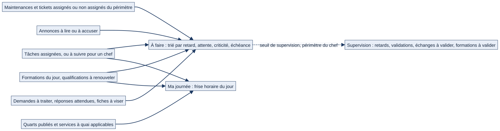

# Chapitre 6 — Espace personnel, tableaux de bord, pilotage et rapports

> **Pour qui :** marins, responsables. **Diffusion :** générale (mécanismes et références dans `restreint/06_accueil_pilotage_technique.md`).
> **Ce que vous y trouverez :** ce que le marin voit en ouvrant Matrix, ce que voit un chef, ce que voit l'acteur à terre, les vues de pilotage par niveau (flotte, COMANAV, spécialité, classe de navire), la synthèse de passation et les bilans exportables.
> **État décrit :** état B (`6d6d0be`), non fusionné dans `main`.

---

## 6.1 Le principe : chacun voit sa journée

« Aujourd'hui » est la **page d'accueil** de Matrix. Elle répond à la question du marin : *qu'est-ce que je dois faire, et où dois-je être, maintenant ?* Principe du projet : un **espace personnel par marin** ; le marin voit ce qui lui est **utile maintenant**, pas cent informations à la fois.

## 6.2 Ce que voit et fait le marin

> Exemple fictif : le matelot Durand, à 07 h 45.

La page « Aujourd'hui » est organisée en blocs.

*Schéma S13 — D'où viennent les informations de la page « Aujourd'hui ».*

1. **« À faire »** — tout ce qui demande son intervention, **trié par urgence** : d'abord ce qui est en retard, puis ce qui attend une action, puis par criticité (5 = la plus critique) et par échéance. On y trouve :
   - ses **tâches** et leurs retards ;
   - ses **maintenances** et **tickets correctifs** assignés ;
   - les **formations** du jour et les **qualifications à renouveler ou expirées** ;
   - les **annonces** à lire ou à accuser (Urgent en tête) ;
   - les **difficultés signalées** à traiter, les **réponses attendues** de lui (mentions dans un fil) ;
   - les **fiches de maintenance** à viser, si sa fonction l'y appelle.
   Chaque ligne est **cliquable** et mène à l'objet. Une ligne mentionne le contexte (bâtiment, service, type de matériel) et « Non assigné » quand c'est le cas.
2. **« Ma journée »** — une **frise horaire** : ses quarts publiés, ses services à quai applicables, ses formations, puis ses tâches et maintenances du jour sans heure précise.
3. **« Mes tours de service »** — ses prochains services (chapitre 8).
4. **Indicateurs** — pour ses périmètres : maintenances en retard, à venir (sur 7 jours), en attente de validation, tickets correctifs ouverts ; **chaque chiffre mène au dossier filtré** correspondant (« aucun chiffre sans dossier derrière »).
5. **Notifications** — compteur et centre ; « Ma journée » du matin et « Ma journée de demain » en fin de journée (heures personnalisables).

Un **bandeau d'identité navale** (type de bâtiment, silhouette) et un indicateur du **mode du bâtiment** (mer ou quai) rappellent le contexte. La page est conçue pour s'afficher sans défilement inutile et sur mobile (chapitre 17).

## 6.3 Ce que voit un chef

À partir du niveau **chef de section**, « À faire » s'enrichit :
- les **maintenances et tickets non assignés** de son périmètre ;
- les **tâches bloquées** de ses marins (« Blocage à lever ») ;
- les **tâches de son équipe** qu'il supervise.

À partir du niveau **chef de secteur** (seuil réglable), un bloc **« Supervision »** présente, pour son périmètre : les **maintenances en retard** (cinq lignes, avec lien), les **validations en attente**, les **échanges de tours à valider**, les **formations à valider** et les **candidatures à approuver**, et des indicateurs d'indisponibilité (matériels hors service, installations critiques en retard). Chaque ligne indique si le chef peut valider lui-même ou si l'acte revient à un autre niveau.

Un chef peut aussi **générer un bilan** de son périmètre (voir §6.7).

## 6.4 Ce que voit l'acteur à terre

Un **responsable de classe ou de spécialité** (sans bâtiment) arrive sur une page « Aujourd'hui » **adaptée** : un bloc « À faire » restreint à ce qui le concerne en consultation, puis **une carte par bâtiment suivi** (indicateurs de maintenance, tickets, anomalies, matériels indisponibles). Il **consulte et commente** ; il ne valide pas (la validation d'une maintenance reste **à bord**, aucun bouton n'est proposé) et peut **commenter** un ticket bloqué. Un sélecteur de bâtiment permet de passer de l'un à l'autre.

## 6.5 Les tableaux de pilotage par niveau

| Vue | Qui la voit | Ce qu'elle montre |
|---|---|---|
| **Vue flotte** | À partir de **chef de section** | Photo d'ensemble du périmètre **effectif** de la personne : sa section (chef de section), son secteur (chef de secteur), son bâtiment (chef de service et au-dessus), toute la flotte (administrateur général). Maintenances en retard, tickets correctifs ouverts, pièces sous le seuil, installations |
| **Vue COMANAV** | Le **COMANAV désigné**, le commandement (commandant, commandant en second, administrateur d'unité), l'administrateur général | Vue d'ensemble du bâtiment pour l'adjoint chargé de la conservation du bâtiment et des équipements : occurrences, tickets, stock, comptes rendus, dérives, circuits de visa ; **étanche par équipage** |
| **Dashboard spécialité** | Le(s) **responsable(s) de spécialité** désigné(s) | Répartition des marins de la spécialité **par bâtiment** et vue d'ensemble de leurs **qualifications**, sur **toute la flotte** ; **lecture seule** |
| **Dashboard classe de navire** | Le **responsable de classe** | Maintenances en retard, tickets ouverts, pièces sous le seuil, **sur tous les bâtiments de la classe** |
| **Prêt à appareiller** | Voir le chapitre 16 | Session de préparation à l'appareillage |

Les vues « spécialité » et « classe » donnent un accès **en lecture seule** et n'ajoutent **aucun droit d'écriture** sur les fiches ou le matériel des bâtiments concernés.

## 6.6 La passation de relève

Quand un **double équipage** relève, Matrix **fige** une **synthèse de passation** pour l'équipage montant : ce que les services existants savent déjà dire du bâtiment (vue COMANAV, qualifications, annonces, listes de service). Elle est **activée par défaut** (l'administrateur général peut la désactiver pour la flotte ; les synthèses existantes sont conservées). Elle est générée à l'application de la relève, ou **manuellement** par le commandement. **Qui la lit** (état B) : le commandement du bâtiment et les chefs des deux équipages concernés (à partir du seuil de supervision des tâches) ; jamais un autre bâtiment. 🔵 La décision du PO (recette V1) dit qu'**un chef de section ne consulte que sa propre section** ; ⚪ **la limitation à la section n'est pas démontrée** : le contrôle côté serveur (`syntheses_visibles`) filtre par bâtiment et équipage, sans borne par section, et le contenu figé couvre tout le bâtiment ; l'écart est conservé comme **non vérifié** (registre des écarts, A14). Une page **imprimable** et une version **PDF** existent. Décision du PO : **pas de module autonome de passation** ; on préserve l'existant (`DEC-PRE-02`).

## 6.7 Rapports et exports

- **Bilan** du périmètre propre de la personne (section, secteur, service ou bâtiment selon son rattachement), réservé au niveau **chef de section** ou plus. **Pas de choix de périmètre** par l'utilisateur : il est déduit de son profil.
- Deux modes : **instantané** (photo de l'état actuel) et **période** (entre deux dates).
- Trois formats : **PDF**, **CSV**, **Excel**. Le **CSV est toujours disponible** ; l'Excel exige la bibliothèque correspondante ; le **PDF est facultatif** (il demande des bibliothèques natives absentes par défaut sous Windows : sans elles, tout le reste fonctionne).
- Les listes de l'application proposent aussi des **exports CSV et Excel** ; la décision du PO est de les conserver puis d'en améliorer la qualité (`DEC-PRE-03`).

## 6.8 Interactions avec les autres modules

L'accueil et les tableaux de pilotage **ne contiennent aucun moteur propre** : ils **assemblent** ce que savent dire les autres modules, avec **les mêmes périmètres que les listes**.

| Module source | Ce qu'il alimente |
|---|---|
| Tâches, demandes (ch. 10) | « À faire », supervision |
| Maintenance, tickets, stock, matériel (ch. 11 à 13) | « À faire », indicateurs, Vue flotte, COMANAV |
| Quarts, échanges (ch. 8) | « Ma journée », tours de service, échanges à valider |
| Formations (ch. 14) | Qualifications, formations du jour et à valider |
| Annonces, discussions (ch. 9) | Annonces à lire, réponses attendues |
| Organisation (ch. 4) | Périmètres, équipage, relève et passation |

## 6.9 Cas particuliers

- **Double équipage** : les listes et les compteurs sont **bornés à l'équipage** du marin ; la passation fait exception (l'équipage montant lit tout).
- **Équipage à terre** : accueil identique mais **lecture seule** ; un marin sans bâtiment voit la page « à terre » s'il a un périmètre de suivi.
- **Module désactivé** : ses blocs et ses catégories disparaissent de l'accueil et de la recherche.
- **Aucun rattachement** : la page ne montre rien plutôt que de montrer des données hors périmètre.

## 6.10 Fonctionnement cible 🔵

- **Tableaux de bord par niveau** jusqu'au **commandement** et au **SSF** (cahier des charges §24 ; phase 6) : indicateurs consolidés, rapports, vue de situation générale. Ils ne sont pas décrits comme existants : seules les vues du §6.5 le sont.
- **Cartes « À faire » et aide progressive**, **épinglage du menu**, **recherche de personnes** (`DEC-UX-01`, `DEC-UX-04`, `DEC-UX-09`) : voir le chapitre 17.
- Le libellé « Mes tours de **services** » demandé par `DEC-UX-08` n'est pas appliqué (écart purement visuel, lot UX).

## 6.11 Limites et éléments non vérifiés

- 🟢 Couverture de tests de l'état B : 261 fonctions de test dans `dashboard`. ⚪ Les écrans n'ont pas été rejoués dans un navigateur ; leur description vient du code et des gabarits.
- ⚪ Le contenu exact de chaque vue de pilotage évolue avec les modules sources ; ce chapitre en décrit la **logique d'assemblage**, pas chaque indicateur.
- ⚪ Le PDF exige des bibliothèques natives non installées dans l'environnement de rédaction : l'export PDF n'a pas été rejoué.
- ⚪ La page Notion « Recette UX V1.1 » n'a pas encore été lue ; elle le sera avant le chapitre 17.

---

**Sources (état B).** `dashboard/aujourdhui.py`, `dashboard/aujourdhui_terre.py`, `dashboard/comanav.py`, `dashboard/passation.py`, `dashboard/indicateurs.py`, `dashboard/web_views.py`, `reports/` ; références ligne par ligne dans `restreint/06_accueil_pilotage_technique.md`. Décisions : `DEC-UX-01`, `DEC-UX-05`, `DEC-UX-08`, `DEC-PRE-02`, `DEC-PRE-03` (dossier V1.2) ; Notion « 13 — Décisions » (vues à terre, passation).
