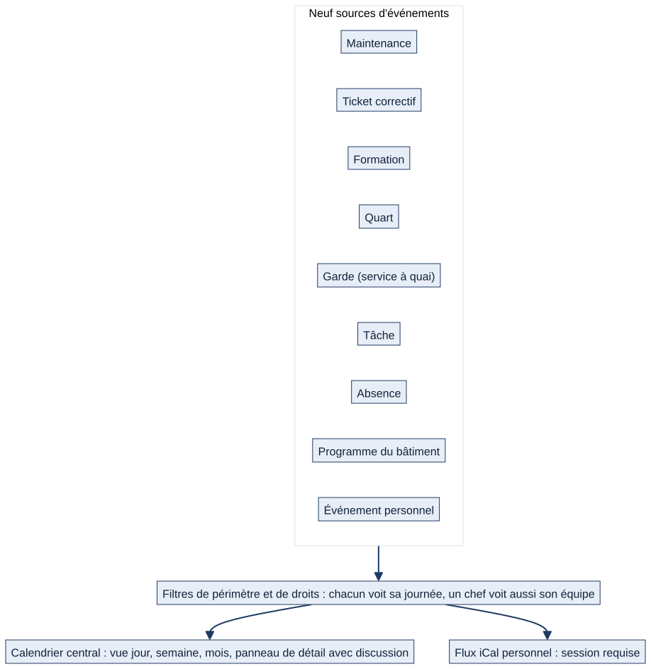

# Chapitre 7 — Le calendrier central

> **Pour qui :** marins, responsables, développeurs. **Diffusion :** générale (mécanismes dans la partie restreinte du dossier).
> **Ce que vous y trouverez :** ce que montre le calendrier, ce que le marin y fait, ce que peuvent faire les chefs, d'où viennent les événements, et comment exporter son calendrier.
> **État décrit :** état B (`6d6d0be`), non fusionné dans `main`.

---

## 7.1 À quoi sert le calendrier

Le calendrier est la **colonne vertébrale** de Matrix : **tout ce qui a une date y apparaît**, pour que le marin n'ait pas à consulter cinq systèmes. Il reflète « la réalité du marin » : quarts, services, tâches, formations, maintenances, absences, programme du bâtiment, rendez-vous personnels — **une seule vision**.

## 7.2 Ce que voit et fait le marin

> Exemple fictif : le matelot Durand ouvre « Calendrier » un lundi.

1. Il choisit une **vue jour, semaine ou mois** et navigue de date en date.

*Schéma S14 — Les neuf sources du calendrier central.*

2. Il voit **ses événements**, de couleurs différentes selon la **source** (légende et filtre par type) :

| Source | Ce qu'on y voit |
|---|---|
| Maintenance | Les occurrences de maintenance de son périmètre ou qui lui sont assignées |
| Ticket | Les tickets correctifs de son périmètre ou qui lui sont assignés |
| Formation | Les sessions où il est inscrit, présent ou formateur |
| Quart | Ses quarts, sur les listes **publiées** |
| Garde | Ses services à quai, en vigueur ou prévisionnels |
| Tâche | Ses tâches avec échéance (retards en évidence) |
| Absence | Ses absences et celles de son équipe pour un chef |
| Programme du bâtiment | Escales, exercices, réunions qui le visent |
| Personnel | Ses propres rappels et notes |

3. Il clique sur un événement : un **panneau de détail** s'ouvre à côté (titre, source, date, responsable, avancement, **fil de discussion**) sans quitter le planning. Il peut y **démarrer une tâche** et **répondre dans le fil**.
4. Il ajoute un **événement personnel** (rappel, note) : **visible de lui seul**, modifiable, supprimable.
5. Il **déplace** par glisser-déposer ce qu'il a le droit de déplacer : ses propres événements personnels, et une maintenance qui lui est assignée.
6. Il **exporte** son calendrier au format **iCal** pour l'ajouter à un autre agenda, tant qu'il est connecté.

**Le calendrier personnel n'a rien à mettre à jour lui-même** : il lit directement les affectations. Quand un échange de tour est validé (chapitre 8), les deux calendriers le reflètent aussitôt.

## 7.3 Ce que font les responsables

- Un **chef** voit, en plus, les événements de son **équipe** : tâches (retards en évidence), absences, quarts et gardes des marins sous lui. Il peut **filtrer** par bâtiment, service, secteur, section, marin et type.
- Un chef de section ou plus peut **déplacer** une maintenance de son périmètre (l'action est **tracée** quand il replanifie celle d'un tiers), un **ticket correctif** de son périmètre, une **session de formation** à laquelle il est personnellement affecté.
- Les chefs ne déplacent **ni les quarts, ni les gardes, ni les tâches** depuis le calendrier : ces objets se modifient dans leur module (listes, tâches).

## 7.4 Qui voit quoi

| Source | Qui la voit |
|---|---|
| Maintenance, tickets | Le périmètre du marin **ou** ses assignations ; un chef voit tout son périmètre |
| Formations | L'affectation **personnelle** : présent, inscrit, formateur (les formations sont communes à tous les bâtiments, pas rattachées à un périmètre) |
| Quarts, gardes | Ses propres créneaux ; un chef voit ceux de son équipe |
| Absences | Les siennes ; un chef voit celles de son équipe |
| Programme | Les événements qui le visent |
| Personnel | Lui seul |

**Double équipage** : les affichages sont bornés à l'équipage du marin. Les menus de filtre ne proposent que les unités de son périmètre ; un filtre incohérent (un secteur hors du service choisi) est corrigé.

## 7.5 Le flux iCal

`/calendar/ical/my/` fournit un **flux iCal personnel** pour importer son calendrier dans un autre agenda : maintenances assignées, formations, quarts et gardes publiés, absences, événements personnels. **Il exige une session ouverte** : ce n'est pas un lien public. **Les tâches et le programme du bâtiment n'y figurent pas** (non trouvés dans le code).

## 7.6 Interactions avec les autres modules

Le calendrier est un **agrégateur** : il **lit** presque tous les modules (il importe 9 paquets) et **n'en écrit presque aucun**, à part les quelques déplacements ci-dessus. Il est aussi utilisé, avec les mêmes règles, par le digest « Ma journée » des notifications.

| Module | Rôle |
|---|---|
| Quarts, absences (ch. 8) | Créneaux et indisponibilités |
| Tâches, programme (ch. 10) | Échéances et événements |
| Maintenance, tickets (ch. 12) | Occurrences et planification |
| Formations (ch. 14) | Sessions |
| Discussions (ch. 9) | Fil du panneau de détail |

## 7.7 Cas particuliers

- **Marin sans événement** : le calendrier est simplement vide ; aucune donnée hors périmètre n'est affichée.
- **Liste prévisionnelle** : les gardes prévisionnelles apparaissent, distinctes des gardes en vigueur.
- **Absence en attente de validation** : affichée ; elle compte aussi pour les contrôles d'échange.
- **Module désactivé** : sa source disparaît du calendrier.

## 7.8 Fonctionnement cible 🔵

- **Calendrier intégrateur** et **échéances** (cahier des charges §15, orientation validée) : plus de sources et de règles de visibilité ; non développé au-delà des neuf sources ci-dessus.
- **Vue personnelle par défaut** : une orientation d'ergonomie à confirmer (chapitre 17).

## 7.9 Limites et éléments non vérifiés

- 🟢 Couverture de tests de l'état B : 124 fonctions de test dans `calendar_app`. ⚪ L'affichage (FullCalendar) n'a pas été rejoué dans un navigateur.
- ⚪ Les événements du calendrier ne portent pas tous la même règle de déplacement : ce chapitre en donne la liste exhaustive ; une évolution la modifierait.
- ⚪ Le flux iCal n'inclut pas les tâches ni le programme : constat issu de la lecture du code, non confronté à un usage réel.

---

**Sources (état B).** `calendar_app/` (sources, vues, déplacement, iCal) ; références ligne par ligne dans la partie restreinte du dossier. Décision : `DEC-UX-11` (le calendrier reste un élément central) ; cahier des charges §15.
