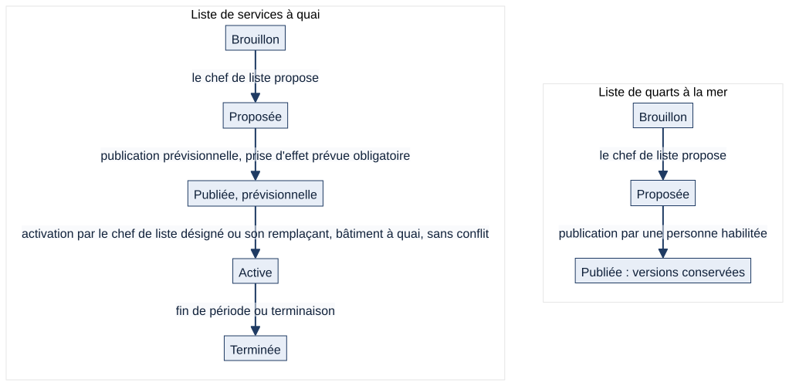
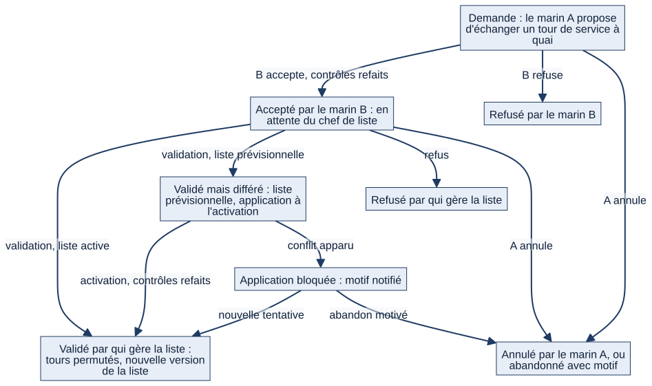
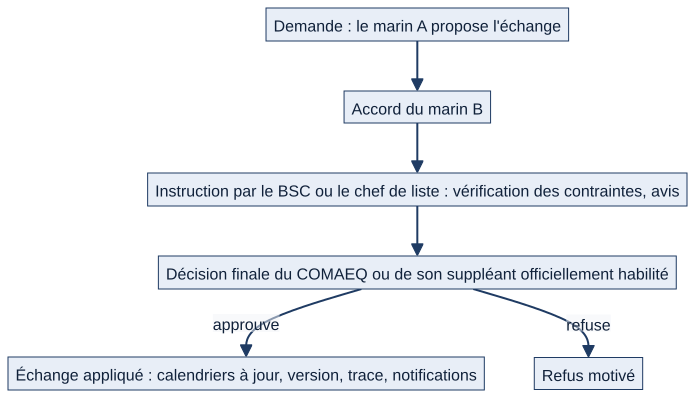
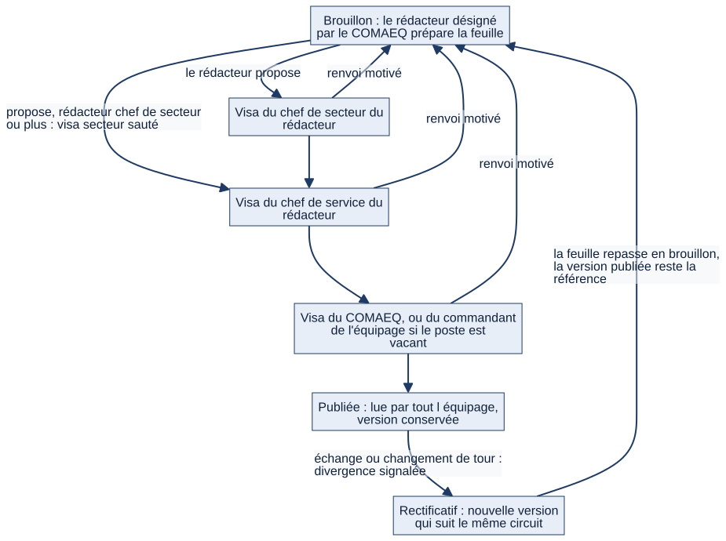

# Chapitre 8 — Quarts, services à quai, gardes, feuille de service, échanges et absences

> **Pour qui :** marins, responsables, développeurs. **Diffusion :** générale (mécanismes et références dans la partie restreinte du dossier).
> **Ce que vous y trouverez :** ce que voit et fait le marin, ce que font le chef de liste, le BSC, le COMAEQ et le commandement ; les circuits de validation ; et, pour les **échanges de tours** et la **publication des listes**, le fonctionnement **actuel** et le fonctionnement **cible** (décisions `DEC-FDS-07`, `DEC-FDS-13`, `DEC-FDS-14`), présentés séparément pour ne jamais les confondre.
> **État décrit :** état B (`6d6d0be`), non fusionné dans `main`.

---

## 8.1 Trois supports à ne pas confondre

La décision du PO (31/10/2026) distingue trois choses, que Matrix ne mélange pas.

| Support | À quoi il sert | Qui le lit |
|---|---|---|
| **Liste de quarts à la mer** | Le roulement horaire du service à la mer (barre, passerelle, machine…) : qui tient quel poste sur quel créneau | Les marins de quart |
| **Liste de services à quai (gardes)** | Les affectations longues à quai (garde de 24 h, permanence…) : qui tient quelle fonction pendant quelle période | Les marins de la fraction de service |
| **Feuille de service** | La déclinaison **quotidienne** du service courant à diffuser pour la journée : le personnel de service et les fonctions prévues, les consignes, les informations utiles | Tout l'équipage |

La feuille de service **n'affiche pas** tous les quarts à la mer : cela la surchargerait. Chaque liste de quarts a son propre tableau, imprimable.

**Vocabulaire retenu** (définitions du PO, pas des normes) : par bordées (2 équipes), par tiers (3), au quart (4), au cinquième (5), au sixième (6) ; « de musique » = nuit entière sans quart ; « homme mort » = marin sans aucun quart sur le roulement considéré. Matrix **ne génère aucun roulement automatiquement** : la planification est **manuelle**, avec contrôle des contraintes (la génération automatique a été abandonnée le 09/10/2026).

## 8.2 Ce que voit et fait le marin

> Exemple fictif : le matelot Durand, de l'équipage A, rattaché à la section « Propulsion ».

1. **Il ouvre « Quarts et tours de service »**. Une vue « quotidienne » lui montre ses prochains quarts et ses tours de service, avec les heures. Sur l'accueil « Aujourd'hui », les quarts et services du jour apparaissent dans sa frise « Ma journée », et ses tours de service dans une carte dédiée. Son **calendrier** les affiche aussi.
2. **Il reçoit une notification** quand une liste qui l'affecte est publiée, quand une liste à quai est activée (son service est alors confirmé), ou quand on modifie son affectation sur une liste publiée.
3. **Il consulte la feuille de service** du jour, une fois publiée : tout marin du bâtiment (de son équipage) la lit.
4. **Il demande un échange de tour.** Il choisit l'un de **ses** tours de service à quai et celui d'un collègue de **son équipage**, et indique un motif. Matrix refuse d'emblée, **en expliquant pourquoi**, si l'échange est impossible : tour déjà commencé, collègue absent, habilitation manquante, délai minimal non respecté, autre service en même temps. Le collègue répond depuis « Mes échanges ».
5. **Il déclare une absence** (permission, mission, maladie… ; types configurables). Un chef de son périmètre la valide ; il ne peut jamais valider la sienne.
6. **Il consulte son « compteur d'équité »** : le nombre de ses services en semaine (lundi–jeudi), le vendredi, le week-end, sur les listes publiées. C'est une information, jamais un score ni un moyen de répartition automatique.

## 8.3 Ce que font les responsables

| Qui | Ce qu'il fait |
|---|---|
| **Chef de liste** (marin désigné pour un périmètre et un type de liste : « quarts à la mer » ou « services à quai ») | Crée la liste de son périmètre, ajoute les créneaux, affecte les marins, **propose** la liste à la publication. Pour une liste à quai : **active** la liste publiée à titre prévisionnel, la reporte ou la retire. Il ne publie pas, sauf s'il relève du commandement ou atteint par ailleurs le seuil de publication de son périmètre. |
| **Remplaçant temporaire d'un chef de liste** | Désigné de façon **explicite, bornée dans le temps (72 h au plus par défaut, sans renouvellement automatique) et tracée** : il peut seulement activer, reporter ou retirer une prévision, pour un périmètre, un équipage et un type de liste précis. |
| **Personne habilitée à publier** | Publie la liste (voir §8.7). |
| **BSC (rédacteur de la feuille de service)** | Prépare la feuille de service de son équipage : en-tête, fonctions de service, personnel du jour. Désigné nominativement par le COMAEQ. |
| **COMAEQ** | Vise la feuille de service ; désigne les rédacteurs ; déclare l'accostage et l'appareillage du bâtiment. |
| **Commandant** | Déclare les mouvements du bâtiment ; gère les listes de son bâtiment au titre de la supervision ; secours du visa de la feuille quand le poste de COMAEQ est vacant. |
| **Chef de section, de secteur, de service** | Valident les absences de leur périmètre ; visent la feuille aux paliers « secteur » et « service » selon le rédacteur. |

Les **droits sont donnés par des désignations** (chef de liste, rédacteur, remplaçant), pas par le grade. Une désignation « historique » sans type (ni quarts, ni quai) **ne donne aucun droit** tant qu'un responsable ne l'a pas qualifiée.

## 8.4 La liste de quarts à la mer

Une liste couvre une période et un **périmètre** (bâtiment, service, secteur ou section, un seul). Elle suit un circuit à trois états :

*Schéma S15 — Listes de quarts et listes de services à quai.*

- **Brouillon** : le chef de liste construit la liste (créneaux : poste, plage horaire, marin).
- **Proposée** : il la propose ; les personnes habilitées à publier sont notifiées (« Proposition à valider »).
- **Publiée** : chaque publication fige une **version** horodatée, jamais réécrite. Les marins affectés sont prévenus à la **première** publication ; republier après une correction crée une nouvelle version sans renotifier tout le monde.
- Une modification d'un créneau d'une liste **déjà publiée** est **tracée** et notifie le marin concerné (avec le motif).
- Un quart se **termine à l'heure effective** par une régularisation motivée, jamais automatique ni rétroactive.

## 8.5 La liste de services à quai et son activation

Une liste à quai a, en plus, une **application** distincte de sa validation : *publier ne rend jamais une liste applicable*.

1. **Publication à titre prévisionnel** : la liste est publiée avec une **prise d'effet prévue** (obligatoire) ; elle reste prévisionnelle.
2. **Activation** : **seul le chef de liste désigné pour ce périmètre, ou son remplaçant temporaire**, peut l'activer. C'est une décision du PO : jamais le COMAEQ, jamais automatique. L'activation exige que le bâtiment soit **à quai** (voir ci-dessous), que la liste n'ait **aucun conflit bloquant**, et, si elle est demandée plus de 30 minutes (réglable) avant la prise d'effet prévue, une **confirmation explicite** du chef de liste. Elle prend effet **immédiatement**, sans rétroactivité ; les marins sont prévenus.
3. **Terminée** : à la fin de la période.

**Le mode du bâtiment (mer ou quai)** n'est jamais saisi librement : il se **déduit des mouvements** (accostage, appareillage) déclarés par le COMAEQ ou le commandant de l'équipage à bord. Une erreur se corrige par **annulation motivée** (jamais par effacement). Tant que le mode n'est pas renseigné, une liste ne peut pas être activée.

**Alertes d'activation.** Si une liste prévisionnelle n'est pas activée, Matrix envoie un **rappel** (30 minutes avant la prise d'effet prévue), une **alerte** (à l'heure prévue) puis une **escalade** (15 minutes plus tard) : délais réglables par bâtiment. Un **accostage confirmé sans liste applicable** déclenche aussi une alerte.

**Conflits à l'activation.** Bloquants : deux services à quai simultanés ; un quart encore en cours en même temps que le service. Non bloquants (avertissement) : un quart **futur** qui recouvre le service, car le régime peut encore changer. Matrix **ne raccourcit jamais un quart**.

## 8.6 Les échanges de tours — fonctionnement ACTUEL 🟢

> Cette section décrit ce que fait le code de l'état B. **Ce n'est pas la règle métier validée** sur le point de la décision finale (voir §8.7).

*Schéma S16 — Échange de tours de service à quai : circuit actuel.*

**Périmètre.** L'échange ne concerne que deux tours d'**une même liste de services à quai**, entre marins d'un **même équipage**. Il n'existe pas d'échange de quarts à la mer.

**Le circuit actuel, pas à pas.**
1. **Demande** (marin A) : Matrix vérifie tout de suite que l'échange est faisable. Le marin B est notifié.
2. **Réponse de B** : il accepte ou refuse. À l'acceptation, les contrôles sont **refaits**.
3. **Décision « du chef de liste »** : celui qui **gère la liste** valide ou refuse. Aujourd'hui, c'est le chef de liste désigné pour le périmètre exact de la liste, ou le commandement du bâtiment. Les contrôles sont **refaits une dernière fois**.
4. **Application** : les deux tours sont permutés, une **nouvelle version** de la liste est figée, les calendriers des deux marins reflètent l'échange (ils lisent directement les créneaux), le chef de liste est informé. Si la liste est encore **prévisionnelle**, l'échange est validé mais **appliqué seulement à l'activation** ; s'il est alors devenu incompatible, il n'est **jamais appliqué en silence** : le blocage est notifié, le chef de liste peut réessayer ou abandonner avec motif.

**Les contrôles, toujours expliqués en français** (jamais un simple « erreur ») : même liste, liste publiée et non terminée, même équipage, chaque tour toujours affecté au bon marin, tour pas encore commencé, délai minimal de la liste respecté, **aucun autre service à quai** ni quart en cours en même temps, **habilitations exigées** valides le jour du tour, **absences déclarées** (validées ou en attente) qui chevauchent le tour. Un quart futur qui recouvre un tour donne un **avertissement**, pas un blocage.

**Exemple.** Durand (garde du 14, 08 h) propose à Martin (garde du 16, 08 h) d'échanger. Martin accepte. Le chef de liste de la section ouvre « Échanges à valider », voit la fiche de l'échange et ses contrôles, valide. Le 14 et le 16 apparaissent permutés dans les deux calendriers ; la liste passe de la version 3 à la version 4.

**Traçabilité.** Chaque étape est enregistrée (historique propre à l'échange, journal d'audit) ; les libellés des tours d'avant l'échange sont conservés : l'ancienne affectation n'est jamais écrasée sans trace.

## 8.7 Échanges et publication — fonctionnement CIBLE 🔵 et écarts

> Cette section décrit la **règle métier validée par le PO**, qui n'est **pas encore appliquée** dans l'état B. Elle ne doit pas être lue comme un fonctionnement existant.

### Échanges de tours (`DEC-FDS-07`, `DEC-FDS-13`)

*Schéma S17 — Échange de tours : circuit cible validé par le PO.*

- Le marin A demande, le marin B accepte, comme aujourd'hui.
- **Le BSC ou le chef de liste instruit** la demande (vérifie les contraintes, donne son avis). Il **ne dispose pas automatiquement de l'autorité de décision finale**.
- **La décision finale revient au COMAEQ ou à son suppléant officiellement habilité.**
- Cette décision **remplace** une note plus ancienne (28/10) qui confiait la validation au chef de liste.

### Publication des listes de quarts et de gardes (`DEC-FDS-14`)

- Le **chef de liste prépare et propose**.
- Le **COMAEQ ou son suppléant officiellement habilité approuve et publie**.
- Toute modification après publication est tracée et donne lieu, si nécessaire, à une **nouvelle version officielle**.

### Comparaison, pour ne rien confondre

| Point | Fonctionnement actuel (état B) 🟢 | Règle cible validée 🔵 |
|---|---|---|
| Qui décide d'un échange | Qui gère la liste : chef de liste désigné ou commandement | COMAEQ ou son suppléant officiellement habilité |
| Rôle du chef de liste / BSC dans l'échange | Valide | Instruit seulement |
| Qui publie une liste | Le commandement, ou un rôle atteignant le seuil « chef de service » **dont le périmètre personnel est exactement celui de la liste** | COMAEQ ou son suppléant officiellement habilité |
| La fonction COMAEQ intervient-elle ? | Non | Oui, c'est elle qui décide et publie |
| Suppléant du COMAEQ | **N'existe pas** (aucun mécanisme) | « Officiellement habilité » : le mécanisme (suppléance explicite, lot L08) reste à construire |
| Administrateur technique | Peut valider et publier (via la supervision du commandement) | Aucun visa métier (`DEC-DRT-02`) |
| Lots de correction | — | L10 (échanges), L09 (publication), L08 (suppléance), L06 (administrateur technique) |

> ⚠️ **Écarts d'implémentation.** Les lignes ci-dessus sont détaillées dans le registre des écarts (partie restreinte du dossier) (A1, A2, A3). **Points à confirmer** (la décision existante est appliquée ; la règle cible n'est pas inventée) : (1) **suppléance du COMAEQ** : le principe est décidé — suppléance explicitement désignée, activée, limitée dans le temps et dans son périmètre, tracée (`DEC-SUP-01`) — mais la **procédure exacte de désignation du suppléant reste à confirmer** (B1) ; (2) les **échanges ne sont pas généralisés aux quarts à la mer** : sans validation métier, le fonctionnement reste celui des services à quai (B3) ; (3) l'**autorité cible** de déclaration d'accostage et d'appareillage reste à confirmer, le fonctionnement actuel étant documenté ci-dessus (B4).

## 8.8 La feuille de service

**Une feuille par bâtiment, par date et, sur un bâtiment à double équipage, par équipage** : chaque équipage, à bord ou à terre, a **sa** feuille, sans validation croisée par le seul grade.

**Ce qu'elle contient.** Des **rubriques d'en-tête** configurables par bâtiment (certaines fixes, d'autres à saisir chaque jour) et la liste des **fonctions de service** (officier de garde, gradé de coupée…, ordre configurable) avec leur titulaire du jour, tiré de la liste de services à quai. La structure du bâtiment est **figée** sur chaque feuille à sa création ; si elle change ensuite, la divergence est signalée et le rédacteur peut **resynchroniser**. Une **organisation d'alerte** (scénarios de sécurité ou de protection-défense : postes à tenir, postes non armés) y est rattachée ; ses modifications suivent « proposer, valider, publier » avec l'autorité configurée.

**Qui rédige.** Le **BSC** ou une personne déléguée, **désigné nominativement par le COMAEQ de l'équipage** (à défaut de COMAEQ, par le commandant de l'équipage). Ni le grade, ni le rôle, ni la supervision ne suffisent : le commandement garde la lecture et les visas. Une désignation qui ne donne plus aucun droit (marin parti, compte désactivé, changement d'équipage) est signalée.

*Schéma S18 — Circuit de visa de la feuille de service.*

**Le circuit de visa.** Le rédacteur **propose** ; la feuille passe par le **visa du chef de secteur** du rédacteur (sauté s'il est lui-même chef de secteur ou plus), le **visa du chef de service**, puis le **visa du COMAEQ**, après quoi elle est **publiée**. À chaque palier, un **renvoi motivé** la remet en brouillon : le circuit recommence entièrement. Le **visa du COMAEQ** n'appartient qu'au **titulaire de la fonction COMAEQ de l'équipage** ; **seul un poste vacant** ouvre ce visa, à titre exceptionnel, au **commandant de cet équipage** (pas au commandant en second, pas à l'administrateur), de façon visible et tracée. Un COMAEQ simplement absent n'ouvre pas cette exception. Le COMAEQ peut aussi corriger l'en-tête pendant le circuit ; une correction qui change le sens ou une information opérationnelle impose un nouveau contrôle.

**Une version publiée est immuable.** Si un échange validé ou un changement de tour fait diverger le planning effectif de la dernière version, la feuille le **signale sans rien modifier** ; le rédacteur ouvre un **rectificatif** qui suit le même circuit, et l'ancienne version n'est remplacée qu'à sa publication. La publication est **refusée** si le contenu a changé depuis le dernier visa.

**À quai seulement (V1).** La feuille concerne le service à quai.

**Fonctionnement cible 🔵 (non développé).** *Impression A4 par le BSC* pour l'affichage et *signalement de la nécessité de réimprimer* une feuille déjà affichée (`DEC-FDS-04`, `DEC-FDS-06`, lot L27) ; *composition-type d'une fraction de service à quai*, configurable par bâtiment, avec postes vacants et complétude (`DEC-FDS-08`, sur GO du PO) ; vérification automatique des qualifications des titulaires : **explicitement reportée** par le PO.

## 8.9 Les absences

Le module d'absences est volontairement **limité** (décision du PO : un système extérieur gère les absences ; Matrix se contente de les prendre en compte). Une absence a un **type** configurable, une **période en jours entiers** et deux états : **déclarée**, puis **validée**. Le marin la déclare pour lui-même ; un chef de section ou plus la déclare ou la valide pour un marin de son périmètre et de son équipage ; **on ne valide jamais sa propre absence**. Les absences, validées ou en attente, alimentent le **calendrier**, bloquent un **échange de tour** sur la période concernée et apparaissent dans la vue d'équipe des chefs.

## 8.10 Le compteur d'équité

Un compteur **en lecture seule** par marin sur les services de garde **publiés** : trois catégories séparées (semaine, vendredi, week-end), classées sur la date de début du créneau. Il aide le chef de liste à répartir à la main ; il ne répartit rien. Il ne porte pas sur les quarts à la mer.

## 8.11 Interactions avec les autres modules

| Avec | Ce qui circule |
|---|---|
| Calendrier (ch. 7) | Quarts et gardes publiés, absences, apparaissent dans le calendrier du marin |
| Notifications (ch. 9) | Publication, proposition à valider, échange à valider, activation, alertes (régimes « à quai », « à la mer ») |
| Formations (ch. 14) | Habilitations exigées pour tenir un service, contrôlées lors d'un échange |
| Organisation (ch. 4) | Périmètre de la liste, équipage, commandant adjoint rattaché au service |
| Accueil (ch. 6) | « Mes tours de service », frise « Ma journée », bloc Supervision (échanges à valider) |
| Tâches (ch. 10) | Aucune dépendance directe |

## 8.12 Cas particuliers

- **Double équipage.** Une liste appartient à l'équipage de son créateur ; un échange reste interne à l'équipage ; chaque équipage a sa feuille. L'équipage à terre garde sa feuille propre malgré la lecture seule.
- **Poste COMAEQ vacant.** Le commandant de l'équipage peut viser la feuille et désigner les rédacteurs, de façon tracée ; ce secours **n'existe pas** pour les échanges ni la publication des listes.
- **Liste prévisionnelle.** Un échange validé attend l'activation ; un échange devenu incompatible est signalé et bloqué, jamais appliqué en silence.
- **Désignation historique non typée.** Elle ne donne **aucun droit** tant qu'elle n'est pas qualifiée par un responsable ; l'inventaire est disponible en lecture seule.
- **Chef de liste absent.** Remplacement temporaire explicite (durée bornée), limité à l'activation, au report et au retrait d'une prévision.
- **Aucun roulement n'est codé en dur.** La durée d'un créneau n'est qu'une valeur par défaut éditable ; les types de service sont du texte libre.

## 8.13 Limites et éléments non vérifiés

- 🟢 Les circuits décrits sont couverts par des tests de l'état B (`quarts/tests/`, 609 fonctions de test dans le paquet) ; ⚪ PostgreSQL, Windows et navigateur n'ont pas été rejoués ; les parcours du §8.2 sont reconstitués d'après le code.
- ⚪ Le rendu imprimable d'une **liste** existe ; celui de la **feuille de service** n'a pas été trouvé dans le code (§8.8, cible).
- ⚪ L'autorité de déclaration d'un accostage ou d'un appareillage (COMAEQ ou commandant de l'équipage à bord) est décrite par les propositions `mer_quai_*` validées par le PO ; elle ne figure pas dans le registre des 125 décisions (B4 du registre des écarts).
- ⚪ Le détail de l'écran d'entrée (vue « quotidienne » et vue « responsable ») est décrit d'après la documentation ; non rejoué.
- 🔵 Non développés : suppléance explicite (L08), visas par fonction et listes publiées (L09), échanges décidés par le COMAEQ (L10), impression et réimpression de la feuille (L27), composition-type d'une fraction à quai.

---

**Sources (état B).** `quarts/models.py` (listes, échanges, feuille), `quarts/echanges.py`, `quarts/activation.py`, `quarts/mouvements.py`, `quarts/remplacement.py`, `quarts/rectificatif.py`, `quarts/services.py`, `absences/`, `matrix/templates/quarts/` ; références ligne par ligne dans la partie restreinte du dossier. Décisions : `DEC-FDS-01` à `DEC-FDS-14`, `DEC-SUP-01`, `DEC-PRE-01` (dossier V1.2, `A1_DECISIONS_S1_S2.md`) ; propositions `docs/propositions/mer_quai_plan_technique.md`, `mer_quai_consolidation.md`, `droits_comaeq.md` (état B) ; Notion « 06 — Service courant, BSC, feuille de service et commissariat » (31/10/2026), « 13 — Décisions ». Écarts : le registre des écarts (partie restreinte du dossier) (A1 à A3, A12, B1 à B5).
