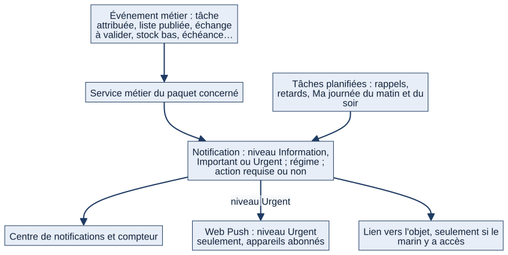

# Chapitre 9 — Communication : discussions, annonces, notifications et recherche

> **Pour qui :** marins, responsables, développeurs. **Diffusion :** générale (mécanismes dans la partie restreinte du dossier).
> **Ce que vous y trouverez :** comment le dialogue s'attache aux objets de travail, comment un responsable diffuse une information, comment Matrix prévient le marin, et comment retrouver une information. Pour chaque module : ce que fait le marin, puis les responsables, puis le cible.
> **État décrit :** état B (`6d6d0be`), non fusionné dans `main`.

---

## 9.1 Le principe : le dialogue est une fonction métier

Dans Matrix, on ne discute pas « dans le vide » : **la discussion est attachée à l'objet dont on parle**. Une question sur la maintenance d'une pompe reste dans le fil de cette maintenance ; une réponse sur une tâche reste dans la tâche. Cela évite que l'information opérationnelle se disperse en messages, mails et conversations perdues.

## 9.2 Les discussions (fils)

### Ce que voit et fait le marin
> Exemple fictif : Durand est bloqué sur une maintenance.

1. Sur la fiche de l'objet (tâche, occurrence de maintenance, ticket correctif, installation, demande…), il ouvre le **fil de discussion**.
2. Il **pose sa question** (« quelqu'un sait où est la clé de 32 ? »). Il peut **mentionner** un collègue avec `@identifiant` : **une réponse est alors attendue** de ce collègue jusqu'à ce qu'il réponde dans le fil, et une alerte d'action l'attend sur son accueil.
3. Il peut joindre un **fichier** à un message (contrôlé : extension, taille, contenu).
4. Il **reçoit une notification** quand quelqu'un répond sur un dossier où il est acteur.
5. Les **événements importants** (blocage, reprise, réaffectation) apparaissent dans le fil comme **messages système** : le fil sert aussi de journal lisible du dossier.

### Ce que font les responsables
- Un chef **ajoute un interlocuteur** (marin du bâtiment, équipage à terre compris) pour le faire entrer dans la discussion.
- Les chefs du périmètre voient le fil des tâches **partagées** de leurs marins et des dossiers qui les concernent.
- **Qui voit un fil** : exactement ceux qui peuvent voir l'**objet** auquel il est attaché. Le fil ne recrée aucun système de droits : il hérite de ceux de l'objet.

### Limites actuelles de l'existant
- Les discussions sont **attachées à des objets**. Il n'existe **pas encore de conversations libres** : ni messagerie privée, ni espaces de groupe (section, secteur, service, bâtiment, groupe temporaire).
- **Un fil n'a aucune valeur de décision ni de visa** : la discussion questionne et répond ; l'acte officiel reste distinct (décision du PO).

## 9.3 Les annonces

### À quoi ça sert
L'annonce est la **diffusion descendante** d'un responsable vers un public ciblé : « Réunion demain 08 h », « Modification de la procédure de sécurité », « Consigne immédiate ».

### Ce que voit et fait le marin
1. Les annonces qui le **visent** apparaissent dans son « À faire » tant qu'elles restent **à lire** ; l'**Urgent** passe en tête.
2. Il **ouvre** l'annonce : si aucun accusé n'est demandé, **l'ouvrir suffit**. Sinon, il clique **« J'ai pris connaissance »** : l'accusé est enregistré avec la date de la première prise de connaissance.
3. Si l'annonce est **modifiée**, il est prévenu, et son accusé est **à renouveler** pour la nouvelle version.
4. Il reçoit un **rappel unique** si son accusé n'est pas donné après le délai réglé.

### Ce que font les responsables
- **Publier** : à partir du niveau **chef de service** par défaut (réglable) ; le **commandant en second** peut publier sur son bâtiment (action qui lui est explicitement ouverte). Un équipage à terre en lecture seule ne publie pas.
- **Choisir le niveau** : **Information**, **Important** ou **Urgent**.
- **Cibler** : un responsable ne peut viser que **son niveau de périmètre et ce qui en dépend** (bâtiment, service, secteur, section, équipage — y compris l'équipage à terre), jamais au-delà.
- **Programmer** : une date d'effet (« visible à partir du »), une fin facultative ; la diffusion a lieu **une seule fois**, à la date d'effet.
- **Demander un accusé** de lecture, et **suivre la lecture** : qui a lu, qui a accusé, qui n'a rien fait.
- **Modifier** : chaque modification crée une **version conservée** ; le public déjà informé est prévenu ; un contrôle évite d'écraser une modification concurrente.
- Une annonce peut donner naissance à une **tâche** liée.

## 9.4 Les notifications

### À quoi ça sert
Une notification **dit au marin ce qui demande son attention, avec un lien direct** vers l'objet, plutôt qu'un simple « vous avez une notification ».

### Ce que voit le marin
- Un **compteur** dans la barre supérieure et un **panneau** : les notifications **non lues** et celles qui réclament encore une **action** (« lue » n'est pas « traitée »), triées par urgence. Les notifications **lues** restent dans le **centre de notifications** (historique).
- Trois **niveaux** : **Information**, **Important**, **Urgent**. Seul **Urgent** déclenche en plus une notification **hors navigateur** (Web Push) sur les appareils abonnés.
- Un **régime** (« à la mer », « à quai », « communes », « transition ») classe la priorité d'affichage selon le **mode du bâtiment** : les notifications de l'autre régime passent dans « autres régimes » ; **aucune n'est supprimée ni masquée**, et une notification **urgente** ou à **action requise** reste toujours prioritaire.
- **Le lien est affiché seulement si le marin a accès à l'objet** ; jamais de lien vers un objet interdit.
- **« Ma journée »** le matin et **« Ma journée de demain »** en fin de journée, à l'heure choisie par chacun.

*Schéma S19 — De l'événement métier à la notification.*

### Ce qui en déclenche
Attribution et blocage de tâche, relances de retard, proposition à valider, échange à valider, liste publiée ou activée, annonce, difficulté signalée, échéance de maintenance, stock bas, formation qui expire, dérive de relevé d'une installation, mention dans un fil… (voir les chapitres de chaque module).

### Ce que font les responsables
Un responsable **ne règle pas** les notifications d'un marin ; il agit sur la source. Les **alertes d'action** des chefs se soldent quand la source est traitée (blocage levé, échange tranché, demande résolue).

## 9.5 La recherche

Une **recherche globale** unique permet de retrouver, par **catégorie** : installations, matériels, tickets correctifs, anomalies, formations, documents, tâches et marins. Chaque résultat mène à un objet que la personne peut **réellement ouvrir** : la recherche reprend le périmètre des listes. Les catégories d'un **module désactivé** ne sont pas interrogées ; la saisie exige **2 caractères** au moins et chaque catégorie en montre **5** au plus, avec un lien « Tout voir ». Une **recherche rapide** accompagne la barre supérieure.

## 9.6 Interactions avec les autres modules

| Module | Lien |
|---|---|
| Tâches, demandes (ch. 10), maintenance, tickets (ch. 12), formations (ch. 14) | Portent des fils ; émettent des notifications |
| Quarts (ch. 8) | Notifications de publication, d'échange, d'activation (régimes) |
| Organisation (ch. 4) | Ciblage des annonces par périmètre et équipage |
| Accueil (ch. 6) | Annonces à lire, réponses attendues, compteur |
| Planification (Celery) | Rappels, relances, « Ma journée » (chapitre 21) |

## 9.7 Cas particuliers

- **Équipage à terre** : il **reçoit** les annonces qui le visent et peut **commenter** les tâches et être interlocuteur d'un fil ; il ne publie pas.
- **Web Push désactivé** (clés non configurées ou HTTP sans HTTPS) : seules les notifications dans l'application fonctionnent ; un appareil injoignable ne bloque jamais l'action métier (envoi borné à 3 secondes).
- **Objet supprimé ou inaccessible** : la notification reste dans l'historique mais **sans lien**.
- **Annonce ciblée sur une unité archivée** : elle reste lisible ; on ne peut plus **choisir** cette unité pour une nouvelle annonce (chapitre 4).

## 9.8 Fonctionnement cible 🔵

Décisions du PO et du cahier des charges, **non développées** :
- **Espaces de groupe** (section, secteur, service, bâtiment, équipe, groupe temporaire) avec messages, réponses, mentions, pièces jointes, messages importants (cahier §18).
- **Chat contextuel bord–terre** et suivi des demandes : des dossiers avec visas, destinataires et historique, où **le fil ne vaut ni décision ni visa** ; les circuits PÉPIN, CRAT, RAV/c **ne sont pas validés** (chapitre 10, §10.7).
- **Recherche universelle étendue** : événements, services, discussions (cahier §37) ; **recherche de personnes** avec les informations professionnelles pertinentes selon les droits (`DEC-UX-09`).
- **Notifications lues** retirées de la liste principale tout en restant dans le centre (`DEC-UX-06`) : le panneau actuel le fait déjà ; le détail reste à confirmer en recette.
- **Épinglage du menu** (`DEC-UX-04`) : chapitre 17.

## 9.9 Limites et éléments non vérifiés

- 🟢 Couverture de tests de l'état B : `notifications` 165 fonctions de test, `annonces` 46, `threads` 30. ⚪ Les écrans n'ont pas été rejoués dans un navigateur ; le Web Push n'a pas été éprouvé sur un appareil réel.
- ⚪ **Relations génériques** (discussions, notifications) : elles désignent leur objet sans clé étrangère protégée ; leur comportement face à la suppression de l'objet visé, notamment une unité, n'est pas vérifié (chapitre 19, §19.6).
- ⚪ Le détail de chaque catégorie de notification et de chaque icône n'est pas inventorié ici (propositions `notifications_par_regime.md`, état B).
- ⚪ L'API REST des fils expose seulement les fils de **tickets** et d'**occurrences de maintenance** ; les fils des autres objets passent par les vues web de leurs modules.

---

**Sources (état B).** `threads/`, `annonces/`, `notifications/`, `matrix/core/recherche.py` ; références ligne par ligne dans la partie restreinte du dossier. Décisions : `DEC-UX-06`, `DEC-UX-09` (dossier V1.2) ; cahier des charges §16 à §19, §23, §37, §38 ; propositions `docs/propositions/notifications_par_regime.md` et `dialogues_integres.md` (état B) ; Notion « 13 — Décisions » (circuits PÉPIN, CRAT).
