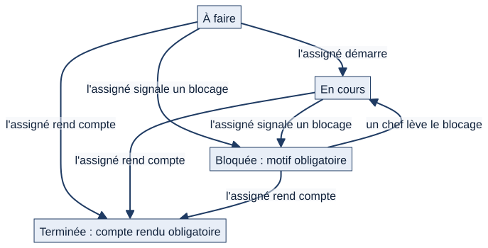
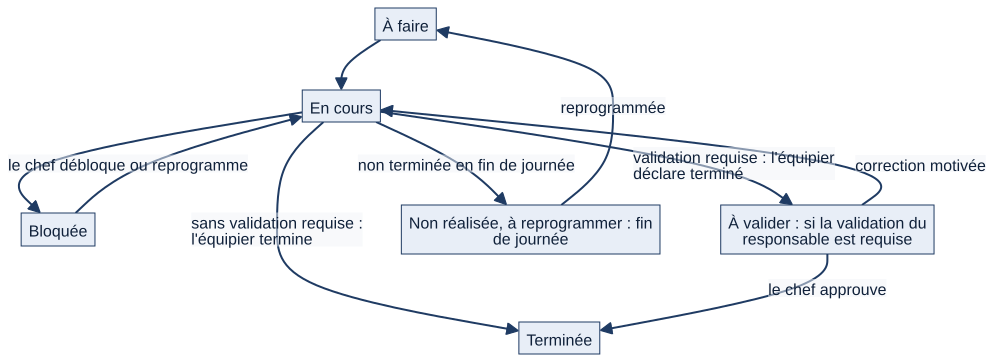

# Chapitre 10 — Tâches, difficultés signalées, programme du bâtiment et postes

> **Pour qui :** marins, responsables, développeurs. **Diffusion :** générale (mécanismes et références dans la partie restreinte du dossier).
> **Ce que vous y trouverez :** comment on attribue, exécute, bloque et termine une tâche ; comment un marin signale une difficulté et la suit jusqu'à sa résolution ; comment l'état-major publie le programme du bâtiment ; comment les postes du bord et leurs titulaires sont suivis. Pour chaque module : ce que fait le marin, puis ce que font les responsables, puis le fonctionnement cible.
> **État décrit :** état B (`6d6d0be`), non fusionné dans `main`.

---

## 10.1 Les tâches

### À quoi ça sert
Une **tâche** est un travail attribué à un marin, avec une consigne, une échéance éventuelle, une checklist, des pièces jointes et un **fil de discussion** attaché. C'est le moyen, pour un chef, de dire « voilà ce qu'il faut faire » et, pour le marin, de savoir « voilà ce que je dois faire » sans passer par un tableur.

### Ce que voit et fait le marin
> Exemple fictif : le matelot Durand.

1. **Sur « Aujourd'hui »**, ses tâches ouvertes apparaissent dans « À faire », triées par urgence : en retard d'abord, puis en attente, puis par criticité et échéance. Une tâche du jour sans heure figure aussi dans sa frise « Ma journée ».
2. Il **ouvre la tâche** : consigne, échéance, priorité, checklist, pièces jointes, fil de discussion.
3. Il **démarre** la tâche (elle passe « En cours »), coche sa checklist.
4. S'il est **bloqué** (pièce manquante, accès refusé), il le **signale avec un motif** : la tâche passe « Bloquée », ses chefs concernés sont prévenus immédiatement.
5. Il **pose une question** dans le fil (« où est la clé de 32 ? ») ; les personnes du dossier sont notifiées, la discussion reste attachée à la tâche.
6. Il **rend compte** : il rédige un compte rendu et la tâche passe « Terminée », sans autre validation. Les personnes concernées sont informées.
7. Il peut aussi **se créer une tâche personnelle**, **privée** tant qu'il ne la **partage** pas avec ses chefs.

### Ce que font les responsables
- **Attribuer.** Un chef de section ou plus attribue une tâche à un marin **de son périmètre et de son équipage** ; il peut aussi l'attribuer à toute une **unité** (section, secteur, service) : Matrix crée alors **une tâche individuelle par marin**, liées par un lot dont on suit l'avancement.
- **Suivre.** Le chef voit l'**avancement de l'équipe** : tâches par statut, charge par marin, retards, blocages, conflits avec les absences.
- **Modifier, réaffecter, replanifier, changer la priorité** d'une tâche attribuée et ouverte : chaque changement est **tracé dans le fil** et le journal, et le marin est prévenu. Un chef ne modifie **jamais** la tâche personnelle d'un marin, ni ne la voit tant qu'elle n'est pas partagée.
- **Lever un blocage** une fois la solution donnée dans le fil : la tâche repasse « En cours ».
- **Ajouter un interlocuteur** au fil : un marin du même bâtiment, **équipage à terre compris**.
- **Relances.** Une tâche dont l'échéance est dépassée est relancée chaque jour (réglable) : l'assigné, le chef qui l'a attribuée ; pour une tâche bloquée en retard, les chefs qui peuvent lever le blocage.

### Les états d'une tâche — actuels 🟢

*Schéma S20 — États d'une tâche dans l'état B.*

Quatre états : **À faire**, **En cours**, **Bloquée**, **Terminée**. Deux priorités : **Normale** et **Urgente**. Seul le marin assigné démarre, signale un blocage et rend compte ; seul un chef du périmètre lève un blocage ou réaffecte.

### Le fonctionnement cible 🔵 (décisions du PO, non développées)

> Cette section décrit des règles **validées mais pas encore en place**. Elle ne décrit pas l'état actuel.

*Schéma S21 — États d'une tâche : circuit cible validé par le PO.*

| Règle validée | Décision | Lot | Écart avec l'actuel |
|---|---|---|---|
| **Trois priorités** : normale, haute, urgente ; une priorité imposée par le chef de secteur ne peut pas être abaissée par le chef de section | `DEC-TAC-04`, `DEC-TAC-05` | L14 | Deux priorités seulement ; pas de règle d'abaissement |
| **Validation facultative** : à la création, le chef coche « Validation du responsable requise » ; l'équipier déclare alors terminé, la tâche passe **« À valider »**, le chef approuve ou demande une **correction motivée** ; le chef de secteur peut valider directement | `DEC-CLO-01` à `DEC-CLO-04` | L15 | Pas d'état « À valider » : l'assigné termine directement |
| **Visa technique distinct** de la validation facultative | `DEC-CLO-05` | L15 | Les visas techniques vivent dans les fiches, pas dans les tâches |
| **Tâche collective** : plusieurs participants, un **coordinateur** proposé au grade le plus élevé, désignable autrement par le chef | `DEC-COL-01` à `DEC-COL-05` | L16 | Un seul assigné par tâche ; le « grade le plus élevé » exige un ordre des grades (information manquante) |
| **Non réalisée** : une tâche non terminée en fin de journée n'est pas reportée en silence ; elle passe « Non réalisée — À reprogrammer » ; le chef débloque et reprogramme sans obligation de créer une anomalie ; le chef de secteur décide si un défaut technique mérite une anomalie | `DEC-BLQ-03` à `DEC-BLQ-05` | L17 | Pas d'état « Non réalisée » ; la « fin de journée » reste à définir par bâtiment |
| **Qualifications** : informatives, jamais bloquantes pour une tâche ordinaire | `DEC-QUA-01` à `DEC-QUA-04` | L18 | Déjà vrai : rien ne bloque aujourd'hui ; l'affichage informatif des qualifications reste à faire |

**Écart de libellé** (sans portée fonctionnelle) : la décision demande « Mes tours de **services** » ; l'accueil affiche « Mes tours de **service** » (lot UX).

## 10.2 Les difficultés signalées (module « demandes »)

### À quoi ça sert
Un marin qui rencontre une difficulté sur un **objet** de Matrix (une tâche, une installation, une anomalie…) la **signale** : un dossier de suivi s'ouvre, un **responsable est désigné dès la création** (jamais un dossier sans propriétaire), les interlocuteurs sont invités, des **actions** sont décidées, et la clôture est tracée. La demande **ne remplace aucun outil officiel** : elle suit un échange et ses décisions, sur un objet de Matrix. Elle prépare le dialogue entre le bord et la terre (voir le fonctionnement cible plus bas).

### Ce que voit et fait le marin
1. Depuis l'objet concerné, il **signale une difficulté** : titre, description, priorité, échéance, et **responsable choisi parmi les chefs de son bâtiment**. Il doit avoir accès à l'objet ; l'**équipage à terre** ne peut pas signaler (lecture seule).
2. Il suit le dossier dans « Difficultés signalées » : états, fil, actions.
3. Si le responsable lui demande une **information**, le dossier passe « En attente d'information » et il reçoit une alerte d'action ; il répond dans le fil, le dossier repasse « Ouvert ».
4. Quand le responsable déclare le dossier **résolu**, il **confirme la clôture** — ou rouvre le dossier.

### Ce que font les responsables
- Le **responsable** prend le dossier en charge (« En traitement »), demande une information, déclare résolu. Il peut **réaffecter**, **ajouter des interlocuteurs** (marins du bâtiment du déclarant, équipage à terre compris) et **créer des actions** : chaque action est une **tâche** assignée, liée au dossier ; sa réalisation informe le fil et le responsable.
- Les **chefs** dont le périmètre couvre le déclarant consultent et peuvent piloter (seuil d'attribution de tâches).

### Les états
**Ouvert** → **En traitement** ↔ **En attente d'information** → **Résolu** → **Clos** (ou **Ouvert** si rouvert). Chaque transition est réservée à un acteur : le responsable pour traiter, attendre, résoudre ; le déclarant pour rouvrir ou clore.

## 10.3 Le programme du bâtiment

### À quoi ça sert
L'**état-major** publie les événements de la vie du bâtiment — **escales, arrêts techniques, exercices, réunions** — **ciblés** sur le bâtiment, un service, un secteur, une section, voire un équipage. Chaque marin voit ceux qui le **visent** ; ils apparaissent dans son **calendrier**.

### Ce que voit et fait le marin
Il consulte « Programme du bâtiment » et son calendrier : titre, type, lieu, début et fin, **seulement ce qui le vise**. Il peut ouvrir les **tâches préparatoires** liées à un événement.

### Ce que font les responsables
- **L'état-major saisit** les événements (titre, type, lieu, dates, cible). Il peut **déléguer** ce droit de saisie à un marin du bâtiment, **dans son propre périmètre** ; la délégation est retirable.
- Les **types** de programme sont **propres à chaque navire** et configurables (nom, couleur, actif) par un niveau administrateur d'unité par défaut ; des types par défaut sont créés au premier accès.
- L'auteur, ou l'état-major tant qu'il garde le droit, **modifie ou annule** un événement (annulé, jamais effacé). Un événement peut être relié à des **tâches préparatoires**.
- L'**équipage à terre**, en lecture seule, ne saisit pas.

## 10.4 Les postes du bord

### À quoi ça sert
Un **poste** est une **fonction à pourvoir**, rattachée à l'organisation (bâtiment, service, secteur ou section, et équipage), avec un **effectif requis** et les **formations qu'il exige**. On y **affecte** des marins. Le **tableau d'effectifs** montre, pour chaque poste, ses titulaires, l'effectif pourvu et les **qualifications manquantes** de chacun.

**Règle essentielle (décision du PO).** Affecter un marin à qui il manque une qualification **reste possible** : les qualifications manquantes sont **signalées, jamais bloquantes**.

### Ce que voit et fait le marin
Il voit les postes qu'il tient. Il ne les gère pas.

### Ce que font les responsables
Un chef de service par défaut (seuil réglable) crée et modifie les postes **de son périmètre de saisie**, définit les formations exigées, affecte et retire des titulaires, consulte le tableau d'effectifs ; un chef de section ou plus voit les postes de son périmètre.

## 10.5 Interactions avec les autres modules

| De → vers | Ce qui circule |
|---|---|
| Annonces → tâches | Une annonce peut donner naissance à une tâche liée (`annonce`) |
| Demandes → tâches | Une action décidée dans un dossier est une tâche liée |
| Tâches → discussions | Chaque tâche et chaque dossier a son fil (module de discussions, chapitre 9) |
| Tâches → calendrier, accueil | Échéances et tâches du jour |
| Tâches ↔ absences | La vue d'équipe signale les conflits d'absence |
| Programme → calendrier, tâches | Événements visibles du marin ; tâches préparatoires |
| Postes → formations | Formations exigées ; qualifications manquantes signalées |
| Tous → notifications | Attribution, blocage, retard, réponse, résolution (chapitre 9) |

## 10.6 Cas particuliers

- **Tâche personnelle** : privée tant qu'elle n'est pas partagée ; si le marin la reprend en privé, les interlocuteurs sont retirés.
- **Équipage à terre** : peut commenter les tâches et être interlocuteur d'un fil ; ne peut ni signaler une difficulté ni saisir le programme ni gérer les postes.
- **Chef absent** : aucune suppléance automatique ; 🔵 la suppléance explicite (lot L08) est validée, non développée.
- **Marin supprimé** : l'historique d'une tâche garde sa trace ; les libellés affichent « un marin supprimé » à la place du nom.
- **Marin sans responsable désignable** : un dossier ne peut pas être créé sans responsable choisi parmi les chefs de son bâtiment.

## 10.7 Fonctionnement cible : demandes bord–terre 🔵

L'orientation validée par le PO (21/10/2026) est de remplacer à terme certains échanges officiels par mail (PÉPIN, CRAT) par des dossiers Matrix avec visas, destinataires, suivi, délais, historique horodaté et **chat contextuel** pour questions et réponses ; **un fil de discussion ne vaut ni décision, ni visa, ni message officiel**. Le module « demandes » actuel en est un **précurseur** (difficulté signalée, responsable, interlocuteurs, actions) ; **les circuits exacts PÉPIN, CRAT et RAV/c ne sont pas validés** et rien n'est codé à ce titre.

## 10.8 Limites et éléments non vérifiés

- 🟢 Les circuits décrits sont couverts par des tests de l'état B (`taches/tests/`, `demandes/tests/`, `programme/tests/`, `postes/tests/`). ⚪ Les modules `programme` et `postes` n'ont que très peu de tests propres (10 et 7 fonctions de test) : leur description repose surtout sur la lecture du code.
- ⚪ Les parcours du §10.1 sont reconstitués d'après le code ; non rejoués dans un navigateur.
- ⚪ La décision « Tâches périodiques générées à partir des fiches de maintenance » relève du chapitre 12.
- 🔵 Non développés : L14 (priorités), L15 (validation facultative), L16 (tâche collective), L17 (non réalisée), L18 (qualifications informatives), L08 (suppléance).

---

**Sources (état B).** `taches/models.py`, `taches/services.py`, `demandes/models.py`, `demandes/services.py`, `programme/models.py`, `programme/services.py`, `postes/models.py`, `postes/services.py` ; références ligne par ligne dans la partie restreinte du dossier. Décisions : `DEC-TAC-01` à `DEC-TAC-06`, `DEC-COL-01` à `DEC-COL-05`, `DEC-CLO-01` à `DEC-CLO-05`, `DEC-BLQ-01` à `DEC-BLQ-05`, `DEC-QUA-01` à `DEC-QUA-04`, `DEC-UX-08` (dossier V1.2) ; Notion « 13 — Décisions » (21/10/2026), « 12 — Glossaire ». Écarts : le registre des écarts (partie restreinte du dossier) (A11, A13, partie C).
