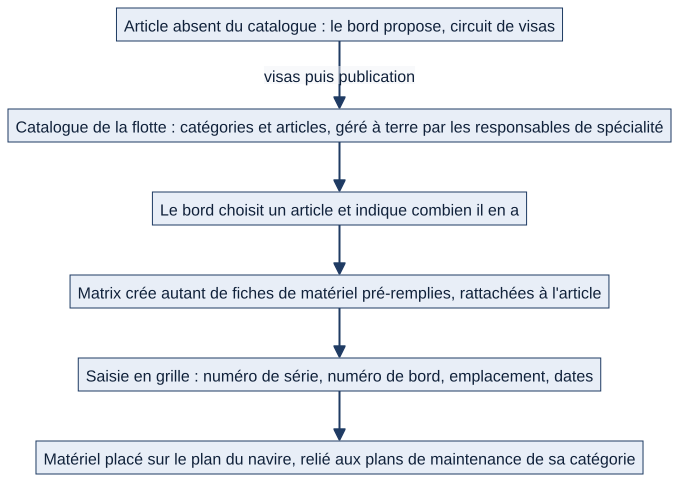
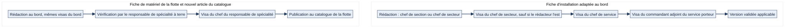

# Chapitre 11 — Matériel et installations

> **Pour qui :** marins, responsables, développeurs. **Diffusion :** générale (mécanismes et références dans la partie restreinte du dossier).
> **Ce que vous y trouverez :** ce que Matrix sait des équipements du bord, comment un marin les consulte et les contrôle, comment un responsable les crée, les équipe depuis le catalogue de la flotte et les relie à leurs fiches de maintenance, et comment une fiche est validée. Les circuits de maintenance qui s'appuient sur ces objets sont au chapitre 12.
> **État décrit :** état B (`6d6d0be`), non fusionné dans `main`.

---

## 11.1 Deux familles d'équipements

Matrix distingue deux familles, qui ne se gèrent pas tout à fait de la même façon.

| | **Matériel mobile** | **Installation fixe** |
|---|---|---|
| Exemples | Extincteur, EPI, multimètre, outil | Propulseur, pompe, groupe électrogène, circuit électrique |
| Identité | Type de matériel, numéro de série, numéro de bord, **NNO** (numéro de nomenclature OTAN), référence, marque | Désignation, référence, marque, gisement, local, « bigramme » |
| État | OK, en service, hors service, défectueux | Pas d'état propre ; une installation **critique** dont une échéance est en retard compte comme indisponible |
| Suivi technique | Contrôle périodique, date de péremption | Relevés (heures de marche, vibration, isolement), pièces, événements, entretiens |
| Emplacement | Local, pont, **épingle sur le plan du navire** | Local |

Chaque équipement est rattaché à un **bâtiment, un service, un secteur** et, facultativement, une **section** : c'est ce rattachement qui fixe qui le voit et qui peut le modifier (chapitre 5). Un équipement peut être **rattaché à un parent** (un multimètre à une caisse à outils ; un turbo à un moteur, lui-même à un groupe de propulsion) ; Matrix **interdit les cycles** (un équipement ne peut pas être son propre ancêtre).

## 11.2 Ce que voit et fait le marin

> Exemple fictif : le matelot Durand, de la section « Propulsion ».

1. **Il consulte** les matériels et installations de son périmètre : fiche, photo, documents, historique des interventions, derniers relevés, discussion attachée.
2. **Il retrouve un équipement** par la recherche globale ou en **scannant son QR code** : le scan ouvre directement le contrôle du jour s'il existe (voir chapitre 12).
3. **Il commente** sur la fiche : la question reste attachée à l'équipement.
4. **Il signale une anomalie** depuis la fiche (équipement pré-rempli) — chapitre 12.
5. **Il consulte le plan du navire** : une vue par pont, chaque matériel positionné par une épingle colorée — **vert** (aucun signal), **orange** (échéance en retard ou ticket correctif ouvert), **rouge** (hors service ou défectueux).
6. **Il signale une fiche fausse ou incomplète** pendant l'exécution d'une maintenance (chapitre 12).

Un marin **ne crée ni ne modifie** un équipement.

## 11.3 Ce que font les responsables

| Qui (seuil par défaut) | Ce qu'il fait |
|---|---|
| **Chef de section ou plus** | Crée et modifie un matériel ou une installation de son périmètre, ajoute un document ; **équipe le bord depuis le catalogue** ; complète les exemplaires en grille ; **importe** du matériel depuis un fichier Excel |
| **Chef de service ou plus** | **Supprime** un matériel, une installation, un document, lance une **action groupée** ; gère les **tâches d'entretien** d'une installation ; modifie le **rattachement parent / enfant** ; **configure le plan du navire** (ponts, positionnement) |
| **Responsable de spécialité** (à terre) | Gère le **catalogue de la flotte** de sa spécialité : catégories, articles, fiches de matériel ; vérifie les propositions du bord |
| **Administrateur général** | Seul à supprimer un article du catalogue (un responsable **archive**) |

Les seuils sont réglables par bâtiment (chapitre 5). Chaque écriture est **bornée au périmètre** de la personne, et l'équipage à terre est en lecture seule.

## 11.4 Équiper le bord depuis le catalogue de la flotte

Le **catalogue** est commun à toute la flotte, organisé en **catégories** et **sous-catégories**, chacune rattachée à une **spécialité**. Il est tenu à terre par les responsables de spécialité.

*Schéma S22 — Du catalogue à l'équipement placé sur le plan.*

1. Le bord **choisit un article** et indique **combien il en possède** ; Matrix crée **autant de fiches de matériel pré-remplies** (type, marque, NNO…), chacune **rattachée à l'article** mais **autonome** : si l'article disparaît du catalogue, la fiche du bord survit.
2. Le chef **complète les exemplaires en grille**, façon tableur : numéro de série, numéro de bord, emplacement, dates de mise en service, de dernier contrôle et de péremption.
3. Le matériel reçoit **les plans de maintenance de sa catégorie** (chapitre 12) et peut être posé sur le **plan du navire**.
4. Un article **absent du catalogue** ? Le bord **propose** un article ; la proposition suit un circuit de visas (§11.5) avant d'entrer au catalogue.

Une **reprise de l'existant** permet de rattacher les anciens dossiers de matériel aux catégories du catalogue : elle est d'abord **proposée** (lecture seule), puis **appliquée** ; **rien n'est supprimé ni déplacé**, le matériel reçoit seulement son lien vers l'article.

## 11.5 Les fiches de maintenance et leurs circuits de validation

**Le calendrier dit *quand* ; la fiche dit *comment*.** Une fiche décrit une **gamme** (par exemple « mensuelle » ou « toutes les 2 000 h ») : ce qu'il faut préparer (outils, pièces, EPI, consignes), les étapes numérotées (avec encadré « Attention »), les lignes de contrôle et de relevé. Une fiche a des **versions** ; seule la **version validée** s'applique et alimente la génération des échéances.

*Schéma S23 — Les deux circuits de validation d'une fiche.*

**Fiche d'installation, adaptée au bord.** Rédaction par un **chef de section** ou un **chef de secteur** → visa du **chef de secteur** (sauf s'il est le rédacteur) → visa du **chef de service** → visa du **commandant adjoint compétent**, c'est-à-dire celui dont dépend le **service porteur** de l'installation → version **validée**.

**Fiche de matériel de la flotte** (et **nouvel article du catalogue**, même logique). Un bord **ne peut pas la publier seul**. Mêmes visas du bord, puis **vérification par le responsable de spécialité** à terre, **visa de son chef**, puis publication au catalogue de la flotte. Un responsable de spécialité qui rédige directement n'a besoin que du visa de son chef.

Règles communes, appliquées par la machine d'états :
- **auto-validation interdite** : on ne vise jamais sa propre version ;
- **une personne n'intervient qu'à une seule étape** ;
- un **refus est motivé** et **revient au rédacteur** ;
- chaque transition est **tracée** avec son auteur et son motif ; deux versions se **comparent** visuellement (lignes, étapes, préparation ajoutées, modifiées, supprimées) ;
- si le poste du commandant adjoint est **vacant**, le visa **reste en attente** avec un message explicite : un administrateur désigne le titulaire, **sans pouvoir viser à sa place** ; aucun grade ne remplace un COMA non désigné.

**Hiérarchie des fiches de la flotte.** Une fiche de matériel vaut pour **sa catégorie et ses sous-catégories** ; pour une gamme donnée, **la fiche de la catégorie la plus proche de l'article s'applique** : une sous-catégorie remplace, pour cette gamme seulement, la fiche de son parent.

**Adaptation locale.** Un navire garde **sa propre fiche** d'installation, tracée « adaptée de la fiche flotte vX » ; quand la fiche flotte évolue, il **décide** s'il reprend les changements ou garde sa version.

**Signalement.** Le marin qui exécute une maintenance signale « fiche fausse ou incomplète » : le signalement reste ouvert **jusqu'à ce qu'une nouvelle version soit proposée** (ou classé).

## 11.6 Les relevés et la détection de dérive

Pour une installation, trois mesures sont suivies :
- **Heures de marche** : chaque relevé est le **compteur total** à la date du relevé (jamais une durée à additionner). Les **heures depuis la dernière visite** sont ce compteur moins celui de la dernière visite en atelier.
- **Vibration** : un état **A, B ou C**, avec un nombre de jours avant la prochaine mesure pour chaque état (180, 90 et 30 jours par défaut, réglables).
- **Isolement** : une valeur en ohms, une périodicité (mensuelle, trimestrielle, annuelle) et un **seuil minimal** réglé par le bord.

Les relevés saisis dans un compte rendu de maintenance **alimentent ces mesures** à la clôture. Matrix détecte une **dérive avant le franchissement du seuil** par une **régression linéaire simple** (sans apprentissage automatique) : il estime dans combien de jours le seuil sera franchi et **prévient les chefs concernés** (chapitre 12).

## 11.7 Documents, événements, pièces, historique

- Une installation porte ses **documents de référence** (plan, notice, procédure), distincts des pièces jointes des événements et des entretiens.
- On y consigne des **événements** et des **modifications techniques** (⚪ la page Notion « 04 » décrit l'orientation selon laquelle une modification technique devrait entraîner la mise à jour de la configuration, de la documentation, de la maintenance, des rechanges et de la formation ; **cette propagation n'existe pas** dans l'état B).
- Les **pièces** de l'installation (avec NNO et photo) sont listées.
- L'**historique d'un équipement** est tiré des comptes rendus : frise chronologique et séries de relevés par ligne de fiche, **sans ressaisie**.

## 11.8 Interactions avec les autres modules

| Module | Lien |
|---|---|
| Maintenance (ch. 12) | Les fiches alimentent les échéances ; l'exécution produit comptes rendus, relevés, tickets |
| Logistique (ch. 12 et 13) | Un ticket vise un matériel **ou** une installation ; les pièces consomment le stock |
| Formations (ch. 14) | Les qualifications requises ; documents et fiches |
| Documentation (ch. 15) | Documents liés à une installation ou un matériel |
| Calendrier, accueil (ch. 6, 7) | Échéances, retards, indicateurs |
| Organisation (ch. 4) | Périmètre ; **une unité occupée par du matériel ne s'archive pas** |
| Appareillage (ch. 16) | Les installations **critiques** alimentent la préparation |

## 11.9 Cas particuliers

- **Installation critique** : la clôture d'une maintenance exige une **confirmation explicite** (chapitre 12) ; ses retards comptent comme indisponibilité ; elle alimente la préparation à l'appareillage.
- **Matériel périmé** : la date de péremption est suivie ; l'échéance est signalée.
- **Équipage à terre / soutien à terre** : lecture seule ; le soutien à terre ne modifie que le catalogue et les circuits de fiches de sa spécialité.
- **Unité archivée** : on ne peut plus y rattacher un matériel ; la valeur déjà portée reste modifiable.
- **Import Excel** : limité au **matériel mobile** (pas aux installations).

## 11.10 Fonctionnement cible 🔵

| Sujet | Décision | Lot | État |
|---|---|---|---|
| **Transfert de matériel** entre secteurs (approbation du chef de service) et entre services (deux chefs de service, puis application par l'administrateur habilité) ; les tâches ouvertes suivent le matériel | `DEC-MAT-01` à `DEC-MAT-04` | L13 | Non développé : aujourd'hui, le matériel se réaffecte par l'affectation en masse |
| **Configuration réelle** du navire à l'instant T (documents, pièces compatibles, maintenance, compétences) ; **états techniques** plus fins (nominal, avec réserve, dégradé, indisponible) | Notion « 04 — Maintenance… » | — | Orientation, non développée |
| **Interlocuteurs SSF / ERO / ERDT** : un expert n'hérite pas de droits globaux ; circuits PÉPIN, CRAT non validés | Notion « 04 », « 13 » | — | Non développé |

## 11.11 Limites et éléments non vérifiés

- 🟢 Couverture de tests de l'état B : `assets` 493 fonctions de test. ⚪ Les écrans (plan du navire, grille, assistants de fiche) n'ont pas été rejoués dans un navigateur.
- ⚪ Le détail de chacun des 29 modèles est dans le dictionnaire généré ; ce chapitre explique les mécanismes, pas chaque champ.
- ⚪ La signification de **NNO** (« numéro de nomenclature OTAN ») est donnée par le libellé du champ du stock ; le champ du matériel porte seulement « NNO ».
- ⚪ Le circuit de transfert n'existe pas : le comportement au moment d'une réaffectation en masse n'est pas décrit comme un circuit.
- ⚪ Les pages Notion « 04 — Maintenance… » décrivent des objets cibles (composants, potentiels, configuration) **non développés** ; ils ne sont pas présentés comme existants.

---

**Sources (état B).** `assets/` (modèles, circuits de fiches, catalogue, mesures, plan du navire, import) ; références ligne par ligne dans la partie restreinte du dossier. Décisions : `DEC-MAT-01` à `DEC-MAT-04` (dossier V1.2) ; Notion « 13 — Décisions » (fiches, catalogue), « 04 — Maintenance, installations, SSF… » (lue).
