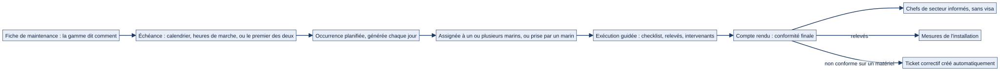
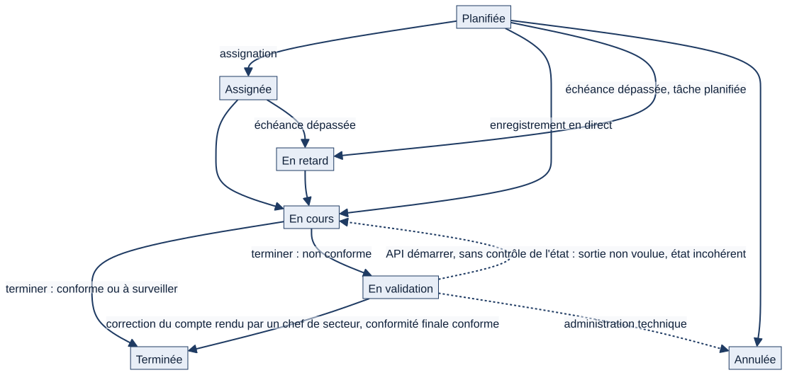
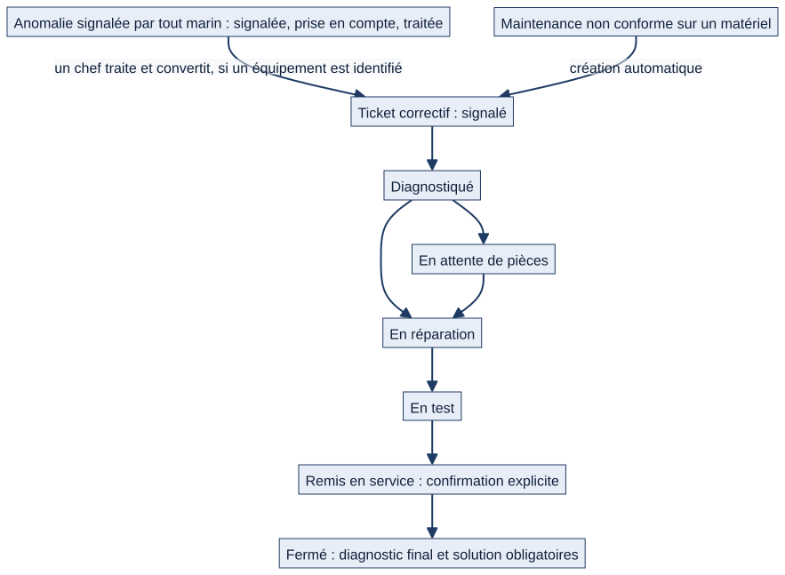

# Chapitre 12 — Maintenance, anomalies, tickets correctifs

> **Pour qui :** marins, responsables, développeurs. **Diffusion :** générale (références dans la partie restreinte du dossier).
> **Ce que vous y trouverez :** comment une maintenance passe du plan à la réalisation ; ce que fait le marin qui l'exécute ; comment une anomalie devient un ticket correctif ; qui peut faire quoi ; ce qui est écrit, tracé et notifié.
> **État décrit :** état B (`6d6d0be`), non fusionné dans `main`. Légende : 🟢 réel vérifié, 🔵 cible validée par le PO, ⚪ non vérifié.

---

## 12.1 Trois objets, trois usages

| Objet | Question à laquelle il répond | Qui l'ouvre |
|---|---|---|
| **Maintenance planifiée** (occurrence) | « Que dois-je contrôler ou entretenir, et quand ? » | Générée automatiquement depuis le plan ou la fiche |
| **Anomalie** | « J'ai vu quelque chose d'anormal à bord » (fuite, issue encombrée…), avec ou sans équipement identifié | Tout marin |
| **Ticket correctif** | « Un équipement précis est en panne ou dégradé, il faut le réparer et le remettre en service » | Un chef, par conversion d'une anomalie ou à la main ; ou **automatiquement** si un contrôle de matériel est non conforme |

## 12.2 Du plan à la réalisation

*Schéma S24 — Le fil de la maintenance planifiée.*

1. **Le plan dit quand.** Un plan de maintenance (par type de matériel) ou une tâche d'entretien d'installation définit la périodicité ; la **fiche validée** (chapitre 11) dit comment. Quand une fiche de la flotte s'applique, **la fiche de la catégorie la plus proche fait foi**.
2. **Matrix génère les échéances à l'avance.** Une tâche planifiée crée les occurrences des 90 prochains jours (matériel et installations). Une occurrence liée à du matériel mobile porte plan + matériel ; une occurrence d'installation ne porte que la tâche d'entretien (jamais les deux : contrainte en base).
3. **L'échéance est assignée** à un ou plusieurs marins, avec une **priorité de 1 à 5** (5 = la plus critique) qui trie la liste « À faire ».
4. **Le retard est calculé automatiquement** : une occurrence « planifiée » ou « assignée » dont la date est dépassée passe en **En retard**.
5. **Le marin exécute** (§12.3), puis la clôture met à jour l'état de l'occurrence, les relevés de l'installation et l'historique.

## 12.3 Ce que fait le marin qui exécute

> Exemple fictif : le matelot Durand contrôle les extincteurs du pont principal.

1. Il ouvre l'échéance (une maintenance qui lui est assignée, ou qu'il s'assigne d'un clic) depuis « À faire », depuis la fiche de l'équipement, ou **en scannant le QR code** de l'équipement : il arrive sur la fiche du jour.
2. Il lit la **préparation** (EPI, consignes, outils, pièces) et les attentions de sécurité.
3. Il renseigne **ligne par ligne** : résultat, mesure, remarque. Les mesures de l'installation (heures, vibration, isolement) se saisissent là, **sans ressaisie ailleurs**.
4. Il peut **enregistrer en cours de route** (l'occurrence passe **En cours**) puis **clôturer** avec un verdict : **conforme**, **non conforme**, etc., des **photos** et une **note**. Il indique les **intervenants**.
5. Pour du **matériel mobile**, une **tournée** permet de contrôler plusieurs équipements d'un même passage dans **un seul tableau** (une ligne par équipement, une colonne par ligne de fiche), à l'écran ou imprimé.
6. À la clôture, une **trace est ajoutée dans la discussion de l'occurrence**, et les **chefs de secteur sont notifiés**.

**Ce qui se passe selon le verdict** (🟢 vérifié au code) :

| Verdict | État de l'occurrence | Suites |
|---|---|---|
| Conforme | **Terminée** | Compte rendu archivé |
| Non conforme | **En validation** | Pour du **matériel mobile** : un **ticket correctif est créé automatiquement** (gravité 3 par défaut, une seule fois par occurrence) et les chefs sont alertés. Pour une **installation** : **aucun ticket automatique** ; le marin peut signaler une anomalie depuis le compte rendu (lien proposé à l'écran) |

**Installation critique.** La clôture d'une installation **critique** (avec un verdict qui n'est pas « non conforme ») exige une **confirmation explicite** : le texte de confirmation est affiché, la tentative sans confirmation est **refusée et tracée**. Elle ne demande pas la signature d'une seconde personne : **c'est le marin qui clôture qui est enregistré comme valideur** (🟢).

**Correction après coup.** Un compte rendu terminé peut être corrigé : Matrix **conserve la saisie d'origine**, enregistre la modification avec son auteur et son motif, et notifie. Si deux personnes enregistrent en même temps, la seconde reçoit un message de conflit et doit recharger : **rien n'est écrasé en silence**.

## 12.4 Le cycle de vie d'une échéance

*Schéma S25 — États d'une occurrence de maintenance.*

États : **Planifiée → Assignée → En cours → Terminée** ; **En retard** (calculé) ; **En validation** (verdict non conforme) ; **Annulée**. Chaque changement est **journalisé** (ancien et nouvel état, auteur) et, pour les installations critiques, **audité**.

🟢 **Sortie de l'état « En validation » : vérifié par test (12/11/2026, état B, données fictives).** Il n'existe **aucune action de validation dédiée** (aucun bouton, aucune route, aucune tâche planifiée). Trois chemins font pourtant changer l'état :
1. **La correction du compte rendu par un chef de secteur ou plus** (action `maintenance_compte_rendu_correction`), avec motif obligatoire : si la conformité finale n'est plus « non conforme », l'occurrence passe **Terminée** ; sinon elle reste « En validation ». Un marin, y compris l'exécutant, et un chef de section **ne le peuvent pas**.
2. **L'API « démarrer »** : elle écrit « En cours » **sans contrôler l'état de départ**, et un marin assigné peut l'appeler. L'occurrence quitte alors « En validation » sans que personne ne l'ait validée, alors que son compte rendu terminé reste « non conforme » : état **incohérent**, qui apparaît ensuite en retard. Une correction par un chef de secteur remet l'état en ordre. Ce chemin n'a manifestement pas été voulu comme une validation (⚪ intention non confirmée).
3. **L'administration Django** : un compte technique peut écrire n'importe quel état, y compris « Annulée ».

Aucune annulation manuelle n'existe dans l'interface ni dans l'API. **Rien ne sort l'occurrence de l'état quand le ticket correctif lié est clôturé** (vérifié : ticket clôturé, occurrence inchangée) ; l'API de clôture refuse un second compte rendu (409) ; la modification directe du statut par l'API est refusée.

**Risque de blocage, vérifié et non inventé.**
- Une occurrence « En validation » **n'est jamais comptée en retard** (choix explicite du code : « une validation en attente n'est pas un retard de l'équipe »), la tâche de retard ne la traite pas et **aucune notification ne la vise** : elle peut rester indéfiniment dans cet état sans notification ni relance.
- Elle reste **visible** : « À faire » de l'exécutant et des chefs la signale « En attente de validation », le bloc de supervision des chefs et la liste filtrable la comptent. Mais **aucune échéance, ancienneté ni escalade** n'existe.
- Pour du **matériel mobile**, la génération des échéances suivantes **continue** (vérifié) et un ticket est créé. Pour une **installation**, **aucun ticket n'est créé et la génération de l'échéance suivante est suspendue** tant que l'occurrence reste « En validation » (la commande de génération considère qu'une occurrence non terminée existe déjà) : l'entretien récurrent de l'installation **s'arrête** jusqu'à la correction du compte rendu. La génération reprend dès que l'occurrence est « Terminée ».
- La tournée verrouille l'occurrence tant qu'elle est « En validation ».
- Matrix ne sait pas dire si le défaut est **corrigé** : seul un chef de secteur ou plus peut conclure, en corrigeant le compte rendu.

Aucune règle nouvelle n'est proposée ici : la règle de sortie reste **à décider par le PO** (écart A20, proposition D2).

## 12.5 L'anomalie : « j'ai vu quelque chose »

Un marin signale une anomalie en quelques clics : titre, description, **gravité de 1 à 5**, photo, localisation en texte libre, et **facultativement un équipement** (une installation **ou** un matériel, jamais les deux). Le périmètre (bâtiment, service, secteur, section) est **déduit de l'équipement, sinon du profil du déclarant**.

États : **Signalée → Prise en compte → Traitée → Clôturée**.

| Qui | Voit | Peut |
|---|---|---|
| **Équipier** | Ses signalements et ceux de sa section | Signaler ; commenter |
| **Chef de section et plus** | Son périmètre | Prendre en compte, traiter, clôturer ; **convertir en ticket correctif** quand un matériel est identifié |
| **État-major** | Les services rattachés à sa fonction | Idem, **borné à ces services** |
| **Administrateur général** | Tout | Tout |

La **conversion en ticket** garde un **lien dans les deux sens** (anomalie ↔ ticket). Le signalement est **notifié** aux chefs du périmètre.

## 12.6 Le ticket correctif

*Schéma S26 — De l'anomalie au ticket, du ticket à la remise en service.*

**États :** Signalé → Diagnostiqué → (En attente de pièces) → Planifié → En réparation → En test → **Remis en service** → **Fermé** ; plus **Bloqué** et **Annulé**. Les six premiers états sont dits « ouverts » : c'est la **référence unique** utilisée par tous les tableaux de bord et la vue flotte.

**Un ticket vise un matériel *ou* une installation**, jamais les deux. Il peut mobiliser **plusieurs marins**. Il porte une **gravité de 1 à 5**.

**Qui fait avancer** : un **chef de section ou plus**, **dans son périmètre** (même filtre que la consultation : un chef ne peut pas faire avancer le ticket d'un autre navire). Un bouton propose **l'étape suivante** (« Passer au diagnostic », « Lancer la réparation », « Passer aux essais », « Remettre en service », « Clôturer »). Un **acteur à terre** peut **commenter** un ticket bloqué mais **ne le fait pas avancer**.

**Deux garde-fous :**
1. **Remise en service** : confirmation explicite obligatoire ; sans elle, rien n'est enregistré et le refus est tracé.
2. **Clôture** : le **retour d'expérience** (diagnostic final et solution appliquée) est **obligatoire**. Un ticket fermé porte donc toujours un REX, retrouvable ensuite par la recherche « pannes déjà rencontrées » sur la fiche de l'équipement.

Chaque changement est **journalisé** (historique de statut) et **audité**.

**Pièces.** Un ticket peut déclencher une **demande de pièces** (chapitre 13) ; le ticket passe en attente tant que les pièces ne sont pas reçues.

## 12.7 Détection de dérive et alertes

Les relevés des installations alimentent une **détection de dérive** par régression linéaire : Matrix estime le délai avant franchissement du seuil et **prévient les chefs concernés** avant que la limite soit dépassée (chapitre 11). Les maintenances en retard, les tickets ouverts et les validations en attente sont comptés à l'accueil (chapitre 6), **chaque chiffre menant au dossier filtré**.

## 12.8 Droits en un coup d'œil

| Action | Qui (seuil par défaut) | Borne |
|---|---|---|
| Voir les échéances | Tout marin de son périmètre ; assignés en priorité | Périmètre, équipage |
| Exécuter une maintenance | **Le marin assigné**, ou un **chef de section ou plus** pour une maintenance qui n'est pas la sienne ; tout marin de son périmètre peut **s'assigner lui-même** (hors équipage à terre et soutien à terre) | Périmètre |
| Corriger un compte rendu terminé | Selon les seuils du bâtiment ; motif tracé | Périmètre |
| Signaler une anomalie | Tout marin | — |
| Traiter / convertir une anomalie | Chef de section et plus | Périmètre ; état-major : services de sa fonction |
| Faire avancer un ticket | Chef de section et plus | Périmètre |
| Confirmer une remise en service | Celui qui fait avancer le ticket | Confirmation explicite |

Les seuils sont **réglables par bâtiment** (chapitre 5). L'équipage à terre est en lecture seule.

## 12.9 Interactions avec les autres modules

| Module | Lien |
|---|---|
| Matériel et installations (ch. 11) | Fiches, relevés, critique, plan du navire |
| Logistique (ch. 13) | Pièces consommées, demandes de pièces, stock |
| Tâches (ch. 10) | Une tâche peut être rattachée à un objet ; création depuis une anomalie ⚪ non vérifiée |
| Discussions (ch. 9) | Chaque occurrence, ticket, anomalie a son fil |
| Notifications | Retards, alertes de dérive, tickets, validations |
| Préparation à l'appareillage (ch. 16) | Tickets bloquants et installations critiques |
| Accueil (ch. 6) | « À faire », indicateurs, supervision |

## 12.10 Cas particuliers

- **Double équipage** : listes et compteurs bornés à l'équipage.
- **Rondes** : le module « rondes » est **retiré de l'interface** ; seuls ses modèles subsistent (non utilisés, non décrits comme fonctionnalité).
- **Équipement supprimé** : voir le chapitre 11 (rattachement) ; les comptes rendus conservent l'historique.
- **Module désactivé** : 🟢 les pages web du module sont refusées et son entrée de menu disparaît, mais **l'accueil et le calendrier continuent d'afficher les maintenances**, et l'API comme les tâches planifiées continuent de fonctionner (écart A25).

## 12.11 Fonctionnement cible 🔵

| Sujet | Décision | Lot | État |
|---|---|---|---|
| **Périodicités nommées** (hebdomadaire à quinquennale) et échéance calculée depuis la réalisation effective | `DEC-PER-01` à `DEC-PER-04` | Plan V1.2 (étape 4.1) | Cible, non développée |
| **Remarques d'outillage et d'instruction**, visibles du chef de secteur, sans modification automatique de la fiche (`DEC-OUT-03`) | `DEC-OUT-01` à `DEC-OUT-05` | Plan V1.2 (étape 4.3) | Cible, non développée |
| **Durée indicative** de maintenance et sa méthode | `DEC-DUR-*` | Plan V1.2 | Cible ; pas de durée dynamique aujourd'hui |
| **Ticket de suivi pour une installation déclarée non conforme**, comme pour le matériel mobile | **Proposition à valider par le PO** — **pas une décision** | — | Non développé ; aujourd'hui seul le matériel mobile en déclenche un. Garde-fous proposés : le ticket **ne clôture jamais automatiquement une anomalie** et **n'autorise jamais une remise en service** |
| **Configuration réelle, potentiels, composants** | Notion « 04 — Maintenance… » | — | Orientation, non développée |

## 12.12 Limites et éléments non vérifiés

- 🟢 Tests de l'état B : `maintenance` et `logistics` (rejoués avec l'ensemble 3 : 1 491 tests OK, 1 ignoré ; voir `RAPPORT_E3.md`).
- 🟢 Pas de validation dédiée pour **En validation** ; trois chemins de sortie (§12.4), dont l'API « démarrer » qui laisse un état incohérent ; risque de blocage sans notification, et suspension de l'entretien récurrent d'une installation.
- ⚪ Les écrans (exécution, tournée, ticket) n'ont pas été rejoués dans un navigateur.
- ⚪ Les envois de notifications (web push, e-mail) n'ont pas été rejoués ; seules leurs conditions de déclenchement sont décrites.

---

**Sources (état B).** `maintenance/` (modèles, vues d'exécution, tournée, tâches), `logistics/` (tickets, anomalies, stock), `notifications/tasks.py`. Références ligne par ligne dans la partie restreinte du dossier.
