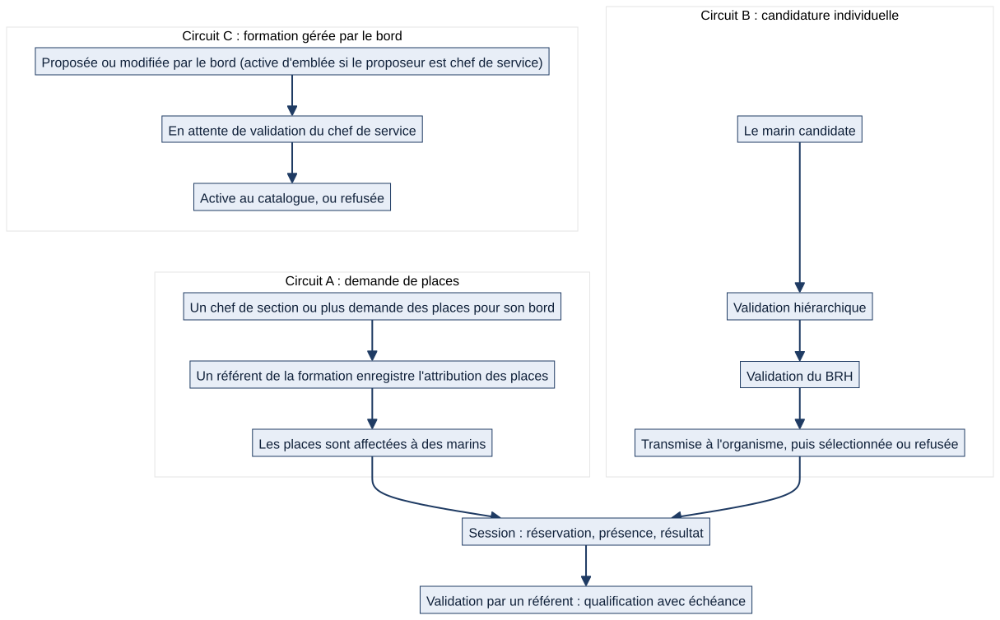

# Chapitre 14 — Formations et qualifications

> **Pour qui :** marins, responsables, développeurs. **Diffusion :** générale (références dans `restreint/14_formations_technique.md`).
> **Ce que vous y trouverez :** le catalogue de formations, la façon dont un marin suit ses qualifications, comment une session se remplit, et **les trois circuits** : demande de places, candidature individuelle, formation proposée par le bord.
> **État décrit :** état B (`6d6d0be`), non fusionné dans `main`. Légende : 🟢 réel vérifié, 🔵 cible validée par le PO, ⚪ non vérifié. Source métier : Notion « 03 — Formation, stages, CFPES, FPS et qualification opérationnelle » (lue ; elle décrit l'état réel au 29/09/2026 et une cible).

---

## 14.1 Le principe : une formation unique, une qualification qui suit le marin

- La **formation** est une fiche **unique et partagée par tous les navires** : la qualification d'un marin le suit en cas de mutation.
- Ce qu'un navire **exige** s'exprime à part (**exigence**), par bâtiment, service, secteur, section ou rôle.
- Ce qu'un marin **détient** est une **validation** (qualification) avec sa date d'obtention et son **échéance**.
- Les formations forment un **arbre de compétences** : certaines sont **prérequises** d'autres.

## 14.2 Ce que voit et fait le marin

> Exemple fictif : le matelot Durand prépare un renouvellement.

1. **Mes qualifications** : valides, **bientôt expirées**, **expirées**, avec l'échéance. Des alertes sont envoyées avant expiration (échéances en jours réglées côté système), et l'accueil les place dans « À faire ».
2. **Catalogue et arbre de compétences** : formations par catégorie, prérequis, ce qu'une validation « débloque » ; chaque formation est **validé / disponible / verrouillée** pour lui.
3. **Réserver une place** dans une session : Matrix contrôle les **prérequis** et la **capacité**. Si la session est pleine, il entre en **liste d'attente** (premier arrivé, premier servi) et est **notifié** quand une place se libère.
4. **Candidater** à une formation qui passe par un organisme (§14.5).
5. Ses sessions apparaissent dans **son calendrier** (stagiaire, réservataire ou formateur).

Une qualification **n'est pas un grade** (`DEC-ORG-04`).

## 14.3 Ce que font les responsables

| Qui | Ce qu'il fait |
|---|---|
| **Référent d'une formation** (désigné pour **cette formation sur ce navire**) | Enregistre les validations, gère les présences des sessions de cette formation |
| **Référent formation du navire** (transversal) | Idem pour toutes les formations du bord ; désigné au niveau de supervision globale |
| **Commandement du bâtiment** | Supervision de toutes les formations de son seul bâtiment |
| **Chef de section et plus** | Affecte des marins de son périmètre à une session ; formule une demande de places |
| **Chef de service et plus** | Valide une formation proposée par le bord (§14.6) |
| **Personnel BRH** (désigné par navire) | Traite les candidatures (étape BRH) |
| **Administrateur général** | Seul quand un marin n'a aucun navire résolvable |

Règle de périmètre : **un référent valide les marins d'un navire précis**, jamais ceux d'un autre ; on ne s'auto-valide pas (sauf administrateur général).

## 14.4 Circuit A — La demande de places

*Schéma S28 — Les trois circuits de formation (A, B, C).*

Pour une formation **à quota limité** (par exemple un stage sécurité), le bord demande des places :

1. Un **chef de section ou plus** formule une **demande de places** (formation, nombre) **pour son propre bord**.
2. La **réponse** attribue un nombre de places et **relie une session** (existante ou créée). États : **Demandée → Attribuée** (ou **Refusée**, **Annulée**).
3. Le chef **affecte ensuite des marins** sur ces places. Plusieurs bords peuvent partager une même session : chaque bord garde **son propre quota** ; le **plafond physique** de la session reste global.

⚪ **Point à signaler.** La note Notion décrit une réponse de **l'organisme de formation**. Dans l'état B, **l'organisme n'est pas un utilisateur de Matrix** : c'est **un référent de la formation, pour ce navire**, qui enregistre la réponse. La transmission à l'organisme est un acte hors outil. Inscrit au registre des écarts (cible : dossier métier avec timeline et organisme).

## 14.5 Circuit B — La candidature individuelle

1. Le **marin** dépose une **candidature** à une formation.
2. **Deux validations indépendantes** : la **hiérarchie** (chef de section ou plus, **dans le périmètre du candidat**) et le **BRH** (personnel désigné pour ce navire). L'ordre n'est pas imposé.
3. Dès que **les deux** sont données, la candidature passe automatiquement **Transmise à l'organisme**.
4. Issues : **Sélectionnée**, ou **Refusée** par la hiérarchie, par le BRH ou par l'organisme.

La **sélection** par l'organisme se traduit par l'attribution de places (circuit A) : les deux circuits se rejoignent à la **session**.

## 14.6 Circuit C — Une formation proposée par le bord

Un bord peut **créer ou modifier une formation interne**. Elle ne devient active qu'après **validation** :
- si le proposeur est **chef de service ou plus**, sa formation est **active immédiatement** (son rôle vaut accord) ;
- sinon elle reste **En attente de validation**, visible seulement de son proposeur et de ses validateurs, et **ne peut ni recevoir de session ni de demande de places** ;
- **validateur** : chef de service ou plus **dans le périmètre du proposeur** ; le commandement valide à titre de supervision ; **dans un service rattaché à un commandant adjoint, seul le titulaire de cette fonction valide parmi l'état-major** (jamais un autre état-major) ;
- le refus est **motivé** et renvoie le statut **Refusée**.

Les formations de l'organisme (non gérées par le bord) restent toujours actives.

## 14.7 De la session à la qualification

1. Une **session** a une date, un lieu, un formateur, une capacité, des **réservations**, des **présents**, un statut (**Planifiée, Effectuée, Annulée**).
2. Le référent consigne les **présences**, puis **enregistre la validation** : date d'obtention, **échéance** (date + validité de la formation, 365 jours par défaut), **certificat** joint.
3. La validation exige que les **prérequis soient valides à la date d'obtention** : sinon elle est **refusée** avec la liste des formations manquantes.
4. La qualification apparaît chez le marin, dans l'arbre, dans l'accueil, dans les vues de spécialité et dans la passation.

⚪ Aujourd'hui, la transition automatique « session effectuée → validation → qualification » n'existe pas : **c'est le référent qui enregistre la validation** (cible Notion, §14.10).

## 14.8 Qualifications et tâches : l'information ne bloque pas

Décision du PO (`DEC-QUA-01` à `DEC-QUA-03`) : une qualification manquante ou périmée **ne bloque jamais** l'attribution d'une tâche ordinaire, le responsable humain choisit ; elle peut s'afficher à titre informatif. Les **visas techniques, fonctions de service et signatures officielles** gardent leurs exigences réglementaires, qui **viennent du bord** (`DEC-QUA-04`) — aucun contrôle de ce type n'est inventé dans ce dossier.

🟢 **Ce que fait le code.** Les **tâches** ne contiennent aucun contrôle fondé sur les qualifications. En revanche, une **liste de service à quai** peut porter des **habilitations requises** (réglage de la liste, jamais codé en dur) : lors d'un **échange de tours**, Matrix vérifie que le marin qui reprend le tour a une **validation valable le jour du tour** et **explique en français** ce qui manque (`quarts/echanges.py:88`). C'est un contrôle propre aux services, conforme à l'esprit de `DEC-QUA-04` ; l'échange est **refusé d'emblée** avec cette explication (chapitre 8). Le refus porte sur l'échange d'un tour de service, non sur l'attribution d'une tâche ordinaire.

## 14.9 Interactions avec les autres modules

| Module | Lien |
|---|---|
| Organisation (ch. 4) | Exigences par périmètre ; spécialité du marin ; mutation |
| Droits (ch. 5) | Référents, BRH, supervision, seuils |
| Calendrier (ch. 6, 8) | Sessions des stagiaires et formateurs |
| Accueil (ch. 6) | Formations du jour, qualifications à renouveler, candidatures à approuver |
| Quarts (ch. 8) | Habilitations requises par une liste de service, contrôlées lors d'un échange de tours |
| Discussions (ch. 9) | Fil par dossier (cible : systématique) |
| Appareillage (ch. 16) | Qualifications des postes critiques |
| Passation (ch. 6) | Qualifications figées dans la synthèse |

## 14.10 Fonctionnement cible 🔵

Selon la page Notion « 03 » (orientation, **non développée** sauf mention) :
- **dossier métier vivant** : une demande ou une candidature devient un dossier avec acteurs, workflow, **timeline**, échéances, pièces jointes, **fil de discussion systématique**, **destinataire et prochaine action** ;
- **transition automatique** session réalisée → résultat validé → qualification créée ou renouvelée → couverture du poste recalculée → **disponibilité RH** du bâtiment ;
- **ouverture contrôlée à des organismes externes** ;
- **indicateurs** : postes critiques couverts, qualifications manquantes ou bientôt expirées, ruptures liées aux départs et mutations ;
- **qualifications fines** (FEM, BE, BAT, BS, BST, BHT, C-CDM) : `DEC-ORG-05`, libellés et validités exacts **non fournis** (IM-01) — aucune liste n'est inventée ici.

## 14.11 Limites et éléments non vérifiés

- 🟢 Tests de l'état B : `training` (exécution à lancer, voir `RAPPORT_E3.md`).
- ⚪ Les envois de notifications (expiration, place libérée) n'ont pas été rejoués ; seules leurs conditions sont décrites.
- ⚪ Le détail de la visibilité des dossiers de formation par rôle est dans le code (`dossiers_formation_visibles_q`) ; il n'est pas reproduit ici cas par cas.
- ⚪ Le rôle exact de l'« organisme » reste à préciser par le PO (§14.4).

---

**Sources (état B).** `training/` ; Notion « 03 — Formation… » ; décisions `DEC-QUA-01` à `04`, `DEC-ORG-04`, `DEC-ORG-05` (dossier V1.2). Références dans `restreint/14_formations_technique.md`.
