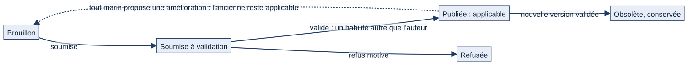
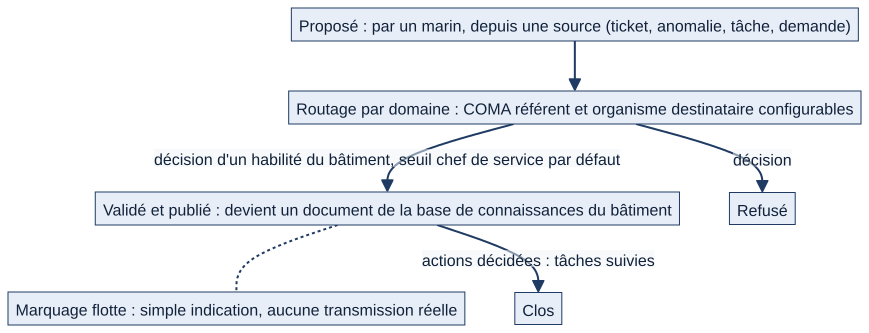
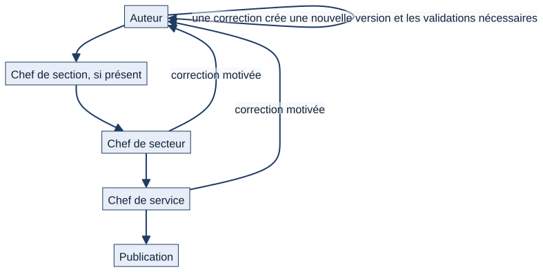

# Chapitre 15 — Documentation du bord et retours d'expérience (RETEX)

> **Pour qui :** marins, responsables, développeurs. **Diffusion :** générale (références dans `restreint/15_documentation_retex_technique.md`).
> **Ce que vous y trouverez :** la base de connaissances du bâtiment (documents, versions, validation), le circuit RETEX qui l'alimente, et — séparés — le circuit tel qu'il fonctionne aujourd'hui et le circuit **cible** décidé par le PO.
> **État décrit :** état B (`6d6d0be`), non fusionné dans `main`. Légende : 🟢 réel vérifié, 🔵 cible validée par le PO, ⚪ non vérifié.

---

## 15.1 Deux objets qui se nourrissent

| | **Document** | **RETEX** |
|---|---|---|
| Rôle | Procédure, consigne ou note que le bord applique | Enseignement tiré d'un événement, proposé pour que le bord s'améliore |
| Cycle | Brouillon → soumis → **publié** (versionné) | Proposé → **validé et publié** (ou refusé) → clos |
| Lien | Un RETEX validé **devient un document publié** | Une action décidée devient une **tâche** suivie |

## 15.2 Ce que voit et fait le marin

> Exemple fictif : le matelot Durand a vécu une fuite mal traitée.

1. **Il consulte** les documents qui le visent (bâtiment, service, secteur, section, équipage) : titre, domaine, **version applicable**, historique des versions, origine (**procédure officielle** avec sa référence, ou **note locale non réglementaire**), date de prochaine révision.
2. **Il retrouve un document** par la recherche, ou directement depuis l'objet concerné : une installation, une formation ou une tâche peuvent afficher **leurs documents liés**.
3. **Il propose une amélioration** d'un document : une nouvelle version est soumise à validation (une seule proposition à la fois par document).
4. **Il propose un RETEX** depuis l'objet concerné (anomalie, ticket, demande…) ou depuis la page RETEX : titre, **constat**, causes si établies, **enseignement**, recommandation, portée, niveau de diffusion (**bâtiment** ou **flotte**), domaine. Le constat, l'enseignement et le titre sont **obligatoires**.

## 15.3 Documents : qui fait quoi

| Action | Qui (seuil par défaut) | Règles |
|---|---|---|
| Rédiger / soumettre | **Chef de section ou plus** (`documentation_redaction`) | Seulement vers des publics de son périmètre ; une procédure officielle **cite sa source** |
| Valider et publier, archiver | **Chef de service ou plus** (`documentation_validation`) | Dans le périmètre du document ; **jamais sa propre version** |
| Refuser | Même droit | **Motif obligatoire** |
| Lier un document à un objet | Droit de gestion des liens | Seulement des objets auxquels on a accès |
| Proposer une amélioration | Tout marin qui voit le document | Équipage à bord uniquement |

*Schéma S29 — Une seule version applicable à la fois ; l'historique est conservé.*

- Une version **publiée** devient la **version applicable** ; la précédente devient **obsolète** mais **reste consultable**. Rien n'est écrasé.
- Le **brouillon, la proposition et le refus** ne sont visibles que de leur **auteur** et des **gestionnaires**.
- Les validateurs reçoivent une notification « Document à valider » ; l'auteur est notifié de la décision.
- Les documents **dont la révision est due** sont signalés aux gestionnaires.
- Un **équipage à terre** consulte mais ne soumet pas.

## 15.4 Le circuit RETEX aujourd'hui 🟢

*Schéma S30 — Le circuit RETEX réellement en place (état B).*

1. **Proposition** par un marin à bord : le RETEX est rattaché à un **domaine du bâtiment**. Les quatre domaines par défaut (modifiables par bâtiment) désignent chacun un **commandant adjoint référent** et un **organisme destinataire habituel** :

   | Domaine | COMA référent | Organisme destinataire |
   |---|---|---|
   | Opérations et missions | COMOPS | ALFAN / Entraînement |
   | Technique, sécurité matérielle, MCO | COMANAV | SSF / ERO / IRB puis ERDT / IRDT |
   | Service courant, protection, vie à bord | COMAEQ | ALFAN / Exploitation |
   | Aviation | COMAVIA | ALFAN / Exploitation |

2. **Routage** : sont notifiés (avec action requise) **tous les habilités du bâtiment** (seuil `retex_validation`, chef de service par défaut), **ceux dont la fonction cite le COMA référent du domaine apparaissant en premier**. Il n'y a **pas d'étape intermédiaire**.
3. **Décision** : un habilité **valide** (le RETEX est **publié comme document du bâtiment**, version 1, origine « note locale ») ou **refuse avec motif**.
4. **Actions** : après validation, le valideur crée une **tâche assignée** à un marin du bâtiment (à bord), liée au RETEX.
5. **Clôture** : le valideur peut **clore** le RETEX, **uniquement quand toutes ses actions sont terminées**. Les domaines (COMA référent, organisme) se configurent au niveau du seuil de validation.
6. **Traçabilité** : chaque étape est enregistrée dans le journal d'audit.

Le RETEX est **limité au bâtiment** : on ne propose ni ne valide pour un autre navire ; le commandement le voit en lecture ; un marin voit les siens et les RETEX **validés** de son bâtiment.

## 15.5 Le circuit RETEX cible 🔵

*Schéma S31 — Circuit décidé par le PO (non développé).*

Décisions du PO (dossier V1.2) :
- `DEC-RTX-01` : **auteur → chef de section (s'il existe) → chef de secteur → chef de service**. Cette décision **remplace** l'ancienne recommandation « COMA référent d'abord ».
- `DEC-RTX-02` : une **demande de correction** doit être **motivée**.
- `DEC-RTX-03` : une correction entraîne une **nouvelle version** et les validations nécessaires.
- `DEC-RTX-04` : **traçabilité** de qui a proposé, modifié, validé ou rejeté.

| | Aujourd'hui | Cible |
|---|---|---|
| Étapes | Une seule : un habilité décide | Chef de section → chef de secteur → chef de service |
| Rôle du COMA référent | Ordre de notification | Ne décide pas d'abord (décision remplacée) |
| Correction | Pas de demande de correction : valider ou refuser | Demande motivée → nouvelle version → nouvelles validations |
| Traçabilité | Audit de chaque étape | Idem, plus l'historique des versions |

⚪ **À confirmer.** Qui, après le chef de service, **transmet le RETEX à l'organisme destinataire** (la diffusion « flotte » ne fait aujourd'hui que **marquer** le RETEX « proposé à l'organisme destinataire ») n'est pas décidé : aucun envoi n'existe. Écart inscrit au registre (lot L11).

## 15.6 Interactions avec les autres modules

| Module | Lien |
|---|---|
| Tickets, anomalies (ch. 12) | Source d'un RETEX ; le ticket fermé porte déjà un **retour d'expérience** (diagnostic et solution) |
| Tâches (ch. 10) | Les actions décidées sont des tâches |
| Formations (ch. 14) | Un RETEX peut déboucher sur une formation (cible : reboucle formation, maintenance, exploitation) |
| Installations, matériel (ch. 11) | Documents liés à l'objet |
| Recherche globale | Documents trouvés, bornés au public visé |
| Annonces (ch. 9) | ⚪ Pas de lien automatique |

## 15.7 Cas particuliers

- **Équipage à terre** : lecture seule pour la documentation et le RETEX.
- **Document archivé** : plus de proposition d'amélioration.
- **Objet source inaccessible** : un RETEX ne peut pas citer une source que l'on ne peut pas ouvrir.

## 15.8 Limites et éléments non vérifiés

- 🟢 Tests de l'état B : `documentation` et `retex` (exécution à lancer, voir `RAPPORT_E3.md`).
- ⚪ Le modèle documentaire **cible** (bibliothèque unifiée, droits de lecture fins par document) n'est pas décrit : aucune décision correspondante n'a été lue.
- ⚪ Les écrans n'ont pas été rejoués dans un navigateur.

---

**Sources (état B).** `documentation/`, `retex/` ; décisions `DEC-RTX-01` à `04` (dossier V1.2). Références dans `restreint/15_documentation_retex_technique.md`.
