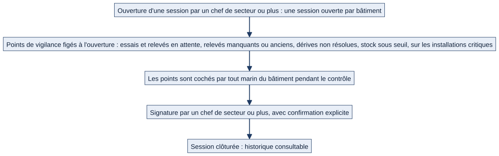
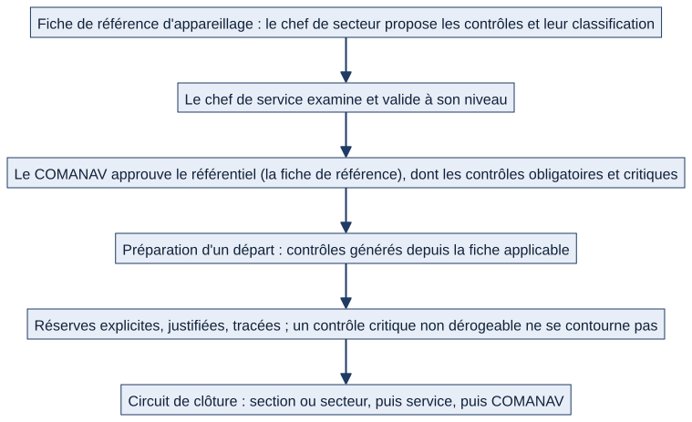

# Chapitre 16 — Préparation à l'appareillage

> **Pour qui :** marins, responsables, développeurs. **Diffusion :** générale (références dans la partie restreinte du dossier).
> **Ce que vous y trouverez :** ce que Matrix propose aujourd'hui pour préparer un départ (une session datée, une liste de points de vigilance à cocher, une signature de clôture), ce que Matrix **ne fait pas** (autoriser l'appareillage), et le circuit **cible** décidé par le PO — présentés séparément.
> **État décrit :** état B (`6d6d0be`), non fusionné dans `main`. Légende : 🟢 réel vérifié, 🔵 cible validée par le PO, ⚪ non vérifié.

---

## 16.1 Ce que Matrix ne dit pas

> **Matrix est un outil de suivi de la préparation. Il ne délivre pas l'autorisation réelle d'appareiller.**

**Matrix ne délivre pas l'autorisation opérationnelle d'appareiller** (`DEC-APP-13`, décision du PO). La session d'appareillage **atteste qu'une préparation a été menée et clôturée**, pas que le bâtiment est apte à appareiller. Le code le précise : la signature **atteste la clôture de la session**, pas l'aptitude du bâtiment (⚪ l'affichage de cette précision à l'écran n'a pas été vérifié).

## 16.2 Aujourd'hui 🟢 — une session datée, une liste de points

*Schéma S32 — Le circuit réellement en place (état B).*

### Pour le marin

> Exemple fictif : le matelot Durand, avant un départ.

1. Il ouvre **« Prêt à appareiller »** (accessible à **tout marin du bâtiment**, dans le menu).
2. S'il y a une **session ouverte**, il voit la **liste de points à vérifier**, regroupés en quatre familles, avec une **barre de progression**.
3. Il **coche** un point qu'il a vérifié sur le terrain ; Matrix enregistre **qui** a coché et **quand**. Il peut **décocher**.
4. Il consulte l'**historique** des sessions déjà clôturées.

Les points ne sont pas saisis à la main : Matrix les **calcule une seule fois, à l'ouverture**.

### Les quatre familles de points

Sur les **installations critiques** du bâtiment :

| Famille | Ce qui déclenche un point |
|---|---|
| **Essai ou relevé en attente** | Une maintenance non terminée d'une installation critique (triée par échéance) |
| **Relevé technique manquant ou ancien** | Heures de marche, vibration ou isolement non à jour |
| **Dérive détectée non résolue** | Une alerte de dérive (chapitre 11) encore active |
| **Pièce de stock sous seuil** | Une pièce de stock au-dessous de son seuil minimal (chapitre 13) |

La liste est **figée** : même si la situation évolue pendant la préparation, **l'état constaté à l'ouverture reste la référence**. Une session sans point est possible (« aucun point de vigilance détecté »).

### Pour le chef

| Action | Qui (état B) | Règle |
|---|---|---|
| Cocher un point | Tout marin du bâtiment (à bord) | Session encore ouverte ; le **commandant en second consulte sans cocher ni signer** |
| **Ouvrir** une session | **Chef de secteur ou plus** | **Une seule session ouverte par bâtiment** |
| **Signer et clôturer** | **Chef de secteur ou plus** | **Confirmation explicite** obligatoire ; sans elle, rien n'est enregistré et le refus est tracé |

Une fois signée, la session est **clôturée et figée** : plus aucune modification. La signature enregistre **le signataire et la date** et est **auditée**. L'**administrateur général** n'ouvre pas de session (il n'est rattaché à aucun bâtiment) mais consulte l'historique de toute la flotte.

L'équipage **à terre** ne voit pas les points issus des occurrences de maintenance (hors commandement).

## 16.3 Ce que Matrix ne contient pas encore 🔵

*Schéma S33 — Circuit décidé par le PO, non développé.*

Décisions du PO (dossier V1.2) :
- `DEC-APP-01` : chaque départ génère des **contrôles à partir de fiches de référence applicables**.
- `DEC-APP-02` : circuit **section ou secteur → service → COMANAV**.
- `DEC-APP-14` (**principe validé par le PO, conservé comme fonctionnement cible**) : le **chef de secteur propose** les contrôles et leur classification (**obligatoire**, **critique**) ; le **chef de service examine** la proposition ; le **COMANAV approuve le référentiel**, y compris les contrôles obligatoires et critiques. ⚪ La compatibilité avec les procédures opérationnelles du bord **n'est pas vérifiée** : à confirmer avant tout développement (lot L23).
- `DEC-APP-03` à `DEC-APP-09` : une modification de référence suit **son propre circuit d'approbation** ; les préparations ouvertes sont **actualisées** (réponses toujours valables conservées, contrôles modifiés ou ajoutés **rouverts**, supprimés **archivés**, signatures affectées **invalidées**) ; les préparations clôturées **gardent leur version historique**.
- `DEC-APP-10`, `DEC-APP-12` : les contrôles obligatoires sont traités **avant validation** ; un contrôle **critique non dérogeable ne se contourne pas**.
- `DEC-APP-11` : une **réserve** est explicite, justifiée et tracée, dans les limites des règles de sécurité.

| | Aujourd'hui | Cible |
|---|---|---|
| Origine des contrôles | **Calculés** à partir de l'état de l'installation critique | **Fiches de référence** approuvées |
| Classification | Aucune (tous équivalents) | Obligatoire, critique, non dérogeable |
| Circuit de signature | **Une** signature : chef de secteur ou plus | Section/secteur → service → **COMANAV** |
| Réserves | Absentes | Explicites, justifiées, tracées |
| Évolution d'une référence | Sans objet | Actualisation, réouverture, invalidation |
| Autorisation d'appareiller | **Jamais délivrée par Matrix** | Idem (`DEC-APP-13`) |

⚪ **À confirmer.** Qui, concrètement, valide la **classification** « critique » et comment elle s'accorde aux procédures du bord (`DEC-APP-14`) — aucune règle n'est inventée ici.

## 16.4 Interactions avec les autres modules

| Module | Lien |
|---|---|
| Installations critiques (ch. 11) | Source des points : relevés, critique |
| Maintenance (ch. 12) | Occurrences non terminées, dérives |
| Logistique (ch. 13) | Pièces sous seuil |
| Formations (ch. 14) | Cible : qualifications des postes critiques |
| Accueil, pilotage (ch. 6) | Entrée « Prêt à appareiller » |
| Quarts (ch. 8) | ⚪ Le mode du bâtiment (mer/quai) n'intervient pas dans l'ouverture d'une session |

## 16.5 Cas particuliers

- **Session déjà ouverte** : l'ouverture d'une seconde est refusée avec un message.
- **Aucun bâtiment associé** au profil : l'ouverture est impossible.
- **Commandant en second** : consulte uniquement (voir le registre des points « à confirmer », B2).
- **Double équipage** : bornage par équipage appliqué aux occurrences.

## 16.6 Limites et éléments non vérifiés

- 🟢 Tests de l'état B : `dashboard` (rejoués sur l'état B avec les six autres paquets de l'ensemble 3 : 1 491 tests OK, 1 ignoré ; voir `RAPPORT_E3.md`).
- ⚪ Les écrans n'ont pas été rejoués dans un navigateur.
- ⚪ Aucune fiche de référence d'appareillage n'existe dans le code ; le cahier des charges et les pages Notion de procédures opérationnelles ne sont pas décrits comme existants.
- ⚪ Le lien entre le mode MER/QUAI et la préparation n'est pas établi.

---

**Sources (état B).** `dashboard/models.py`, `dashboard/web_views.py` ; décisions `DEC-APP-01` à `DEC-APP-14` (dossier V1.2). Références dans la partie restreinte du dossier.
