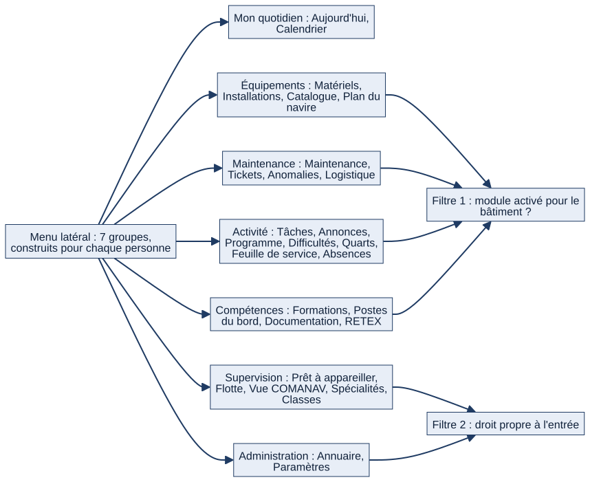

# Chapitre 17 — Interface, ergonomie, parcours et poste de travail

> **Pour qui :** marins, responsables, développeurs. **Diffusion :** générale (mécanismes et références dans la partie restreinte du dossier).
> **Ce que vous y trouverez :** comment l'interface est pensée (PC fixe, poste partagé, réseau du bord), comment on s'y repère, comment on saisit vite, ce que Matrix fait sur mobile et tablette, les parcours types par profil, ce que le PO a observé en recette et ce qui reste cible.
> **État décrit :** état B (`6d6d0be`), non fusionné dans `main`. Légende : 🟢 réel vérifié, 🔵 cible ou observation du PO, ⚪ non vérifié. Sources métier lues : cahier UX `docs/UX.md` (décisions du 02/10/2026), Notion « Cap UX/UI Naval Premium » (29/10/2026) et « Recette UX V1.1 » (31/10/2026).

---

## 17.1 Les principes

| Principe | Ce que cela veut dire |
|---|---|
| **Dense en fonctions, calme à l'écran** | Un marin ouvre Matrix, comprend sa situation, voit ce qui demande son attention et sait quoi faire. Rien n'expose toute la complexité en permanence. |
| **PC fixe d'abord** | Matrix s'utilise au clavier et à la souris sur les postes du réseau du bâtiment. Tablette et QR code sont des **options** : aucun parcours n'en dépend. |
| **Maintenance « papier puis saisie »** | La fiche s'imprime, l'entretien se fait sur place, la saisie suit sur un PC : la **fiche imprimable** et la **saisie en grille** sont des livrables de premier plan. |
| **Poste partagé** | Plusieurs marins se relaient sur la même machine : on voit toujours qui est connecté, on se déconnecte en un clic, un travail en cours n'est jamais perdu. |
| **Poste ancien** | Référence **1366 × 768**, pages légères, pas d'animation coûteuse ni de bibliothèque JavaScript lourde. |
| **Hors Internet** | Polices, icônes, graphiques et calendrier sont **embarqués** : aucune ressource distante. |
| **Aide progressive** | L'explication détaillée s'ouvre à la première visite, puis laisse une interface plus calme ; elle se rouvre à tout moment. **On ne retire jamais** une information réglementaire, une alerte critique ou une confirmation de sécurité. |
| **Droits côté serveur** | L'interface adapte ce qu'elle montre, mais **c'est toujours le serveur qui décide** : masquer un bouton n'est pas une protection. |

## 17.2 Le menu : une carte construite pour chaque personne

*Schéma S34 — Les sept groupes du menu et leurs deux filtres.*

Le menu latéral compte **sept groupes** : Mon quotidien, Équipements, Maintenance, Activité, Compétences, Supervision, Administration. Il est **calculé pour chaque personne** :
1. **Module activé ?** Une entrée dont le module est **désactivé pour le bâtiment** disparaît (le commandant active ou désactive un module pour son bâtiment ; aucune donnée n'est supprimée).
2. **Droit propre** : certaines entrées exigent un droit (le plan du navire à configurer, la Vue flotte, la Vue COMANAV, les dashboards de spécialité et de classe, l'annuaire pour le commandement).
3. **Une entrée « Prêt à appareiller »** est ouverte à tout marin ; l'ouverture et la signature d'une session restent réservées (chapitre 16).

Chaque marin **replie ou déplie** les groupes ; ce choix est **enregistré dans son profil** (pas dans le navigateur), retrouvé à la reconnexion, et **ne donne ni ne retire aucun droit**. Au premier affichage seul « Mon quotidien » est déplié. La barre latérale elle-même peut être **repliée**.

⚪ Le PO a relevé en recette un menu de **24 entrées** pour un équipier à 1366 × 768 (parfois coupé). Le regroupement en sept groupes répond à cette observation ; la recette sur poste réel n'a pas été rejouée ici.

## 17.3 Les écrans que le marin rencontre

- **Aujourd'hui** (chapitre 6) : « À faire » trié par urgence, « Ma journée », « Mes tours de service », indicateurs cliquables, notifications.
- **Fiches métier** : une anatomie commune (titre, état, actions possibles, onglets, historique, discussion attachée) pour le matériel, les installations, les tickets, les tâches.
- **Cartes et indicateurs** : un chiffre mène toujours au dossier filtré ; un graphique n'est utilisé que s'il aide une décision.
- **Calendrier** (chapitre 7) : événements compacts, vue semaine, retour à « Aujourd'hui ».
- **Recherche globale** : une barre en haut de chaque page, raccourci **Ctrl + K**, résultats limités au **périmètre** de la personne et aux modules activés.
- **Pages d'erreur** : 400, 403, 404 et 500 sont **habillées** et expliquent sans exposer de détail technique ; une saisie invalide (caractère interdit, longueur, date) donne **un message**, jamais une erreur 500.
- **Mode sombre** : choisi par chaque marin (usage de nuit à la passerelle, locaux à éclairage réduit), mémorisé dans son profil ; le mode clair est le défaut ; les couleurs d'état gardent leur sens.
- **Impression** : une feuille de style commune ; la fiche de maintenance et les listes s'impriment lisiblement, y compris en noir et blanc.

## 17.4 Saisir plus vite qu'avec Excel

| Besoin | Réponse de l'interface |
|---|---|
| Créer quelque chose de complexe (matériel, anomalie, liste) | **Assistant** en quelques étapes, champs pré-remplis |
| Saisir beaucoup de lignes de même nature (relevés, exemplaires de matériel, compte rendu en série) | **Grille façon tableur** : Tab et flèches, **collage depuis Excel** (colonnes séparées par tabulation) |
| Ne pas perdre un travail commencé | **Brouillons enregistrés automatiquement**, repris plus tard ; conservés 30 jours par défaut (réglable, 0 = jamais purgés), taille bornée |
| Éviter une erreur lourde | **Confirmation explicite** avant un acte critique (remise en service, clôture d'une installation critique, signature d'appareillage) : sans elle, rien n'est écrit et le **refus est tracé** |
| Corriger après coup | Saisie d'origine conservée, motif obligatoire (chapitre 12) |
| Un fichier à joindre | Contrôle du type et de la taille (20 Mo par défaut, réglable) ; fichiers servis **uniquement après contrôle des droits** |

## 17.5 Le poste partagé et la sécurité de l'interface

- La **personne connectée est toujours visible** (nom, grade, équipage) dans la barre supérieure ; la déconnexion est accessible partout.
- **Déconnexion automatique après inactivité** : **15 minutes par défaut** (réglable de 1 minute à 8 heures), avec un **préavis** de 60 secondes (réglable). Le brouillon en cours est conservé.
- **Écriture refusée si la page a été ouverte pour un autre marin** : si un collègue s'est connecté sur le même poste entre-temps, l'action de l'onglet resté ouvert est refusée plutôt qu'attribuée à la mauvaise personne.
- **Mot de passe provisoire** : changement obligatoire avant toute autre page.
- **Équipage à terre** : un bandeau court rappelle l'accès limité ; la lecture seule est appliquée par le serveur (chapitre 5).

## 17.6 Mobile, tablette et poste de bord

🟢 **Ce qui existe.** Pages à mise en page fluide (Bootstrap) ; le cahier UX demande des zones d'action d'au moins 44 px sur les écrans opérationnels (⚪ non mesuré) ; QR code imprimable sur les fiches d'équipement qui ouvre le contrôle du jour, **manifeste d'application web** (nom, icônes, affichage « application ») et **service worker** dédié aux **notifications push**. Le Web Push demande **HTTPS ou `localhost`** et des **clés VAPID** ; sans elles il est simplement désactivé.

🟢 **Ce qui n'existe pas.** Aucune **application native** ; aucun **mode hors-ligne** : le service worker ne met rien en cache et ne rejoue aucune saisie. Sans réseau, une saisie n'est pas enregistrée.

⚪ **Ce qui n'a pas été vérifié.** L'affichage sur téléphone et tablette réels, Safari sur iPhone, Firefox, lecteurs d'écran (VoiceOver, NVDA), Windows et l'impression physique : la checklist `docs/COMPATIBILITE_CHECKLIST.md` demande de noter ces contrôles « non effectué » quand ils ne sont pas rejoués ; **ils ne le sont pas dans ce dossier**.

**Position du PO** : le PC fixe reste le support principal ; la tablette et le scan de QR code sont des options.

## 17.7 Trois parcours, vus par l'interface

> Exemples fictifs, données de démonstration uniquement.

**Le matelot (équipier).** Il ouvre Matrix, lit en cinq secondes « À faire » (le retard d'abord), ouvre sa tâche, la met à jour ; il trouve son prochain quart dans « Mes quarts » et son prochain tour dans « Mes tours de service » ; il signale une anomalie depuis la fiche d'un équipement ; il ferme sa session en un clic.

**Le chef de secteur.** Il voit ses retards de maintenance et les validations qui l'attendent dans « Supervision », assigne un ticket, visa une fiche, ouvre une session d'appareillage, consulte la Vue flotte de son périmètre ; chaque chiffre ouvre le dossier filtré.

**L'acteur à terre (responsable de spécialité ou de classe).** Il choisit un bâtiment dans le sélecteur, consulte une carte par bâtiment, **commente** sans valider ; il ne voit que la lecture seule.

**L'administrateur d'unité (Paramètres).** Il règle les seuils de rôle de son bâtiment, active les modules, gère la relève de l'équipage (chapitres 4 et 5).

## 17.8 Les Paramètres : l'administration par l'interface

La page **Paramètres** est découpée en onglets réservés selon le rôle :

| Onglet | Qui | Contenu |
|---|---|---|
| **Notification quotidienne** | Chaque marin | Heures de « Ma journée » du matin et du soir |
| **Sécurité (seuils de rôle)** | Administrateur d'unité | Seuils de rôle des 35 actions, **par bâtiment** (chapitre 5, annexe B) |
| **Modules** | Commandement (seuil `module_gestion`) | Activer ou désactiver un des 14 modules pour son bâtiment |
| **Équipage** | Commandant, commandant en second, administrateur d'unité d'un bâtiment à double équipage | Relève, fuseau, génération de la passation (chapitre 4) |
| **Utilisateurs et responsables** | Rôle habilité (seuil `responsabilite_transverse_gestion`) | Désignation des responsables de spécialité et de classe |
| **Référentiels, navires, hiérarchie, journal** | Comptes techniques (administrateur général) | Grades, spécialités, fonctions, unités et hiérarchie, bigrammes, paramètres des tâches, annonces et passation, paramètres de vibration, journal |

Principe du projet : **configuration plutôt que code** (durée d'un délai d'inactivité, conservation des brouillons, taille des fichiers, seuils de rôle, modules). L'archivage remplace la suppression pour les unités (chapitre 4).

## 17.9 La charte « Naval Premium »

Orientation validée par le PO (29/10/2026) : **fiable, simple, rapide, professionnel, visuellement désirable**, sans effet décoratif au détriment du travail quotidien.
- Bandeau haut sombre, fond clair, cartes ; polices **Inter** et **Space Grotesk**, mono réservée aux micro-libellés ; icônes au trait ; **cyan « Signal » rare**, réservé aux actions et états importants ; la sémantique des couleurs métier et sécurité est conservée.
- Les textes de procédure apparaissent **au moment utile** (aide contextuelle, formulaire, confirmation), pas en pavés permanents.
- L'exemple approuvé : un long bandeau « lecture seule » devient une ligne courte avec un bouton « Comprendre mes droits » ; **les permissions réelles ne changent pas**.

⚪ Le **design system** (logo, charte graphique) vit dans le sous-module `design/`, **vide dans l'environnement de rédaction** : sa description vient des documents du dépôt, pas du sous-module.

## 17.10 Observations de recette du PO (31/10/2026) — pas des décisions

Les pages Notion de recette consignent des **observations** d'un seul passage, sur la V1.1 tranche 1 (`a1503ac`) : barre supérieure jugée lourde (PO-01), zone vide sur l'accueil (PO-03), reprise de brouillon d'anomalie en erreur 404 (PO-04), carte « Mes services de garde » à rebaptiser « Mes tours de service » (PO-05), cartes non cliquables (PO-06), graphiques peu actionnables (PO-07, PO-08), textes d'accompagnement envahissants (PO-09), fiches de maintenance fictives trop vides (PO-10, PO-21), notifications verbeuses (PO-13), Web Push inactif dans la démonstration isolée (PO-14), notifications lues encore visibles (PO-15), page des quarts peu claire pour un équipier (PO-16).

**Statut :** ce sont des **constats qualifiés « à décider »**, pas des règles. Le dossier ne les présente ni comme corrigés ni comme non corrigés dans l'état B ⚪ : seuls ceux qui ont un écart au registre sont suivis (A11 : libellé « Mes tours de services »). Le défaut de droits PO-17 (un matelot pouvait créer une feuille de service) est traité au chapitre 8 : la rédaction est confiée à un **rédacteur désigné**.

## 17.11 Fonctionnement cible 🔵

- **Ergonomie (lot L24)** : plusieurs petits lots indépendants — liens et boutons morts, titres d'onglet, « Mes tours de services », niveau « Critique », archivage des notifications lues (`DEC-UX-01` à `DEC-UX-11`).
- **Favoris épinglés** en tête du menu, par compte (PO-19), **recherche de personnes** limitée aux informations professionnelles autorisées (PO-18), **formulaires RH configurables** (PO-20) : « à faire plus tard », **non décidés** comme règles.
- **Préférence d'aide par compte**, déjà enregistrée dans le profil ; détails de composants et de premier usage à prototyper et valider par le PO.
- **Tranches suivantes** du cap V1.1 (calendrier, fiches et listes, finitions) : non ouvertes.

## 17.12 Limites et éléments non vérifiés

- ⚪ Aucune recette navigateur n'a été rejouée pour ce dossier (Chrome, Firefox, Safari, mobile, clavier, impression, lecteur d'écran).
- ⚪ Sous-module `design/` non initialisé.
- ⚪ Les observations PO-xx sont des constats d'un seul passage, non reproduits.
- 🟢 Tests de l'interface de l'état B : tests Django de la navigation, des composants, des contrastes, de l'inactivité, des brouillons, de la grille et du manifeste, plus quatre tests JavaScript exécutables avec Node (grille, brouillon, compte rendu, inactivité) ; non rejoués dans cette édition.

---

**Sources (état B).** `matrix/core/navigation.py`, `matrix/templates/`, `matrix/static/`, `accounts/preferences.py`, `matrix/core/inactivite.py`, `matrix/core/brouillons.py` ; `docs/UX.md` ; Notion « Cap UX/UI », « Recette UX V1.1 ». Références dans la partie restreinte du dossier.
