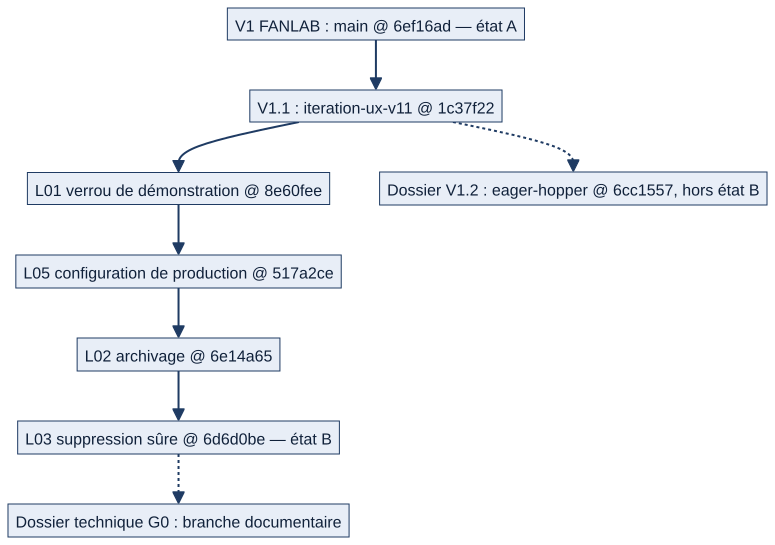

# Chapitre 26 — Historique des versions et des lots

> **Pour qui :** responsables, développeurs. **Diffusion :** générale pour la chronologie ; les branches, les SHA et les états de fusion sont dans la partie restreinte du dossier. **État décrit :** état B (`6d6d0be`), non fusionné dans `main`.
> **Ce que vous y trouverez :** d'où vient Matrix, ce que chaque version et chaque lot a changé, et ce qui est — ou n'est pas — fusionné dans `main`. Pour savoir **ce que fait le logiciel**, lire les chapitres 1 à 16 ; ce chapitre répond à « **quand et pourquoi** ».

---

## 26.1 Deux états, à ne pas confondre

| État | Contenu | Où |
|---|---|---|
| **A** | **V1 FANLAB**, fusionnée dans `main` (PR #16) le 28/10/2026 | `main` @ `6ef16ad` |
| **B** | A + V1.1 + lots **L01, L05, L02, L03**, **non fusionnés** | `claude/l03-suppression-sure-v11` @ `6d6d0be` |

**Le dossier décrit l'état B**, qui est le plus avancé et celui que le PO a demandé de documenter ; l'état A sert de comparaison. **Rien de B n'est dans `main`.**

Entre A et B : **127 commits**, dont **117** pour la V1.1 et **10** pour les quatre lots ; environ **422 fichiers modifiés**, 21 000 lignes ajoutées et 2 600 supprimées (ordre de grandeur, documentation comprise).

## 26.2 La chronologie

*Schéma S40 — De la V1 à l'état B.*

| Date | Jalon | Ce que cela a apporté |
|---|---|---|
| **03/09/2026** | Ancien découpage en six phases (fondation, calendrier, maintenance préventive et corrective, formation, matériel) | Statuts établis à partir de preuves dans le code ; calendrier et formation jugés terminés |
| **06/09/2026** | **Nouvelle feuille de route « Matrix 2.0 »** : huit phases (0 à 7) | Elle remplace l'ancien découpage pour la suite ; l'historique est conservé |
| **10/10/2026** | PR n° 6 (refonte de l'accueil, double équipage, catalogue, maintenance, planning, absences, feuille de service, notifications) et PR n° 7 (travail local et intégration) **fusionnées** | `main` @ `dfd6a3c` ; la « passation automatique » et l'« organisation miroir » sont retirées de `main` et différées |
| **09–10/10/2026** | **Cap de démonstration** : « une semaine dans un service » (organiser → affecter → consulter → exécuter ou signaler → suivre) | Priorité à la valeur quotidienne ; la génération automatique des tours est **abandonnée** |
| **13–27/10/2026** | Recette V1, sécurité des périmètres, fiabilité (annonces, quarts, stock), PostgreSQL, feuille de service (escalade, historisation, rectificatif, suivi), confirmations des actes critiques, cahier UX | Chaîne feuille de service et échanges ; durcissement |
| **21–27/10/2026** | **Consolidation de la V1 FANLAB** (`integration/v1-fanlab-20261021`) | Branche d'intégration de `main` |
| **28/10/2026** | **V1 FANLAB fusionnée dans `main`** (PR n° 16) — **état A** | `main` @ `6ef16ad` |
| **28/10/2026** | **Priorité sécurité** décidée par le PO : garde-fou des commandes de démonstration | Donnera L01 |
| **29/10/2026** | **Cap UX/UI « Naval Premium »** : décisions produit ; **GO démonstration encadrée, NO GO déploiement opérationnel** | Cadre de la V1.1 |
| **31/10/2026** | **V1.1 tranche 1** (`a1503ac`) : prototype Naval Premium ; protocole de recette UX ; observations du PO PO-01 à PO-21 | Kit de démonstration figé |
| **01/11/2026** | Correctifs métier et UX (`recette-metier-ux-v11-20261101`) | Ordre de travail « correctifs métier et UX » du 01/11 (la correction des droits de la feuille de service, PO-17, y est cadrée) |
| **05/11/2026** | **V1.1** (`1c37f22`, `iteration-ux-v11-20261102`) ; audit général de la V1.1 | Base de tous les lots ; source du dossier V1.2 |
| **10–11/11/2026** | **Dossier V1.2** : 125 décisions du PO, 47 anomalies, plan en 28 lots | Document de décision (ne contient pas de code) |
| **10/11/2026** | **L01** — verrou des commandes de démonstration | Voir §26.3 |
| **10/11/2026** | **L05** — configuration de production minimale | Voir §26.3 |
| **11/11/2026** | **L02** — archivage effectif des unités | Voir §26.3 |
| **11/11/2026** | **L03** — suppression sûre des unités — **état B** | `6d6d0be` |
| **11/11/2026** | **Dossier technique G0** (cette documentation) | Branche documentaire dédiée |

## 26.3 Ce que chaque lot a changé

Les quatre lots sont **empilés** (chacun construit sur le précédent) et **aucun n'est fusionné**.

| Lot | Anomalies traitées | Ce qui change pour le logiciel | Migration |
|---|---|---|---|
| **L01** — verrou de démonstration | AUD-009 | Les quatre commandes de données fictives refusent de s'exécuter hors d'une base de démonstration marquée ; mots de passe de démonstration générés au hasard ou fournis ; réinitialisation qui les renouvelle ; adoption explicite des anciennes bases ; contrôle `verifier_instance` ; recette Windows | **Oui** (marqueur de l'instance de démonstration, migration 0022) |
| **L05** — configuration de production | AUD-010, AUD-017 | Refus de démarrer en production avec une clé secrète trop faible ou un mot de passe de base trivial | Non |
| **L02** — archivage effectif | AUD-028 | Les unités s'archivent et se réactivent ; les sélecteurs d'affectation ignorent les unités archivées ; refus de rattacher du matériel à une unité archivée ; correction des contournements restants (stock, listes de quarts, exigences de formation, catalogue, Paramètres) | Oui (champ d'archivage) |
| **L03** — suppression sûre | AUD-020 | Une unité référencée ne se supprime plus : refus avec le détail, en web comme en API (409) ; protections contre les suppressions en cascade | Non (voir chapitre 4) |

Chaque lot a donné lieu à un **compte rendu** dans le dossier V1.2 (`N_LOT_L01…`, `O_LOT_L05…`, `P_LOT_L02…`, `Q_LOT_L03…`), à une **relecture** et à des **tests** (suite complète : 3 963 tests OK, 20 ignorés, sur SQLite, au dernier lot).

## 26.4 Ce que le dossier V1.2 n'a pas changé

Le dossier V1.2 **ne contient aucun code applicatif** : il consigne des décisions, des anomalies et un plan. Les anciennes recommandations remplacées par une décision du PO sont signalées (par exemple, la validation d'un RETEX « par le COMA référent d'abord » est **caduque**, remplacée par `DEC-RTX-01`).

## 26.5 Limites : ce qui n'est pas dans l'historique

- ⚪ Le dépôt compte **52 branches distantes** (à la date de l'inventaire) ; seules celles qui expliquent l'évolution sont analysées (annexe F, restreint). Les autres sont **listées sans analyse**.
- ⚪ Les versions antérieures à septembre 2026 (premier code, anciennes phases) ne sont **pas reconstituées** : le dossier ne s'appuie que sur la feuille de route Notion pour cette période.
- ⚪ Aucune **balise de version** (tag) n'existe : la V1 « non publiée » est repérée par son commit.
- ⚪ Aucun **déploiement** n'est consigné : aucune version n'a été mise en production réelle (NO GO du PO).

---

**Sources.** Git (branches, dates, commits), dossier V1.2 (comptes rendus de lots), Notion « Feuille de route » (10/10/2026), « Cap UX/UI » (29/10/2026), « Recette UX V1.1 ». Détail des branches : la partie restreinte du dossier, annexe F.
