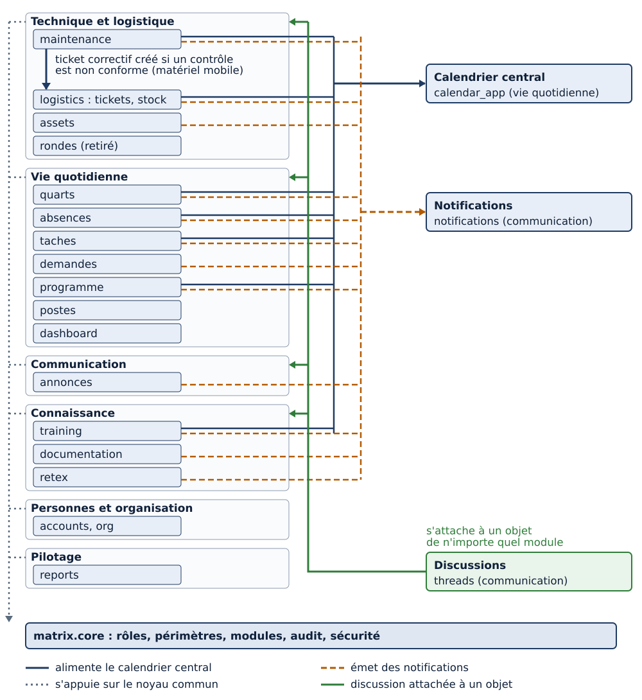

<!-- couvre: diffusable/02_vue_ensemble.md | Chapitre 2 — Vue d'ensemble : modules, acteurs et parcours-types -->
<!-- couvre: diffusable/02_vue_ensemble.md | 2.1 La carte des modules -->
<!-- couvre: diffusable/02_vue_ensemble.md | 2.2 Ce que voit le marin : le menu -->
<!-- couvre: diffusable/02_vue_ensemble.md | 2.3 Les acteurs -->
<!-- couvre: diffusable/02_vue_ensemble.md | 2.4 Trois journées-types -->
<!-- couvre: diffusable/02_vue_ensemble.md | Le marin -->
<!-- couvre: diffusable/02_vue_ensemble.md | Le chef de section ou de secteur -->
<!-- couvre: diffusable/02_vue_ensemble.md | L'acteur à terre -->
<!-- couvre: diffusable/02_vue_ensemble.md | 2.5 Comment les modules s'enchaînent -->
<!-- couvre: diffusable/02_vue_ensemble.md | 2.6 Limites et éléments non vérifiés -->
<!-- partie: Cadre -->
# Vue d'ensemble : modules, acteurs et parcours-types

<b>Public :</b> tous · <b>Ce que vous y trouverez :</b> la carte de Matrix (ce qu'il contient, qui s'en sert), et trois journées-types pour comprendre comment les pièces s'assemblent. Chaque domaine est détaillé dans les chapitres suivants

## La carte des modules

Matrix est composé de **22 ensembles de code**, appelés *paquets* : 21 applications fonctionnelles et un noyau commun (`matrix.core`) qui porte les règles partagées (rôles, périmètres, modules, sécurité). Le schéma ci-dessous les regroupe par grande fonction ; le menu de l'application, lui, est organisé en sept groupes de navigation (la section « Ce que voit le marin : le menu »).

**Relations représentées** (une ligne par type de flèche du schéma ci-dessus ; les flèches fonctionnelles — calendrier, notifications, discussions, ticket — décrivent ce que les modules font les uns pour les autres, la dernière série décrit la dépendance technique au noyau commun)

| De | Condition ou passage | Vers |
|---|---|---|
| `maintenance` | un contrôle est non conforme sur un **matériel mobile** (pas sur une installation : NE-07 ; 🟣 proposition D1) | `logistics` : ticket correctif créé automatiquement |
| `absences`, `logistics`, `maintenance`, `programme`, `quarts`, `taches`, `training` | leurs événements ont une date | `calendar_app` : calendrier central du marin |
| `absences`, `annonces`, `assets`, `demandes`, `documentation`, `logistics`, `maintenance`, `programme`, `quarts`, `retex`, `taches`, `training` | un événement du module appelle une alerte, un rappel ou une validation | `notifications` : notifications (« presque tous les modules ») |
| `threads` : discussions | une discussion s'attache à un objet | un objet de n'importe quel module (tâche, équipement, ticket, formation…) |
| Personnes et organisation : accounts, org | s'appuie sur (dépendance technique) | matrix.core : rôles, périmètres, modules, audit, sécurité |
| Vie quotidienne : dashboard, calendar_app, quarts, absences, taches, demandes, programme, postes | s'appuie sur (dépendance technique) | matrix.core : rôles, périmètres, modules, audit, sécurité |
| Communication : threads, annonces, notifications | s'appuie sur (dépendance technique) | matrix.core : rôles, périmètres, modules, audit, sécurité |
| Technique et logistique : assets, maintenance, logistics, rondes (retiré) | s'appuie sur (dépendance technique) | matrix.core : rôles, périmètres, modules, audit, sécurité |
| Connaissance : training, documentation, retex | s'appuie sur (dépendance technique) | matrix.core : rôles, périmètres, modules, audit, sécurité |
| Pilotage : reports | s'appuie sur (dépendance technique) | matrix.core : rôles, périmètres, modules, audit, sécurité |

| Domaine | Ce qu'il fait | Paquets | Chapitre |
|---|---|---|---|
| Personnes et organisation | Comptes, rôles, grades, bâtiments, services, secteurs, sections, double équipage | `accounts`, `org` | [[RF:04_organisation]], [[RF:05_roles_et_autorisations]] |
| Accueil et pilotage | Page « Aujourd'hui », tableaux de bord par niveau, bilans et exports | `dashboard`, `reports` | [[RF:06_fiche_accueil_pilotage]] |
| Calendrier | Calendrier central du marin et du bâtiment | `calendar_app` | [[RF:07_fiche_calendrier]] |
| Quarts et services | Listes de quarts et de gardes, feuille de service, échanges, absences | `quarts`, `absences` | [[RF:08_fiche_quarts_services_feuille]] |
| Communication | Discussions attachées aux objets, annonces, notifications, recherche | `threads`, `annonces`, `notifications` | [[RF:09_fiche_communication]] |
| Tâches et vie du bâtiment | Tâches, difficultés signalées, programme du bâtiment, postes du bord | `taches`, `demandes`, `programme`, `postes` | [[RF:10_fiche_taches_demandes_programme_postes]] |
| Matériel et maintenance | Matériels, installations, plans de maintenance, anomalies, tickets, stocks | `assets`, `maintenance`, `logistics` | [[RF:11_fiche_materiel_installations]], [[RF:12_fiche_maintenance]], [[RF:13_fiche_logistique]] |
| Connaissance | Formations et qualifications, documentation, retours d'expérience | `training`, `documentation`, `retex` | [[RF:14_fiche_formations]], [[RF:15_fiche_documentation_retex]] |
| Appareillage | Préparation et signature du prêt à appareiller | `dashboard` | [[RF:16_fiche_preparation_appareillage]] |
| Rondes de contrôle | Module retiré fonctionnellement ; code conservé | `rondes` | [[RF:12_fiche_maintenance]] |
| Noyau | Rôles, périmètres, seuils, modules activables, double équipage, audit, sécurité | `matrix.core` | [[RF:05_roles_et_autorisations]], [[DT:18_architecture]], [[DT:22_securite]] |

**Mesures de l'état B** (inventaire généré depuis le code) : {{fait:n_modeles}} modèles de données, {{fait:n_routes}} routes (pages et points d'API), {{fait:n_taches_planifiees}} tâches planifiées, {{fait:n_commandes}} commandes de gestion.

## Ce que voit le marin : le menu

Le menu latéral est le même pour tous dans sa structure, mais chacun ne voit que ce qu'il a le droit d'ouvrir et que le bâtiment a activé. Sept groupes, dont seul le premier est ouvert par défaut :

| Groupe | Entrées |
|---|---|
| Mon quotidien | Aujourd'hui, Calendrier |
| Équipements | Matériels, Installations, Catalogue, Plan du navire |
| Maintenance | Maintenance, Tickets correctifs, Anomalies, Logistique |
| Activité | Tâches, Annonces, Programme du bâtiment, Difficultés signalées, Quarts et tours de service, Feuille de service, Absences |
| Compétences | Formations, Postes du bord, Documentation, RETEX |
| Supervision | Prêt à appareiller, Flotte, Vue COMANAV, Spécialités, Classes de navire |
| Administration | Annuaire, Paramètres |

Deux mécanismes décident de ce qui apparaît (détaillés au [[RF:05_roles_et_autorisations]]) :
1. **Les modules activés pour le bâtiment.** Un bâtiment peut masquer, par exemple, « Postes du bord » : l'entrée de menu et les pages disparaissent, mais **aucune donnée n'est supprimée** ; réactiver le module fait tout réapparaître.
2. **Les droits de la personne.** Par exemple, « Annuaire » n'apparaît qu'à partir du niveau commandant en second ; « Flotte » à partir de chef de section. Le menu masque ; c'est toujours le serveur qui décide, à chaque action.

## Les acteurs

Matrix distingue cinq notions qu'il ne faut pas confondre : le **grade** (rang de la personne), la **fonction exercée** (ce qu'elle fait réellement : chef de liste, BSC, COMAEQ…), le **périmètre** (où elle agit : sa section, son secteur, son service, son bâtiment), l'**habilitation** (ce qu'on l'autorise à faire dans Matrix) et le **brevet** (ce qu'elle sait faire). Les droits viennent de la fonction et du périmètre, jamais du seul grade.

| Acteur | Ce qu'il fait dans Matrix |
|---|---|
| **Équipier / marin** | Consulte sa journée, exécute ses tâches, déclare un blocage, signale une anomalie, demande un échange de tour |
| **Chef de section** | Attribue les tâches de sa section, suit son équipe |
| **Chef de secteur** | Supervise le secteur, attribue et réaffecte, décide des suites des anomalies |
| **Chef de service** | Supervise son service, approuve les circuits de son niveau |
| **Commandant adjoint** (COMAEQ, COMOPS, COMANAV, COMAVIA) | Compétent pour les services qui lui sont rattachés ; le COMAEQ vise la feuille de service ; le COMANAV signe le prêt à appareiller |
| **Commandant, commandant en second** | Vision globale du bâtiment ; le second supplée le commandant pour la relève |
| **BSC** | Prépare et imprime la feuille de service |
| **Chef de liste** | Prépare les listes de quarts et de gardes |
| **Administrateur d'unité / administrateur général** | Administre la plateforme et le bâtiment (comptes, structure, réglages) |
| **Équipage à terre (B)** | Consulte son bâtiment en lecture seule ; tient sa propre feuille de service |
| **Soutien à terre** (responsable de classe ≈ IRB, responsable de spécialité ≈ ALFAN Exploitation) | Consulte les bâtiments qu'il suit et commente ; n'agit que dans les circuits prévus |

🔵 Le rôle de **suppléant** (exercer temporairement une fonction d'un autre) est validé en principe mais **non développé** : aujourd'hui, seul le chef de liste est suppléable ([[RF:25_cible_et_feuille_de_route]]).

## Trois journées-types

> 🟢 Les écrans de ces parcours ont été rejoués sur l'instance de démonstration le 16/11/2026 (guide utilisateur) ; ⚪ l'enchaînement complet d'une journée n'a pas été rejoué de bout en bout. Les captures viendront avec la recette navigateur ([[RF:17_principes_interface]]). Les données de l'exemple sont fictives.

### Le marin

1. Il ouvre **Aujourd'hui**. La page lui présente un « À faire » trié par urgence (retard, attente de validation, le reste), une frise « Ma journée » avec ses quarts, services, tâches et formations, et ses notifications.
2. Il ouvre sa **tâche** de la matinée : il y trouve la consigne, la checklist, le fil de discussion attaché. Il pose une question à un collègue dans ce fil ; la discussion reste liée à la tâche.
3. Il **exécute** une maintenance guidée. Si un contrôle sur un **matériel mobile** est non conforme, un **ticket correctif** est créé automatiquement et les chefs sont alertés ; sur une **installation**, aucun ticket n'est créé (le marin signale lui-même une anomalie ; 🟣 un ticket automatique pour une installation est la proposition D1, non arbitrée). Un relevé chiffré hors plage propose un lien pré-rempli « signaler une anomalie ».
4. Il consulte son **calendrier** : un quart demain à 06 h. Un collègue lui propose un **échange de tour** : il accepte, puis la demande est validée par la personne qui gère la liste. 🔵 Règle cible validée par le PO : le chef de liste ou le BSC instruit, et le COMAEQ (ou son suppléant) décide ; elle n'est pas encore en place ([[RF:08_fiche_quarts_services_feuille]] et [[RF:25_cible_et_feuille_de_route]]). ⚪ L'effet de l'échange sur les deux calendriers est décrit au [[RF:08_fiche_quarts_services_feuille]].
5. Le soir, il reçoit le récapitulatif « Ma journée de demain ».

### Le chef de section ou de secteur

1. Sur **Aujourd'hui**, un bloc « Supervision » (à partir du niveau chef de secteur par défaut) affiche les retards et les validations en attente de son périmètre.
2. Il **attribue** des tâches à ses marins, suit leur avancement, traite une anomalie remontée.
3. Il consulte la **Vue flotte** limitée à son périmètre (section, secteur, bâtiment ou flotte selon son rôle).
4. Il ne voit et ne modifie que ce qui relève de **son périmètre** ; toute modification importante est tracée.

### L'acteur à terre

1. Un responsable de classe ou de spécialité, sans rattachement à un bâtiment, arrive sur une page « Aujourd'hui » adaptée : les **bâtiments qu'il suit**, avec ce qui demande son attention.
2. Il **consulte** et **commente** (par exemple un ticket) ; il ne modifie pas les données du bord.
3. L'équipage B à terre, lui, voit son propre bâtiment en lecture seule, mais garde sa feuille de service propre.

## Comment les modules s'enchaînent

Matrix n'est pas une juxtaposition de silos : une donnée créée dans un module alimente les autres. Quelques enchaînements concrets (détail au [[DT:21_interactions_modules]]) :

- une **exécution de maintenance non conforme sur un matériel mobile** crée un **ticket correctif** (maintenance → logistique) ; pour une installation, aucun ticket automatique n'est créé (NE-07 ; 🟣 proposition D1) ;
- les **quarts, services, tâches, formations et absences** alimentent le **calendrier** unique du marin ;
- presque tous les modules émettent des **notifications** (rappels, validations attendues, alertes de stock) ;
- une **discussion** s'attache à un objet de n'importe quel module (tâche, équipement, ticket, formation…).

## Limites et éléments non vérifiés

- ⚪ L'enchaînement complet des trois journées-types n'a pas été rejoué de bout en bout ; leurs écrans l'ont été.
- ⚪ La correspondance « responsable de classe ≈ IRB » et « responsable de spécialité ≈ ALFAN Exploitation » vient de la page Notion « 13 — Décisions » ; elle n'est pas modélisée dans le code au-delà des deux désignations `ResponsableClasseNavire` et `ResponsableSpecialite`.
- 🔵 Les échanges entre le bord et la terre (chat contextuel, procédures officielles de type PÉPIN/CRAT) sont des orientations validées, non développées, et dont les circuits exacts ne sont pas encore validés.

**Sources (état B).** Code de l'état B : navigation, modules activables, page « Aujourd'hui », bâtiments suivis à terre, soutien à terre, chaîne de contrôle des requêtes (références de code dans le dossier technique à accès restreint). Notion : « Organigramme et rôles », « 13 — Décisions Matrix et gouvernance fonctionnelle ».
