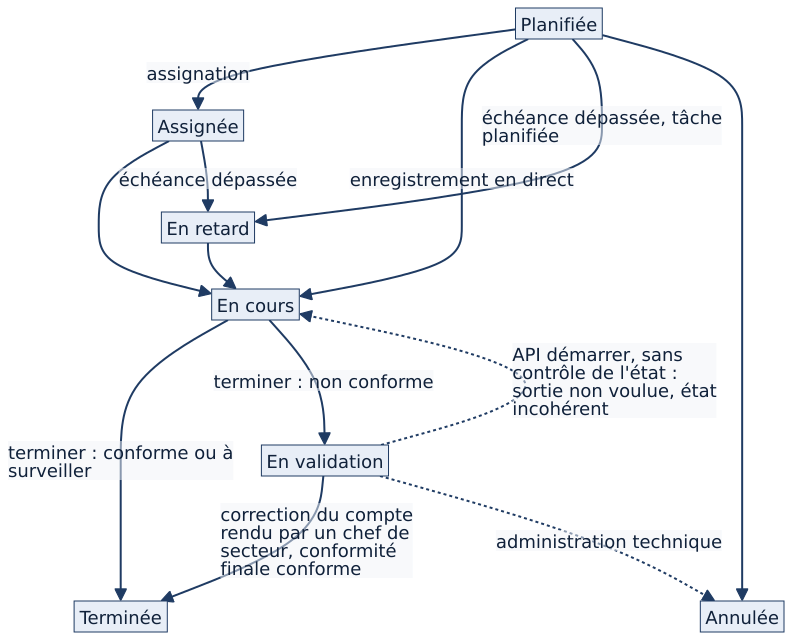
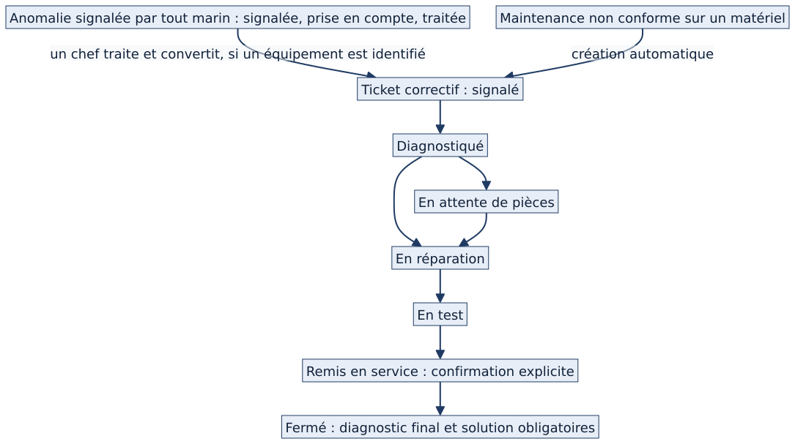

<!-- couvre: diffusable/12_maintenance_anomalies_tickets.md | Chapitre 12 — Maintenance, anomalies, tickets correctifs -->
<!-- couvre: diffusable/12_maintenance_anomalies_tickets.md | 12.1 Trois objets, trois usages -->
<!-- couvre: diffusable/12_maintenance_anomalies_tickets.md | 12.2 Du plan à la réalisation -->
<!-- couvre: diffusable/12_maintenance_anomalies_tickets.md | 12.3 Ce que fait le marin qui exécute -->
<!-- couvre: diffusable/12_maintenance_anomalies_tickets.md | 12.4 Le cycle de vie d'une échéance -->
<!-- couvre: diffusable/12_maintenance_anomalies_tickets.md | 12.5 L'anomalie : « j'ai vu quelque chose » -->
<!-- couvre: diffusable/12_maintenance_anomalies_tickets.md | 12.6 Le ticket correctif -->
<!-- couvre: diffusable/12_maintenance_anomalies_tickets.md | 12.7 Détection de dérive et alertes -->
<!-- couvre: diffusable/12_maintenance_anomalies_tickets.md | 12.8 Droits en un coup d'œil -->
<!-- couvre: diffusable/12_maintenance_anomalies_tickets.md | 12.9 Interactions avec les autres modules -->
<!-- couvre: diffusable/12_maintenance_anomalies_tickets.md | 12.10 Cas particuliers -->
<!-- couvre: diffusable/12_maintenance_anomalies_tickets.md | 12.11 Fonctionnement cible 🔵 -->
<!-- couvre: diffusable/12_maintenance_anomalies_tickets.md | 12.12 Limites et éléments non vérifiés -->
<!-- partie: Modules -->
# Maintenance, anomalies et tickets correctifs

<b>Public :</b> responsables métier, commandement · <b>Module :</b> maintenance, anomalies, tickets · <b>Écran de référence :</b> [[GU 1]] · <b>Étiquettes :</b> 🟢 actuel vérifié · 🔵 cible validée · 🟣 proposition · ⚪ non vérifié

## À quoi sert ce module

Il répond à trois questions de la vie à bord : **que dois-je contrôler ou entretenir, et quand ?** (maintenance planifiée) ; **j'ai vu quelque chose d'anormal** (anomalie) ; **un équipement est en panne, il faut le réparer et le remettre en service** (ticket correctif).

| Objet | Question à laquelle il répond | Qui l'ouvre |
|---|---|---|
| **Maintenance planifiée** (« occurrence ») | Que dois-je contrôler ou entretenir, et quand ? | Matrix, automatiquement, depuis le plan ou la fiche |
| **Anomalie** | J'ai vu quelque chose d'anormal (fuite, issue encombrée…), avec ou sans équipement identifié | Tout marin |
| **Ticket correctif** | Un équipement précis est en panne ou dégradé : le réparer et le remettre en service | Un chef (conversion d'une anomalie, ou à la main) ; **automatiquement** si un contrôle de matériel mobile est non conforme |

## Qui fait quoi

Les seuils ci-dessous sont les **valeurs par défaut** ; chaque bâtiment peut les régler (voir le référentiel des rôles). L'équipage à terre est en lecture seule.

| Action | Qui | Borne |
|---|---|---|
| Voir les échéances | Tout marin de son périmètre ; ses propres assignations en priorité | Périmètre, équipage |
| Exécuter une maintenance | Le marin assigné ; un **chef de section ou plus** pour une maintenance qui n'est pas la sienne ; tout marin peut **s'assigner** lui-même (hors équipage à terre) | Périmètre |
| Corriger un compte rendu terminé | **Chef de secteur ou plus**, avec motif ; ni l'exécutant, ni le chef de section | Périmètre |
| Signaler une anomalie | Tout marin | — |
| Prendre en compte, traiter, convertir une anomalie | **Chef de section ou plus** | Périmètre ; état-major : services de sa fonction |
| Faire avancer un ticket | **Chef de section ou plus** | Périmètre |
| Confirmer une remise en service | Celui qui fait avancer le ticket, avec confirmation explicite | — |

Un **acteur à terre** peut commenter un ticket bloqué mais ne le fait pas avancer.

## Les écrans

Le parcours du marin et celui du chef, avec captures, sont décrits dans le guide utilisateur : [[GU 1]]. Trois écrans à retenir : la **liste des maintenances** (compteurs « à traiter », filtres), la **fiche d'exécution guidée** (contrôles, consignes de sécurité, progression), et la **fiche d'une anomalie ou d'un ticket** (état, historique, fil de discussion).

## Les règles de fonctionnement

### Du plan à la réalisation

| Étape | Ce qui se passe |
|---|---|
| 1. Le plan dit quand | Un plan de maintenance (par type de matériel) ou une tâche d'entretien d'installation définit la périodicité ; la **fiche validée** dit comment. Quand une fiche de la flotte s'applique, **la fiche de la catégorie la plus proche fait foi**. |
| 2. Matrix génère les échéances | Chaque jour, Matrix crée les échéances des **90 prochains jours** (matériel et installations). Une échéance de matériel porte plan et matériel ; une échéance d'installation ne porte que la tâche d'entretien. |
| 3. L'échéance est assignée | À un ou plusieurs marins, avec une **priorité de 1 à 5** (5 = la plus critique) qui trie la liste « À faire ». |
| 4. Le retard est calculé | Une échéance « planifiée » ou « assignée » dont la date est dépassée passe **En retard**. |
| 5. Le marin exécute | Puis la clôture met à jour l'état, les relevés de l'installation et l'historique. |

### Exécuter une maintenance et la clôturer

Le marin ouvre l'échéance (depuis « À faire », depuis la fiche de l'équipement ou en scannant son QR code), lit la **préparation** et les consignes de sécurité, renseigne les contrôles **ligne par ligne** (résultat, mesure, remarque), puis clôture avec un verdict, des photos et une note. Pour du matériel mobile, une **tournée** permet de contrôler plusieurs équipements dans un seul tableau. À la clôture, une trace est ajoutée dans la discussion de l'occurrence et les chefs de secteur sont notifiés.

| Verdict | État de l'échéance | Suites |
|---|---|---|
| Conforme | **Terminée** | Compte rendu archivé |
| Non conforme | **En validation** | **Matériel mobile** : un ticket correctif est créé automatiquement (gravité 3 par défaut, une seule fois par échéance) et les chefs sont alertés. **Installation** : aucun ticket automatique ; le marin peut signaler une anomalie depuis le compte rendu |

- **Installation critique** 🟢 : la **clôture** (pas l'enregistrement en cours de route) exige, pour un verdict autre que « non conforme », une **confirmation explicite** (texte affiché ; une tentative sans confirmation est refusée et tracée). La personne qui clôture est enregistrée comme valideur ; aucune seconde signature n'est demandée.
- **Correction après coup** 🟢 : un compte rendu terminé peut être corrigé ; la **saisie d'origine est conservée**, la modification est enregistrée avec son auteur et son motif. Si deux personnes enregistrent en même temps, la seconde reçoit un message de conflit : rien n'est écrasé en silence.

### Le cycle de vie d'une échéance

États : **Planifiée → Assignée → En cours → Terminée** ; **En retard** (calculé) ; **En validation** (verdict non conforme) ; **Annulée**. Chaque changement est journalisé (ancien et nouvel état, auteur) et, pour les installations critiques, audité. Les trois flèches en pointillés partant de « En validation » sont décrites plus bas (écart A20).

### L'anomalie

Un marin signale une anomalie en quelques clics : titre, description, **gravité de 1 à 5**, photo, lieu, et **facultativement un équipement** (installation ou matériel, jamais les deux). Le périmètre est déduit de l'équipement, sinon du profil du déclarant. États : **Signalée → Prise en compte → Traitée → Clôturée**. La **conversion en ticket** garde un lien dans les deux sens. Le signalement est notifié aux chefs du périmètre.

### Le ticket correctif

Un ticket vise **un matériel ou une installation**, jamais les deux ; il peut mobiliser plusieurs marins et porte une gravité de 1 à 5. États : Signalé → Diagnostiqué → (En attente de pièces) → Planifié → En réparation → En test → **Remis en service** → **Fermé** ; plus Bloqué et Annulé. Deux garde-fous :

1. **Remise en service** : confirmation explicite obligatoire ; sans elle, rien n'est enregistré et le refus est tracé.
2. **Clôture** : le **retour d'expérience** (diagnostic final et solution appliquée) est obligatoire ; un ticket fermé porte donc toujours un REX, retrouvable ensuite depuis la fiche de l'équipement.

### Détection de dérive et alertes

Les relevés des installations alimentent une détection de dérive par régression linéaire simple : Matrix estime le délai avant franchissement du seuil et prévient les chefs concernés. Les maintenances en retard, les tickets ouverts et les validations en attente sont comptés à l'accueil ; chaque chiffre mène au dossier filtré.

## Liens avec les autres modules

| Module | Lien |
|---|---|
| Matériel et installations | Fiches, relevés, caractère critique, plan du navire |
| Logistique | Pièces consommées, demandes de pièces, stock |
| Tâches | Une tâche peut être rattachée à un objet ; création depuis une anomalie ⚪ non vérifiée |
| Discussions | Chaque échéance, ticket et anomalie a son fil |
| Notifications | Retards, alertes de dérive, tickets, validations |
| Préparation à l'appareillage | Tickets bloquants et installations critiques |
| Accueil | « À faire », indicateurs, supervision |

Cas particuliers : en **double équipage**, listes et compteurs sont bornés à l'équipage ; le module **« rondes »** est retiré de l'interface (aucune fonction de ronde n'est disponible) ; un **module désactivé** disparaît du menu et ses pages sont refusées, mais l'accueil et le calendrier continuent d'afficher les maintenances (écart A25).

## Ce qui existe et ce qui est prévu

| Sujet | État |
|---|---|
| Génération des échéances, retards, exécution guidée, compte rendu, correction motivée | 🟢 Disponible |
| Ticket automatique pour un matériel mobile non conforme | 🟢 Disponible |
| Ticket automatique pour une **installation** non conforme, avec garde-fous (ne clôture jamais une anomalie, n'autorise jamais une remise en service) | 🟣 **Proposition** à valider par le PO (D1) ; non développé |
| Périodicités nommées (hebdomadaire à quinquennale), échéance calculée depuis la réalisation effective. *Aujourd'hui : un intervalle en jours (90 par défaut) ; l'échéance suivante prolonge la grille déjà planifiée* | 🔵 Cible validée, non développée |
| Remarques d'outillage et d'instruction visibles du chef de secteur, sans modification automatique de la fiche | 🔵 Cible validée, non développée |
| Durée indicative actualisée, historique des estimations. *Aujourd'hui : une durée estimée saisie, jamais recalculée* | 🔵 Cible validée, non développée |
| Configuration réelle, potentiels, composants | 🔵 Orientation, non développée |

**Décisions du PO qui changent ce que vous pouvez attendre de ce module** (état dans l'état B ; « partielle » = en partie réalisée) :

@decisions DEC-PER-01 DEC-PER-02 DEC-PER-03 DEC-PER-04 DEC-OUT-03 DEC-DUR-01

> **Registre central.** Les autres décisions de ce module (outillage, durée, anomalies et interventions : 15 entrées) et l'état de chacune sont dans le registre des écarts et décisions, [[RE 7]]. Rien n'y est un engagement de date : « non développée » signifie seulement que le lot correspondant n'est pas livré dans l'état B.

## Limites et écarts documentés

> **Ces constats sont documentés, pas arbitrés.** Ils ne modifient ni le logiciel ni une décision du PO.

**Sortie de l'état « En validation » (écart A20).** 🟢 *Vérifié par test et dans le navigateur le 12/11/2026 (données fictives).* Il n'existe **aucune action de validation dédiée**. Trois chemins font pourtant changer l'état : (1) **la correction du compte rendu par un chef de secteur ou plus** (motif obligatoire) : si la conformité finale n'est plus « non conforme », l'échéance passe **Terminée** ; (2) **une commande technique de l'interface de programmation** (« démarrer »), appelable par un marin assigné, qui écrit « En cours » sans contrôler l'état de départ et laisse un état **incohérent** ; (3) **l'administration technique**. Aucune annulation manuelle n'existe ; clôturer le ticket lié ne change pas l'échéance.

**Risque de blocage.** Une échéance « En validation » n'est **jamais comptée en retard** et **aucune notification ne la vise** : elle peut rester indéfiniment dans cet état, visible mais sans échéance, ancienneté ni escalade. Pour une **installation**, aucun ticket n'est créé et **la génération de l'échéance suivante est suspendue** tant que l'échéance reste « En validation » : l'entretien récurrent s'arrête jusqu'à la correction du compte rendu. La règle de sortie reste **à décider par le PO** (proposition D2). Aucune règle nouvelle n'est proposée ici.

@ecarts A20 A25 D1 D2 NE-01

> **Registre central.** Les autres écarts qui touchent ce module (périodicités et remarques d'outillage : A21 ; lignes de tickets cliquables à la souris seulement : NE-02) sont dans [[RE 2]] et [[RE 3]]. Chaque entrée du registre donne le constat, la preuve, les profils concernés et la date de dernière vérification.

Le bouton **« Exécuter »** (NE-01) apparaît dans la liste pour des échéances que l'utilisateur ne peut pas exécuter : le serveur refuse ensuite l'ouverture.

## Vérifications effectuées

| Point | Méthode | Date |
|---|---|---|
| Exécution, clôture, correction réservée au chef de secteur, états de l'échéance | Navigateur, instance de démonstration, comptes fictifs | 12/11/2026 |
| Sorties de « En validation » (A20), modules désactivés (A25) | Tests exécutés sur une copie isolée de l'état B | 12/11/2026 |
| Ticket automatique, seuils par défaut, génération sur 90 jours | Lecture du code de l'état B | 12/11/2026 |
| Envois de notifications (appareil, courriel) | ⚪ Non rejoués : seules leurs conditions de déclenchement sont décrites | — |
| Écrans de tournée et de ticket complet | ⚪ Non rejoués en totalité dans le navigateur | — |
