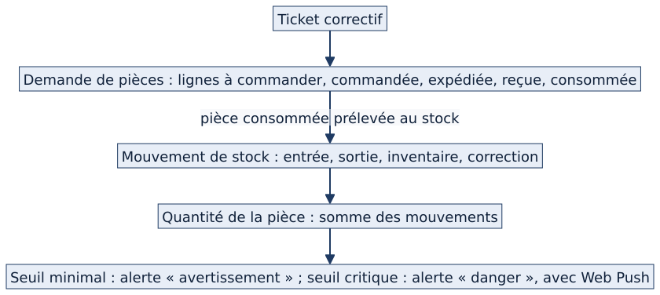

<!-- couvre: diffusable/13_logistique.md | Chapitre 13 — Logistique : stock de pièces et demandes de pièces -->
<!-- couvre: diffusable/13_logistique.md | 13.1 Deux logiques complémentaires -->
<!-- couvre: diffusable/13_logistique.md | 13.2 Ce que voit et fait le marin -->
<!-- couvre: diffusable/13_logistique.md | 13.3 Ce que font les responsables -->
<!-- couvre: diffusable/13_logistique.md | 13.4 Le stock : un solde qui se justifie -->
<!-- couvre: diffusable/13_logistique.md | 13.5 La demande de pièces d'un ticket -->
<!-- couvre: diffusable/13_logistique.md | 13.6 Alertes de pénurie -->
<!-- couvre: diffusable/13_logistique.md | 13.7 Droits en un coup d'œil -->
<!-- couvre: diffusable/13_logistique.md | 13.8 Interactions avec les autres modules -->
<!-- couvre: diffusable/13_logistique.md | 13.9 Cas particuliers -->
<!-- couvre: diffusable/13_logistique.md | 13.9 bis Inventaire exhaustif de l'existant -->
<!-- couvre: diffusable/13_logistique.md | 13.10 Fonctionnement cible 🔵 -->
<!-- couvre: diffusable/13_logistique.md | 13.11 Limites et éléments non vérifiés -->
<!-- partie: Modules -->
# Logistique : stock de pièces et demandes de pièces

<b>Public :</b> marins, responsables, développeurs · <b>Ce que vous y trouverez :</b> comment le bord suit ses pièces de rechange, comment une réparation consomme du stock, comment une pénurie est signalée, et ce que Matrix ne fait pas encore (commande, approvisionnement flotte)

**Écran de référence :** [[GU:14_ecrans_materiel_stock]] (captures de l'état B sur une instance de démonstration).

## Deux logiques complémentaires

| | **Stock proactif** | **Demande de pièces** |
|---|---|---|
| Question | « Qu'ai-je en réserve à bord ? » | « Il me faut telle pièce pour réparer ce matériel » |
| Objet | Fiche de pièce de rechange (`StockPiece`) | Demande rattachée à **un ticket correctif**, avec des lignes |
| Indépendance | Existe sans ticket | N'existe que par un ticket |

Les deux se rejoignent quand une ligne de demande est **consommée** : Matrix peut alors sortir la quantité du stock.

## Ce que voit et fait le marin

- Il **consulte** le stock de son périmètre : référence, désignation, **NNO** (numéro de nomenclature OTAN, facultatif, texte libre), quantité, seuils, emplacement, photo, note ; une pastille indique **stock normal, bas ou critique**.
- Il **voit les pièces d'un ticket** sur lequel il intervient, avec l'état de chaque ligne.
- Il ne **modifie pas** le stock : les écritures commencent au seuil `stock_ecriture` (chef de section par défaut).

## Ce que font les responsables

| Qui (seuil par défaut) | Ce qu'il fait |
|---|---|
| **Chef de section ou plus** (action `stock_ecriture`) | Crée ou modifie une pièce, **prélève** pour un ticket, saisit une **entrée**, un **inventaire** ou une **correction**, gère les lignes de demande de pièces de son périmètre |
| **Chef de secteur et plus** | Mêmes droits sur un périmètre plus large ; création d'une pièce **dans un secteur de son périmètre** uniquement |
| **Acteur à terre** | Consultation et commentaire seulement |

Le seuil est **réglable par bâtiment** ([[RF:05_roles_et_autorisations]]). Toute écriture est **bornée au périmètre** de la personne.

## Le stock : un solde qui se justifie

**Relations représentées** (une ligne par flèche du schéma ci-dessus)

| De | Condition ou passage | Vers |
|---|---|---|
| Mouvement de stock : entrée, sortie, inventaire, correction | — | Quantité de la pièce : somme des mouvements |
| Quantité de la pièce : somme des mouvements | — | Seuil minimal : alerte « avertissement » ; seuil critique : alerte « danger », avec Web Push |
| Ticket correctif | — | Demande de pièces : lignes à commander, commandée, expédiée, reçue, consommée |
| Demande de pièces : lignes à commander, commandée, expédiée, reçue, consommée | pièce consommée prélevée au stock | Mouvement de stock : entrée, sortie, inventaire, correction |

Règle centrale : **la quantité d'une pièce n'est jamais « tapée » ; elle résulte de mouvements.**

| Mouvement | Effet | Motif |
|---|---|---|
| **Entrée** | Ajoute | Facultatif |
| **Sortie** | Retire (refusée si le stock est insuffisant) | Facultatif ; rattachée à un ticket quand elle vient d'une intervention |
| **Inventaire** | Ramène le stock à l'effectif compté ; l'écart est enregistré | **Obligatoire** |
| **Correction** | Variation signée | **Obligatoire** |

Garanties (🟢 vérifiées au code) :
- un **mouvement n'est jamais modifié ni supprimé** : une erreur se corrige par un **nouveau mouvement** ;
- chaque mouvement garde **l'auteur, le motif, le solde après** et le lien éventuel au ticket ;
- l'écriture se fait **sous verrou**, dans une transaction : deux sorties simultanées ne peuvent pas rendre le stock négatif ;
- chaque mouvement est **audité** ;
- une **même sortie n'est jamais comptée deux fois** pour un même ticket et une même pièce.

## La demande de pièces d'un ticket

1. Sur un ticket, un chef ouvre une **demande de pièces** (avec une date « nécessaire avant ») puis ajoute des **lignes** : référence, désignation, quantité, fournisseur, numéro de commande, coûts estimé et réel.
2. Chaque ligne suit les états : **À commander → Commandée → Expédiée → Reçue → Consommée** (ou **Retournée**).
3. Quand une ligne passe à **Consommée**, Matrix **tente une sortie de stock** pour cette ligne, si la personne a le droit de gérer le stock. Trois issues, toutes explicites à l'écran :
   - sortie enregistrée ;
   - **stock insuffisant** → avertissement, aucune sortie ;
   - **sortie déjà enregistrée** → avertissement, pas de doublon ;
   - droit de stock insuffisant → avertissement : la ligne passe « consommée » mais **sans sortie**.
4. Un chef peut aussi **prélever directement** une pièce du stock pour un ticket ; la sortie est **tracée dans la discussion du ticket**.

⚪ Dans l'état B, **la demande de pièces n'a pas de circuit d'approbation ni de commande réelle** : les états décrivent le suivi par le bord ; rien n'est transmis à un système d'approvisionnement.

## Alertes de pénurie

Une tâche planifiée quotidienne contrôle le stock :
- sous le **seuil minimal** → alerte de niveau **avertissement** ;
- sous le **seuil critique** (ou à 0 si non renseigné) → alerte de niveau **danger** (déclenche un push) ;
- destinataires : **chef de service, chef de secteur et chef de section** dont le périmètre correspond à la pièce ;
- **une seule alerte active** par pièce et par destinataire (pas de rappel quotidien) ; elle est **mise à jour** si la situation s'aggrave ou s'améliore, et **résolue** quand le stock repasse au-dessus du seuil.

## Droits en un coup d'œil

| Action | Seuil | Borne |
|---|---|---|
| Voir le stock | Tout marin du périmètre | Périmètre, équipage |
| Créer / modifier une pièce, mouvement, inventaire, prélèvement | `stock_ecriture` (chef de section) | Périmètre ; service de la pièce |
| Changer l'état d'une ligne de demande | Chef de section dans le périmètre du ticket | Périmètre du ticket |
| Sortie automatique à la consommation | `stock_ecriture` | Idem |

## Interactions avec les autres modules

| Module | Lien |
|---|---|
| Tickets ([[RF:12_fiche_maintenance]]) | Une demande de pièces appartient à un ticket ; la consommation sort du stock |
| Installations ([[RF:11_fiche_materiel_installations]]) | Les pièces d'une installation (avec NNO) sont listées sur sa fiche ; elles sont **distinctes** du stock |
| Notifications | Alertes de stock bas / critique |
| Accueil ([[RF:06_fiche_accueil_pilotage]]) | Indicateur « pièces sous le seuil » (vue flotte, dashboard de classe) |
| Préparation à l'appareillage ([[RF:16_fiche_preparation_appareillage]]) | Pièces critiques manquantes |

## Cas particuliers

- **Une pièce appartient à un bâtiment et à un service** (obligatoires) ; la section est facultative.
- **Équipage à terre / soutien à terre** : lecture seule.
- **Pièce sans NNO** : permis (champ facultatif, pièces anciennes).
- **Pièces de l'installation ≠ stock** : la liste de pièces d'une installation décrit ce qu'elle contient ; le stock décrit ce qui est à bord.

## Inventaire exhaustif de l'existant

**Fiche de pièce** : référence, désignation, NNO (facultatif), quantité (copie du solde), quantité minimale, seuil critique (facultatif ; à défaut 0), emplacement, note, photo ; **bâtiment, service, secteur** (obligatoires) et **section** (facultative) ; **lien facultatif vers un équipement** (installation **ou** matériel, jamais les deux, **dans le même secteur**). La pièce apparaît alors dans l'onglet « Pièces » de la fiche de l'équipement ; si l'équipement est supprimé, la **pièce reste** (seul le lien disparaît). Le total des mouvements doit toujours égaler la quantité.

**États d'une pièce** : normal ; **bas** (sous le minimum, au-dessus du critique) ; **critique** (au seuil critique ou en dessous).

**Écrans et actions** : liste du stock avec **recherche texte** ; fiche de pièce (création, modification) ; **page des mouvements** d'une pièce (entrée, sortie, inventaire, correction) ; prélèvement depuis un ticket ; **export CSV et Excel** du stock affiché, **borné au périmètre** de la personne (l'Excel peut manquer sur un serveur sans la bibliothèque : le CSV reste disponible).

**Demandes de pièces** : demande par ticket (**Ouverte / Fermée**), lignes avec fournisseur, numéro de commande, coûts estimé et réel, dates de commande et de réception ; six états de ligne ; interface programmable (API) pour les tickets, les demandes et les lignes ; **le stock n'a pas de route API propre** ⚪.

**Non trouvé dans le code examiné** (constat, pas une cible ; ⚪ absence déduite de la lecture des modèles et des routes) : approbation d'une demande, commande transmise à un fournisseur, réception comptable, valorisation du stock, inventaire planifié, réservation de pièces, transfert entre bâtiments, rattachement automatique d'une pièce aux gammes de maintenance.

## Fonctionnement cible 🔵

Le dossier V1.2 ne contient **aucune décision du PO** sur le stock ni sur la commande de pièces. Le cahier des charges prévoit une logistique plus large (approvisionnement, circuit SSF) mais **rien n'est validé ni développé** : ce chapitre ne décrit donc aucune cible.

## Limites et éléments non vérifiés

- ⚪ **Preuve historique, non rejouée pour la révision 2** : le compte rendu de lot de l'édition initiale (11/11/2026) rapporte, pour sept paquets dont `logistics`, **1 491 tests OK, 1 ignoré** sur l'état B ; ce résultat n'a pas été rejoué pour cette révision.
- ⚪ Absence de circuit d'approbation pour les demandes de pièces : constatée au code, non confirmée comme voulue.
- ⚪ Les envois de notifications n'ont pas été rejoués.
- 🟢 La liste du stock a été rejouée sur l'instance de démonstration le 16/11/2026 ; ⚪ pas de page de détail rejouée.

**Sources (état B).** Code de l'état B (stock et demandes de pièces) ; références de code dans le dossier technique à accès restreint.

## Écarts et décisions du registre

Les tableaux ci-dessous sont **générés depuis le registre central** : le statut et l'état de chaque entrée y sont tenus ; cette fiche n'en donne aucun autre. Une proposition 🟣 n'est pas une décision ; « non développée » signifie seulement que le lot correspondant n'est pas livré dans l'état B.

### Écarts, points à confirmer et propositions

@ecarts NE-02
