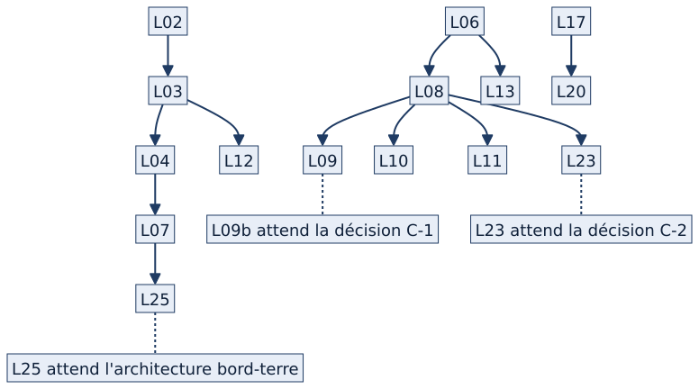

<!-- couvre: diffusable/25_fonctionnement_cible.md | Chapitre 25 — Fonctionnement cible et feuille de route -->
<!-- couvre: diffusable/25_fonctionnement_cible.md | 25.1 Le plan en un coup d'œil -->
<!-- couvre: diffusable/25_fonctionnement_cible.md | 25.2 Les dépendances entre lots -->
<!-- couvre: diffusable/25_fonctionnement_cible.md | 25.3 Phase A — Risques critiques -->
<!-- couvre: diffusable/25_fonctionnement_cible.md | 25.4 Phase B — Autorisations et circuits -->
<!-- couvre: diffusable/25_fonctionnement_cible.md | 25.5 Phase C — Circuits des tâches -->
<!-- couvre: diffusable/25_fonctionnement_cible.md | 25.6 Phase D — Maintenance, appareillage, feuille de service -->
<!-- couvre: diffusable/25_fonctionnement_cible.md | 25.7 Phase E — Ergonomie, mutation, dette -->
<!-- couvre: diffusable/25_fonctionnement_cible.md | 25.8 Propositions à valider par le PO 🟣 -->
<!-- couvre: diffusable/25_fonctionnement_cible.md | 25.9 Orientations du cahier des charges, non décidées en lots 🔵⚪ -->
<!-- couvre: diffusable/25_fonctionnement_cible.md | 25.10 Dépendances externes -->
<!-- couvre: diffusable/25_fonctionnement_cible.md | 25.11 Limites -->
<!-- partie: Cible et feuille de route -->
# Fonctionnement cible et feuille de route

<b>Public :</b> responsables, marins, développeurs · <b>Ce que vous y trouverez :</b> tout ce que le PO a décidé et que Matrix ne fait pas encore, regroupé par domaine et par lot, avec l'état de chaque lot. **Rien de ce chapitre n'est décrit au présent comme existant** ; chaque point renvoie au chapitre qui décrit le comportement actuel. **Aucun lot n'est lancé par ce dossier.** Le plan en 28 lots est **une proposition du dossier V1.2, à valider** ; seuls L01, L05, L02 et L03 sont livrés (sur l'état B, non fusionnés). L04 n'est pas lancé

## Le plan en un coup d'œil

**Feuille de route** (remplacé par un tableau)

| Élément | Contenu |
|---|---|
| `A` | Phase A — Risques critiques : L01 à L05 |
| `B` | Phase B — Autorisations et circuits : L06 à L13, L21 |
| `C` | Phase C — Circuits des tâches : L14 à L18 |
| `D` | Phase D — Maintenance, appareillage, feuille de service : L19, L20, L22, L23, L26, L27 |
| `E` | Phase E — Ergonomie, mutation, dette : L24, L25, L28 |
| `L` | Livrés sur l'état B : L01, L05, L02, L03 — L04 non lancé |

| De | Condition ou passage | Vers |
|---|---|---|
| Phase A — Risques critiques : L01 à L05 | — | Phase B — Autorisations et circuits : L06 à L13, L21 |
| Phase B — Autorisations et circuits : L06 à L13, L21 | — | Phase C — Circuits des tâches : L14 à L18 |
| Phase C — Circuits des tâches : L14 à L18 | — | Phase D — Maintenance, appareillage, feuille de service : L19, L20, L22, L23, L26, L27 |
| Phase D — Maintenance, appareillage, feuille de service : L19, L20, L22, L23, L26, L27 | — | Phase E — Ergonomie, mutation, dette : L24, L25, L28 |

| Phase | Lots | Objet |
|---|---|---|
| **A — Risques critiques** | L01 à L05 | Verrou de démonstration, archivage, suppression sûre, désactivation des comptes, configuration de production |
| **B — Autorisations et circuits** | L06 à L13, L21 | Administrateur technique, rattachement, suppléance, visas, échanges, RETEX, structure du bord, transfert, sécurité d'accès |
| **C — Circuits des tâches** | L14 à L18 | Priorités, validation, coordinateur, tâche bloquée, qualifications |
| **D — Maintenance, appareillage, feuille de service** | L19, L20, L22, L23, L26, L27 | Périodicité, durée, anomalies, appareillage, outillage, feuille |
| **E — Ergonomie, mutation, dette** | L24, L25, L28 | Ergonomie, mutation de personnel, dette documentaire et CI |

Principes du plan : risques critiques d'abord, puis autorisations et circuits, puis ergonomie ; chaque lot assez petit pour être testé, relu et validé seul ; **aucun lot ne mélange sécurité et fonctionnalité nouvelle** ; toute migration est annoncée.

## Les dépendances entre lots

Trois lots **attendent une décision ou une architecture externe** : **L25** (mutation de personnel) attend l'**architecture bord–terre** ; **L09b** (visas par fonction) attend la décision **C-1** ; **L23** (appareillage) attend la décision **C-2** et la conformité aux procédures du bord.

## Phase A — Risques critiques

| Lot | En clair | Décisions | État |
|---|---|---|---|
| **L01** | Les commandes de données fictives refusent de s'exécuter sur une vraie base ; mots de passe de démonstration non prévisibles | `DEC-PRE-06` | 🟢 Livré (B), non fusionné — [[DT:23_configuration_deploiement_exploitation]] |
| **L05** | L'application refuse de démarrer en production avec une clé ou un mot de passe de base trop faibles | `RT-04` | 🟢 Livré (B) — [[DT:23_configuration_deploiement_exploitation]] |
| **L02** | Les unités s'**archivent** (et se réactivent) au lieu de se supprimer | `DEC-DRT-05`, `DP-13` | 🟢 Livré (B) — [[RF:04_organisation]] |
| **L03** | Une unité référencée **ne se supprime plus** (refus 409 avec le détail) | `DEC-DRT-05`, `DP-13` | 🟢 Livré (B) — [[RF:04_organisation]], [[DT:20_api_interfaces]] |
| **L04** | Les **comptes** se désactivent au lieu de se supprimer ; l'historique reste à l'ancien bâtiment | `DEC-MUT-06`, `DEC-MUT-07`, `DEC-DRT-05` | 🔵 **Non lancé** (dépend de L03) |

## Phase B — Autorisations et circuits

| Lot | En clair | Décisions | Chapitres actuels |
|---|---|---|---|
| **L06** | L'administrateur technique **ne fait plus d'acte métier** (visa, validation, publication) | `DEC-DRT-02` | 5 (écart A1) |
| **L07** | Un compte au rattachement incomplet n'accède pas aux informations opérationnelles sans autorisation explicite et tracée ; **aucun accès du seul fait du grade** | `DEC-DRT-06` | 5 |
| **L08** | **Suppléance explicite** : désignée, activée par une autorité, temporaire, limitée à une fonction et un périmètre, tracée | `DEC-SUP-01`, `DEC-SUP-02`, `DEC-SUP-03`, `DEC-SUP-04`, `DEC-SUP-05`, `DEC-SUP-06`, `DEC-SUP-07` | 5, 8 (points B1) |
| **L09** | **Visas par fonction** et listes publiées (3 sous-lots) ; L09b attend la décision C-1 | `DEC-DRT-01`, `DEC-FDS-02`, `DEC-FDS-05` | 8 (écart A3) |
| **L10** | Les **échanges de tours** sont décidés par le COMAEQ ou son suppléant habilité ; le BSC ou le chef de liste instruit | décision S3 | 8 (écart A2) |
| **L11** | **Circuit RETEX** hiérarchique : auteur → chef de section → chef de secteur → chef de service ; correction motivée avec nouvelle version ; **la transmission à un organisme reste un acte distinct** | `DEC-RTX-01`, `DEC-RTX-02`, `DEC-RTX-03`, `DEC-RTX-04` | 15 (écarts A15, A16) |
| **L12** | La **structure du bord** (services, secteurs, sections) est tenue par une fonction habilitée | `DEC-ORG-02`, `DP-13` | 4 |
| **L13** | **Transfert de matériel** entre secteurs et entre services, avec approbations | `DEC-MAT-01`, `DEC-MAT-02`, `DEC-MAT-03`, `DEC-MAT-04` | 11 (écart A18) |
| **L21** | **Sécurité d'accès**, avec les SIC (HTTPS, limitation des connexions) | `DEC-PRE-06`, P03 | 22, 23 |

## Phase C — Circuits des tâches

| Lot | En clair | Décisions | Chapitres actuels |
|---|---|---|---|
| **L14** | **Trois priorités** : normale, haute, urgente ; une priorité posée par un chef de secteur ne peut être abaissée par un chef de section | `DEC-TAC-04`, `DEC-TAC-05`, `DEC-TAC-06` | 10 (écart A13) |
| **L15** | **Validation facultative** d'une tâche et statut « À valider » | `DEC-CLO-01`, `DEC-CLO-02`, `DEC-CLO-03`, `DEC-CLO-04`, `DEC-CLO-05` | 10 |
| **L16** | Tâche **collective** : coordinateur et rang des grades (valeurs à fournir par le PO : B7) | `DEC-COL-02`, `DEC-COL-03`, `DEC-COL-04`, `DEC-COL-05` | 10 |
| **L17** | Tâche **bloquée** et « Non réalisée — À reprogrammer » ; heure de fin de journée par bâtiment (B6, à confirmer) | `DEC-BLQ-01`, `DEC-BLQ-02`, `DEC-BLQ-03`, `DEC-BLQ-04`, `DEC-BLQ-05` | 10 |
| **L18** | **Qualifications : information, pas blocage** pour les tâches ordinaires ; exigences réglementaires pour les visas techniques et signatures | `DEC-QUA-01`, `DEC-QUA-02`, `DEC-QUA-03`, `DEC-QUA-04` | 14 |

## Phase D — Maintenance, appareillage, feuille de service

| Lot | En clair | Décisions | Chapitres actuels |
|---|---|---|---|
| **L19** | **Périodicités nommées** (hebdomadaire à quinquennale), échéance calculée depuis la réalisation effective | `DEC-PER-01`, `DEC-PER-02`, `DEC-PER-03`, `DEC-PER-04` | 12 (A21) |
| **L20** | **Durée estimée actualisée** (option B) ; **propositions techniques non validées** | `DEC-DUR-01`, `DEC-DUR-02`, `DEC-DUR-03`, `DEC-DUR-04`, `DEC-DUR-05`, `DEC-DUR-06`, `DEC-DUR-07` | 12 |
| **L22** | **Anomalies, interventions et ticket correctif** | `DEC-ANO-01`, `DEC-ANO-02`, `DEC-ANO-03`, `DEC-ANO-04`, `DEC-ANO-05` | 12 |
| **L23** | **Préparation à l'appareillage** : fiches de référence, circuit chef de secteur → chef de service → COMANAV, contrôles obligatoires et critiques, réserves ; attend C-2 ; **Matrix ne délivre pas l'autorisation d'appareiller** | `DEC-APP-01`, `DEC-APP-02`, `DEC-APP-03`, `DEC-APP-04`, `DEC-APP-05`, `DEC-APP-06`, `DEC-APP-07`, `DEC-APP-08`, `DEC-APP-09`, `DEC-APP-10`, `DEC-APP-11`, `DEC-APP-12`, `DEC-APP-13`, `DEC-APP-14` | 16 (écart A17) |
| **L26** | **Remarques d'outillage et d'instruction** visibles du chef de secteur, sans modification automatique de la fiche | `DEC-OUT-01`, `DEC-OUT-02`, `DEC-OUT-03`, `DEC-OUT-04`, `DEC-OUT-05` | 12 |
| **L27** | **Feuille de service** : réimpression avec versionnement, alerte de remplacement, fraction à quai | `DEC-FDS-06`, `08`, `09` | 8 (écart A12) |

## Phase E — Ergonomie, mutation, dette

| Lot | En clair | État |
|---|---|---|
| **L24** | **Ergonomie**, en petits lots indépendants : liens et boutons morts, titres d'onglet, « Mes tours de services », niveau « Critique », archivage des notifications lues (`DEC-UX-01`, `DEC-UX-02`, `DEC-UX-03`, `DEC-UX-04`, `DEC-UX-05`, `DEC-UX-06`, `DEC-UX-07`, `DEC-UX-08`, `DEC-UX-09`, `DEC-UX-10`, `DEC-UX-11`) | 🔵 Non lancé — [[RF:17_principes_interface]] |
| **L25** | **Mutation de personnel** : formations et qualifications suivent le marin, l'historique d'activité reste à l'ancien bâtiment, les compteurs d'équité ne suivent pas (`DEC-MUT-01`, `DEC-MUT-02`, `DEC-MUT-03`, `DEC-MUT-04`, `DEC-MUT-05`) | 🔵 **Reporté** : attend l'architecture bord–terre |
| **L28** | **Dette documentaire et CI hors Internet**, tests des modules secondaires (documentation, RETEX, postes, programme) | 🔵 Non lancé — [[DT:24_qualite_contribution]] |

## Propositions à valider par le PO 🟣

Ces points ont été **proposés** ou **relevés**, pas décidés ; ils ne sont rattachés à aucun lot.

| Proposition | Contenu | Garde-fous demandés |
|---|---|---|
| **Ticket de suivi pour une installation non conforme** | Créer un ticket, comme pour le matériel mobile, quand une installation est déclarée non conforme (aujourd'hui seul le matériel mobile en déclenche un) | Un ticket **ne clôture jamais automatiquement une anomalie** et **n'autorise jamais une remise en service** ([[RF:12_fiche_maintenance]]) |
| **Sortie de l'état « En validation »** | Une occurrence non conforme peut rester indéfiniment « En validation » sans alerte de retard (écart A20) ; la règle de sortie reste **à décider** | Aucune règle inventée dans ce dossier |
| **Transmission d'un RETEX à un organisme** | Destinataires, canaux, responsabilités à confirmer avec les procédures métier ; **le marquage « flotte » n'est pas une transmission** | — |
| **Autorité de classification « critique »** d'un contrôle d'appareillage | Le principe `DEC-APP-14` est validé ; la compatibilité avec les procédures du bord est à confirmer avant tout développement | — |

## Orientations du cahier des charges, non décidées en lots 🔵⚪

- **Phase 6 — Pilotage** : tableaux de bord par niveau jusqu'au **commandement** et au **SSF**, indicateurs consolidés, rapports ([[RF:06_fiche_accueil_pilotage]]).
- **Phase 7 — Écosystème** : **synchronisation bord–terre**, **API**, **interopérabilité**, **déploiement multi-bâtiments** ; **volontairement différée** (« prouver la valeur » avant l'architecture de déploiement réel). **SIGLe et ODIN restent les référentiels officiels** de la maintenance et de la logistique.
- **Moteur de dossiers** (Notion « 03 — Formation ») : une demande ou une candidature devient un **dossier vivant** (acteurs, workflow, timeline, fil de discussion, échéances, pièces jointes), la formation étant le premier cas pilote ; chaîne « besoin → demande → validations → places → session → résultat → qualification → couverture du poste ».
- **Configuration réelle d'un navire**, états techniques fins, **conformité** (Notion « 07 ») : « utilisable = fonctionne + conforme + contrôlé + autorisé » ; **aucune exigence chiffrée** n'a été fournie.
- **Idées « à faire plus tard »** (recette UX) : favoris épinglés, annuaire professionnel limité, formulaires RH configurables et coffre documentaire.
- **Abandonné** : la **génération automatique** des tours de service ; l'organisation « miroir » en double équipage ; **ne pas les réintroduire** sans décision.

## Dépendances externes

| Dépendance | Ce qu'elle bloque |
|---|---|
| **Architecture bord–terre** (réservée aux SIC) | L25 (mutation), toute synchronisation, la phase 7 |
| **Experts SIC** | L21 (HTTPS, limitation de connexions), sauvegarde et supervision ([[DT:23_configuration_deploiement_exploitation]]) |
| **Décisions C-1 et C-2** | L09b et L23 |
| **Procédures opérationnelles du bord** | L23 (classification des contrôles), horaires propres à une unité |
| **Validation SSI et GO du PO** | Tout déploiement opérationnel, toute donnée réelle |

## Limites

- ⚪ Le plan en 28 lots **est une proposition** ; ni l'ordre ni la taille ne sont engagés. Seules les décisions `DEC-…` citées sont validées par le PO.
- ⚪ Les décisions et lots ont été relevés dans le dossier V1.2 ({{fait:n_decisions_v12}} décisions) et dans les comptes rendus L01, L05, L02, L03 ; l'état des autres lots est « non lancé ».
- 🟣 Les propositions de la section « Propositions à valider par le PO » ne sont pas des décisions.

**Sources.** Dossier V1.2 (, comptes rendus L01, L05, L02, L03) ; Notion « Feuille de route », « Cahier des charges », « 03 — Formation », « 07 — SIC », « Cap UX/UI » ; le registre des écarts (partie restreinte du dossier).
