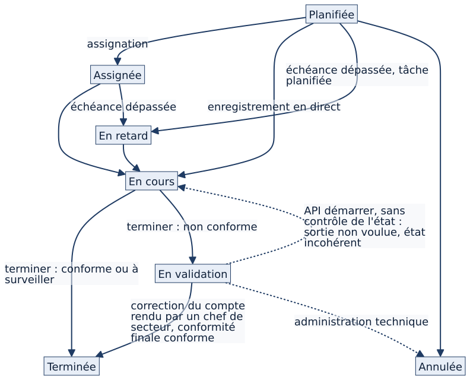
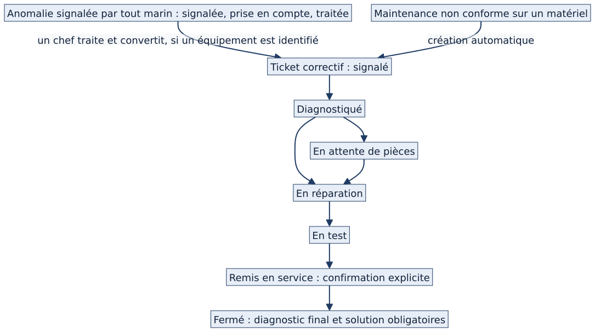

<!-- couvre: restreint/12_maintenance_anomalies_tickets_technique.md | Chapitre 12 (technique) — Maintenance, anomalies, tickets : mécanismes -->
<!-- couvre: restreint/12_maintenance_anomalies_tickets_technique.md | 12.T1 Modèles -->
<!-- couvre: restreint/12_maintenance_anomalies_tickets_technique.md | 12.T2 Logique -->
<!-- couvre: restreint/12_maintenance_anomalies_tickets_technique.md | 12.T2 bis Modèles secondaires -->
<!-- couvre: restreint/12_maintenance_anomalies_tickets_technique.md | 12.T4 Points non vérifiés -->
<!-- couvre: restreint/12_maintenance_anomalies_tickets_technique.md | Tests -->
<!-- couvre: restreint/12_maintenance_anomalies_tickets_technique.md | Limites -->
<!-- retire: restreint/12_maintenance_anomalies_tickets_technique.md | 12.T3 Schémas | Les schémas S24 à S26 sont insérés dans les sections concernées (S24 devient un tableau) -->
<!-- partie: Modules -->
# Maintenance, anomalies et tickets : mécanismes

<b>Public :</b> développeurs, mainteneurs · <b>Accès restreint</b> · <b>Fonctionnel :</b> voir [[RF 1]] · <b>État décrit :</b> EB-2026-11-11 · <b>Fusionne :</b> l'ancien chapitre 12 technique et la part mécanique de l'ancien chapitre 12.

## Vue d'ensemble du module

Le module est réparti sur trois paquets : **`maintenance`** (plans, échéances, exécutions, comptes rendus, tournée), **`logistics`** (tickets correctifs, anomalies, demandes de pièces) et **`assets`** (fiches, installations, mesures, qui alimentent l'exécution). Les règles métier sont dans les modules de vues et de services ; les modèles portent surtout les contraintes d'intégrité. Le module `rondes` est présent dans le dépôt mais **sans aucune vue** : ne pas le confondre avec une fonctionnalité.

Les trois objets du fonctionnel se retrouvent ainsi : l'**occurrence** (`MaintenanceOccurrence`), l'**anomalie** (`Anomalie`) et le **ticket** (`CorrectiveTicket`). L'ensemble s'exécute dans le processus web ; trois tâches planifiées (génération, retard, notifications) dépendent de Celery et de Redis.

## Modèles

| Objet | Référence | Rôle |
|---|---|---|
| Plan de maintenance | `maintenance/models.py` `MaintenancePlan` (:18) | Périodicité par type de matériel |
| Occurrence | `maintenance/models.py` `MaintenanceOccurrence` (:36) | Échéance ; statuts PLANNED, ASSIGNED, IN_PROGRESS, WAITING_VALIDATION, DONE, OVERDUE, CANCELLED (`STATUS` :37) ; contrainte « matériel XOR installation » |
| Journal d'états | `maintenance/models.py` `OccurrenceStatusLog` (:103) | Ancien et nouvel état, auteur |
| Exécution | `maintenance/models.py` `MaintenanceExecution` (:110) | Compte rendu : résultats, mesures, conformité |
| Modification de compte rendu | `maintenance/models.py` `ModificationCompteRendu` (:146) | Saisie d'origine conservée, auteur, motif |
| Compte rendu correctif | `maintenance/models.py` `CompteRenduCorrectif` (:164) | Compte rendu d'un ticket |
| Ticket correctif | `logistics/models.py` `CorrectiveTicket` (:23) ; `STATUTS_TICKET_OUVERTS` (:19) | Six états « ouverts » : référence unique des tableaux de bord |
| Journal d'états d'un ticket | `logistics/models.py` `TicketStatusLog` (:90) | |
| Anomalie | `logistics/models.py` `Anomalie` (:317) ; `AnomalieStatutLog` (:401) | Signalée → Prise en compte → Traitée → Clôturée |
| Demande et ligne de pièces | `logistics/models.py` `PartRequest` (:97), `PartLineItem` (:107) | Voir le chapitre logistique |
| Module retiré | `rondes/models.py` `RondeModele` (:22), `PointControle` (:75), `Ronde` (:102), `ResultatPoint` (:143) | Modèles et migrations seuls |

## États et transitions d'une occurrence

| Transition | Où elle est écrite |
|---|---|
| PLANNED → ASSIGNED | Auto-assignation (`maintenance/web_views.py` `MaintenanceOccurrenceSelfAssignView` (:652)) ou assignation |
| PLANNED / ASSIGNED → OVERDUE | `maintenance/tasks.py` `compute_overdue` (:83) : toute occurrence « planifiée » ou « assignée » dont la date est dépassée |
| → IN_PROGRESS / DONE / WAITING_VALIDATION | `maintenance/web_views.py` `OccurrenceExecuteView` (:72), méthode `post` (:150) ; le statut final dépend de la conformité (:283) |
| WAITING_VALIDATION → DONE | Correction du compte rendu (même vue, :283) par un niveau « chef de secteur » |
| WAITING_VALIDATION → IN_PROGRESS | **Action `start` de l'API** (`maintenance/views.py:108`), sans contrôle de l'état de départ (écart A20) |
| WAITING_VALIDATION → toute valeur | Administration (`maintenance/admin.py:10`) |

Les états finaux sont exclus du calcul des retards par `STATUTS_SANS_RETARD` (`maintenance/perimetre.py:18`) : **DONE, CANCELLED et WAITING_VALIDATION**. La tournée verrouille une occurrence en validation (`maintenance/tournee.py:19`).

## Exécution et clôture

`OccurrenceExecuteView` (`maintenance/web_views.py:72`) charge l'occurrence dans le **périmètre** de l'utilisateur (`perimetre_occurrences_q`, `maintenance/perimetre.py:10`), puis exige que l'utilisateur soit **assigné** ou atteigne le seuil `maintenance_occurrence_gestion_tiers` ; sinon il lève `PermissionDenied` (`maintenance/web_views.py:90`). Un objet hors périmètre répond 404, un droit insuffisant sur un objet visible répond 403. L'écriture se fait sous verrou (`_ecrire` :248) ; un conflit d'écriture simultanée lève `_Conflit` (:44) et affiche un message ; la clôture d'une installation critique exige la confirmation `maintenance_critique` (`matrix/core/confirmations.py`).

**Ticket automatique.** Le signal `create_corrective_on_non_conform` (`maintenance/models.py:213`, récepteur :212) crée un ticket de gravité 3, **une seule fois par occurrence**, quand la conformité est NON_CONFORME **et que l'occurrence porte un matériel** ; une occurrence d'installation ne crée aucun ticket.

**Génération.** `generate_occurrences` (`maintenance/tasks.py:66`) et `generate_installation_occurrences` (`maintenance/tasks.py:89`) produisent les échéances des 90 jours suivants. La commande d'installation (`maintenance/management/commands/generate_installation_occurrences.py:79`) ne génère rien tant qu'une occurrence non terminée existe : **l'entretien récurrent d'une installation est suspendu** tant qu'une occurrence reste « En validation ».

## Anomalies et tickets

- **Anomalie** : création (`logistics/anomalie_views.py` `AnomalieCreateView` (:141)), prise en charge réservée aux chefs (`_est_chef` :35, `_peut_traiter` :39), conversion en ticket (`AnomalieConvertirView` :341) avec lien dans les deux sens.
- **Ticket** : `TicketTransitionView` (`logistics/web_views.py:368`) ; table des étapes suivantes `ACTION_SUIVANTE_TICKET` (`logistics/web_views.py:154`) ; seuil « chef de section », périmètre `perimetre_tickets_q` ; **retour d'expérience obligatoire** à la clôture ; confirmation `remise_en_service` avant la remise en service.

## Droits et seuils

Les droits passent par le registre de seuils (`matrix/core/role_thresholds.py` `REGISTRE_ACTIONS` (:45)), réglable par bâtiment.

| Action | Clé | Seuil par défaut |
|---|---|---|
| Créer ou modifier une occurrence ou une exécution | `maintenance_execution_ecriture` | EQUIPIER |
| Exécuter ou commenter une maintenance qui n'est pas la sienne | `maintenance_occurrence_gestion_tiers` | CHEF_SECTION |
| Corriger un compte rendu terminé | `maintenance_compte_rendu_correction` | CHEF_SECTEUR |
| Créer ou modifier un plan | `maintenance_plan_ecriture` | CHEF_SECTION |

## Routes

@routes maintenance/ logistics/anomalies logistics/tickets logistics/part

L'API REST du module (`/api/maintenance/…`, `/api/logistics/tickets/…`) est décrite dans le chapitre API ; l'action `start` y est la source d'une des sorties de l'état « En validation ».

## Tâches planifiées et signaux

Parmi les {{fait:n_taches_planifiees}} tâches planifiées : `generate_occurrences_daily`, `compute_overdue_hourly`, `notify_overdue_occurrences_hourly`, `notify_maintenance_echeance_proche_daily`, `generate_installation_occurrences_daily`, `generate_installation_notifications_daily`, `generate_installation_maintenance_notifications_daily`, `detect_installation_drift_daily`. **Sans worker ni beat, aucune n'est exécutée.** Un seul signal propre au module : le ticket automatique (ci-dessus).

## Points d'attention pour le mainteneur

| Sujet | Constat | Où |
|---|---|---|
| **A20** — sorties de « En validation » | Trois chemins vérifiés par test ; aucune validation dédiée ; aucune notification ; entretien d'installation suspendu | `maintenance/web_views.py:283`, `maintenance/views.py:108`, `maintenance/management/commands/generate_installation_occurrences.py:79` |
| **NE-01** — bouton « Exécuter » | Le gabarit de la liste affiche toujours le bouton ; le refus n'intervient qu'à l'ouverture de la fiche | `matrix/templates/maintenance/occurrence_list.html:53` ; refus `maintenance/web_views.py:90` |
| **NE-02** — lignes de tickets | La ligne ouvre la fiche par un gestionnaire de clic, sans lien | `matrix/templates/logistics/ticket_list.html:28` |
| **A25** — module désactivé | Les pages web sont refusées ; l'API, la génération, les notifications et le signal continuent | chapitre Architecture et API |

@ecarts A20 A25 NE-01 NE-02

## Tests et vérifications

- Tests de l'état B : `maintenance/tests/` (178 fonctions) et `logistics/tests/` (228 fonctions, partagées avec la logistique).
- Preuves des écarts A20 et A25 : fichiers de test conservés dans les preuves versionnées (`audit_preuves/tests_verification/verif_g0_a20.py`, `verif_g0_a25.py`), à copier dans une **copie isolée** de l'état B ; ils ne sont **pas** intégrés au dépôt applicatif.
- Commande pour rejouer les tests du paquet dans une copie isolée : `python manage.py test maintenance` (résultat : voir la barrière G3).

## Limites ⚪

- Les envois de notifications (appareil, courriel) ne sont pas rejoués.
- Le comportement des verrous d'écriture simultanée sous PostgreSQL n'est pas rejoué.
- L'intention du chemin « API `start` » (non voulu comme validation) n'est pas confirmée.
