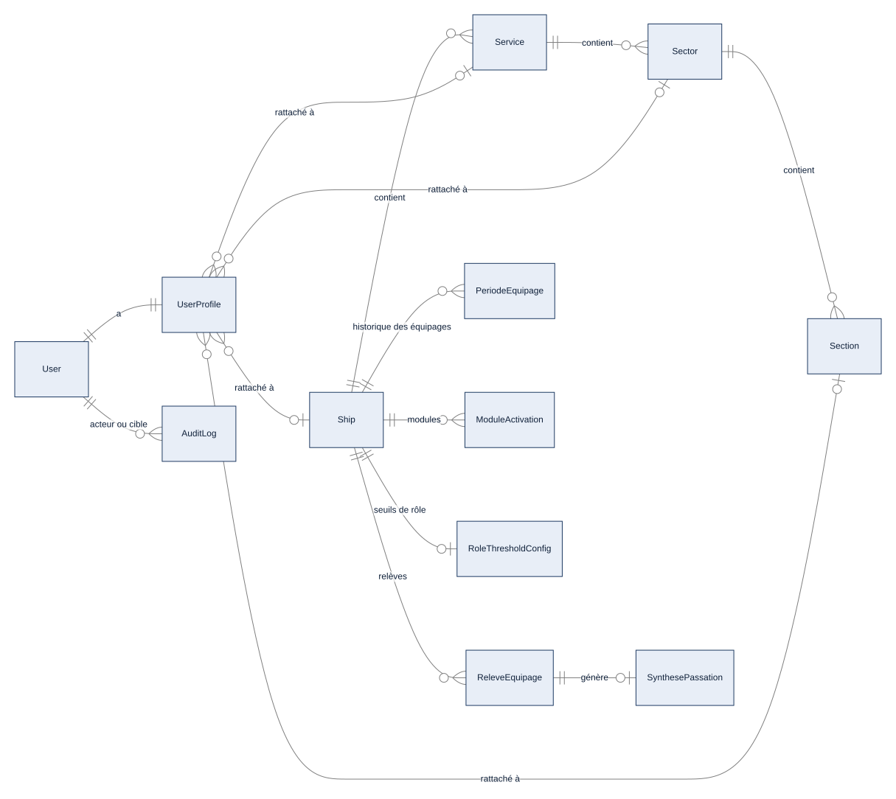

# Chapitre 4 (technique) — Organisation : modèles, relève, archivage, modules

> **Diffusion restreinte.** Complète `diffusable/04_organisation.md` (à lire d'abord). **État décrit :** état B (`6d6d0be`), non fusionné dans `main`.
> **Pour qui :** développeurs, administrateurs. **Ce que vous y trouverez :** les modèles de données de l'organisation et leurs contraintes, le mécanisme exact de la relève et de la lecture seule, les règles d'archivage et de suppression, la résolution des modules activés, et les points d'entrée web et API.

---

## 4T.1 Les modèles de l'organisation

Le paquet `org` porte 15 modèles (inventaire généré, `couverture/etat_B/MODELES.md`). Les quatre niveaux de la hiérarchie sont reliés par des clés étrangères **en cascade vers le bas** : supprimer un parent supprime les enfants. C'est précisément pourquoi la suppression d'une unité est encadrée (§4T.4).

| Modèle | Rôle | Relations notables | Contraintes |
|---|---|---|---|
| `Ship` (`org/models.py:18`) | Unité : navire, école, centre, bureau | `type_batiment` (SET_NULL) | `name` et `code` uniques ; `type_unite` ; `double_equipage` ; `equipage_a_bord` ; `fuseau_horaire` validé |
| `Service` (`:166`) | Service de l'unité | `ship` (CASCADE) | unique (`ship`, `name`) ; `commandant_adjoint` ∈ COMAEQ, COMOPS, COMANAV, COMAVIA (vide = non configuré, repli sur les seuils de rôle) |
| `Sector` (`:185`) | Secteur | `service` (CASCADE) | `archived` |
| `Section` (`:201`) | Section | `sector` (CASCADE) | `archived` |
| `SectorConfig` (`:216`) | Préférences, surcharges de statut, seuils d'alerte, widgets d'un secteur (JSON) | 1-1 `sector` (PROTECT) | — |
| `RoleThresholdConfig` (`:287`) | Seuils de rôle d'un bâtiment (JSON `{clé: nom_de_rôle}`) | 1-1 `ship` (PROTECT, facultatif : `ship` vide = configuration de portée flotte) | pas d'unicité SQL sur la configuration globale (NULL non comparé) |
| `ModuleActivation` (`:322`) | Module activé ou non pour un bâtiment | `ship` (PROTECT) | unique (`ship`, `module`) ; absence de ligne = activé |
| `VersionConfiguration` (`:227`) | Numéro de version des réglages mis en cache | — | clé, jeton UUID |
| `ReleveEquipage` (`:409`) | Proposition de relève | `ship` (PROTECT), `propose_par`, `decide_par`, `annulee_par` (SET_NULL) | **unicité partielle : une seule relève en statut `en_attente` ou `planifiee` par bâtiment** |
| `PeriodeEquipage` (`:447`) | Historique des équipages à bord | `ship` (PROTECT), 1-1 `releve` (SET_NULL) | **unicité partielle : une seule période ouverte (`fin` vide) par unité** |
| `SynthesePassation` (`:472`), `ParametresPassation` (`:496`) | Synthèse générée à la relève ; réglage d'activation (activée par défaut) | `ship` (PROTECT) | — |
| `TypeBatiment` (`:70`), `ReferenceBatiment` (`:91`) | Type porteur de la silhouette du bandeau ; référentiel des bâtiments de la Marine | 1-1 facultatif de `ReferenceBatiment` vers `Ship` (SET_NULL) | statuts de référence, famille Marine/Gendarmerie maritime |
| `ResponsableClasseNavire` (`:378`) | Désignation d'un responsable de classe de navire | `user` (CASCADE) | texte libre de classe |

Le rattachement d'un marin (`accounts.UserProfile`) pointe vers les quatre niveaux en **PROTECT** (voir chapitre 19).

**Le niveau le plus fin renseigné donne le périmètre.** `UserProfile.scope` (`accounts/models.py:87`) renvoie section, sinon secteur, sinon service, sinon unité. Un profil peut n'avoir que son secteur renseigné ; `navire_id_effectif` remonte alors au bâtiment par la hiérarchie.

*Schéma S10 — Organisation et comptes (extrait).*

## 4T.2 La relève : mécanisme exact

Tout le double équipage est dans `matrix/core/equipage.py`. Ce module est **le seul à lire ou écrire `Ship.equipage_a_bord`** : le reste du code passe par `equipage_a_bord(navire)` (`:45`), qui applique d'abord les relèves planifiées dont la date est atteinte.

| Étape | Fonction | Contrôles |
|---|---|---|
| Proposition | `proposer_releve` (`:170`) | auteur commandant ou second d'un des deux équipages ; date non passée ; double équipage activé et équipage à bord renseigné ; l'équipage proposé n'est pas déjà à bord ; **l'autre équipage a au moins un commandant ou second actif** ; aucune relève ouverte ou planifiée. Notifie les commandants de l'autre équipage. |
| Décision | `decider_releve` (`:219`) → `_appliquer_decision` (`:318`) | relève encore en attente ; décideur commandant ou second **de l'autre équipage** ; pas l'auteur. Refus → `refusee` ; validation avec date future → `planifiee` ; sinon application immédiate. |
| Application | `_appliquer` (`:353`) | change `equipage_a_bord`, ferme la période ouverte à la date d'effet et ouvre la suivante (`_enregistrer_periode`), trace, génère la synthèse de passation. La relève reste appliquée même si la synthèse échoue (trace `passation_echec`). |
| Application planifiée | `appliquer_releves_echues` (`:66`) | idempotente, bâtiment verrouillé puis relève relue sous verrou ; appelée par la tâche planifiée `appliquer_releves_echues_minute` (toutes les 60 s) **et** à chaque lecture de l'équipage à bord. |
| Annulation | `annuler_releve` (`:422`), `annuler_releve_planifiee` (`:445`) | l'auteur annule sa proposition en attente ; une relève planifiée s'annule avec justification par un commandant d'un des deux équipages ; une relève appliquée ne s'annule pas. |
| Secours | `valider_releve_secours` (`:275`) | administrateur général seulement, motif obligatoire, seulement si l'équipage valideur n'a ni commandant ni second. |

**Concurrence.** Le bâtiment est verrouillé (`select_for_update`) pendant proposition, décision, annulation et application ; la relève est relue sous verrou, ce qui rend une double validation inoffensive. L'unicité partielle SQL double ce contrôle.

**Fuseau horaire.** Les instants sont conservés en UTC ; la saisie et l'affichage se font dans le fuseau du bâtiment (`Ship.fuseau_horaire`, repli sur `TIME_ZONE = Europe/Paris`). `changer_fuseau` (`:505`) est réservé à qui atteint le seuil `unite_administration`.

**Traces dans `AuditLog`** : `releve_proposee`, `releve_validee`, `releve_validee_secours`, `releve_refusee`, `releve_annulee`, `releve_appliquee`, `releve_application_echouee`, `passation_echec`, `fuseau_horaire_modifie`, `changement_equipage`.

## 4T.3 La lecture seule de l'équipage à terre

Deux définitions de la restriction, deux contrôles, **refus par défaut**.

- `equipage_a_terre_lecture_seule(user)` (`matrix/core/equipage.py:31`) est vrai si l'utilisateur est rattaché à une unité à double équipage, a un équipage renseigné et que cet équipage n'est pas celui à bord. Pas d'équipage renseigné, ou équipage unique : aucune restriction. Le superutilisateur n'est jamais restreint.
- `soutien_a_terre(user)` (`matrix/core/scopes.py:40`) : personnel sans bâtiment (`navire_id_effectif` vide) désigné responsable de classe, responsable de spécialité ou chef d'un responsable de spécialité, hors administrateur général.

`EquipageATerreMiddleware` (`matrix/core/middleware.py:310`) refuse **toute requête d'écriture** (méthode non sûre, web comme API) de ces deux catégories, sauf chemins listés :

| Catégorie | Écritures permises (hors lecture) |
|---|---|
| Équipage à terre | chemins personnels (connexion, session, brouillons, notifications, thème, bâtiment choisi, barre latérale, préférences, calendrier personnel), commentaires de tâche, `/demandes/`, `/annonces/` ; dans les Réglages, seulement les actions de relève et l'heure de notification ; dans le détail de **sa** feuille de service, seulement les actions `creer, enregistrer_entete, proposer, viser_secteur, viser_service, viser_comaeq, renvoyer, resynchroniser, ouvrir_rectificatif` ; désignation des rédacteurs |
| Soutien à terre | chemins personnels, commentaires de tâche, circuits du catalogue flotte (`/catalogue/`, `/fiches/`, API de catalogue), messages et pièces jointes de discussion |

Le middleware n'est qu'un **filet** ; chaque vue revérifie fonction, bâtiment et équipage propriétaire. Un refus renvoie 403 (JSON pour `/api/`, page 403 sinon) avec un message en français.

## 4T.4 Archivage et suppression des unités

**Règle d'activité** (`org/archivage.py`). `est_active` (`:30`) : une unité est active si elle et tous ses ancêtres ne sont pas archivés. `verifier_modele` (`:106`) est appelée par `clean()` de chaque modèle d'unité : elle refuse d'archiver une unité occupée (marins actifs, installations, matériel, sous-unités comprises), de réactiver sous un parent archivé, de créer ou déplacer sous un parent archivé. Un rattachement déjà porté reste tolérable ; une **nouvelle** affectation vers une unité archivée est refusée dans les formulaires, l'affectation en masse, l'import et l'API. Les listes de choix de nouvelles saisies (chef de liste, secteur d'une anomalie, cibles d'annonces, documents, programme, postes) ne proposent que les unités actives ; la lecture de l'existant est inchangée.

**Règle de suppression** (`org/structure_services.py`).
- `dependances(unite)` (`:35`) parcourt l'unité et ses sous-unités, puis compte pour chaque relation entrante : les relations en `PROTECT` (via le gestionnaire de base) et les relations plusieurs-à-plusieurs. Les sous-unités et `ReferenceBatiment.unite` sont exclus (hiérarchie vide, simple référentiel).
- `verifier_suppression` (`:57`) lève `SuppressionRefusee` avec le détail par type d'objet et **trace la tentative** (`suppression_unite_refusee`).
- `supprimer` (`:65`) vérifie, supprime dans une transaction, et trace `delete_<type>` ; un `ProtectedError` tardif (objet rattaché entre le contrôle et la suppression) est converti en refus.
- 92 relations vers les unités sont en `PROTECT` (inventaire de 105 relations dans 14 applications, `Q` §2) : Django refuse donc aussi toute suppression directe contournant le service. 14 migrations `AlterField`, sans SQL.
- Interfaces : Réglages (refus avec détail, périmètre limité au bâtiment de l'appelant), **API : code 409 avec détail** au lieu de 204, administration Django (même service, y compris « supprimer la sélection »).

## 4T.5 Modules activables

- Registre : `REGISTRE_MODULES` (`matrix/core/modules.py:66`), 14 entrées `{clé = nom de l'application, libellé, description}`. Hors registre (jamais désactivables) : `accounts`, `org`, `notifications`, `dashboard`, `calendar_app`, `threads`.
- Résolution : `module_actif(cle, ship_id)` (`:149`) vaut **vrai** si le module est inconnu du registre, si le bâtiment est inconnu, ou s'il n'y a pas de ligne `ModuleActivation`.
- `ModuleActivationMiddleware` (`matrix/core/middleware.py:210`) déduit le module du paquet Python qui définit la vue (`view_class.__module__`), bloque les pages web d'un module désactivé (message et redirection vers l'accueil) et **laisse passer** `/api/`, `/admin/`, les tâches planifiées et les enchaînements internes.
- Le menu masque l'entrée par le même test (`matrix/core/navigation.py`).
- **Cohérence multi-processus** : les seuils et les modules sont mis en cache dans chaque processus, validés par un numéro de version en base (modèle `VersionConfiguration` ; lecture par `valeurs_validees`, `matrix/core/config_version.py:67`). Chaque enregistrement ou suppression incrémente la version (signaux `post_save` et `post_delete`, `org/models.py`) ; la lecture des versions est mémorisée pour la durée d'une requête ou d'une tâche Celery. Une révocation est donc vue dès la requête suivante, quel que soit le processus.

## 4T.6 Contexte de bâtiment

`batiments_du_perimetre(user)` (`matrix/core/contexte_batiment.py:35`) : tous les bâtiments non archivés pour l'administrateur général et le responsable de spécialité ; sinon le bâtiment de rattachement plus ceux des classes dont l'utilisateur est responsable. Le choix du sélecteur est mémorisé en session (`batiment_courant_id`) mais **revalidé à chaque requête** (`BatimentCourantMiddleware`, `matrix/core/middleware.py:144`) ; `build_scope_q` (`matrix/core/mixins.py:16`) borne alors les listes (variable de contexte `batiment_filtre`).

## 4T.7 Points d'entrée

| Interface | Routes | Remarque |
|---|---|---|
| API | `/api/org/ships/`, `services/`, `sectors/`, `sections/`, `sector-configs/` (`org/views.py`) | structure modifiable seulement au seuil `structure_navire_ecriture` ; archivage d'unité occupée : 400 ; suppression d'unité référencée : 409 |
| Réglages | `/parametre/` (`matrix/views.py`) | onglets Général, Hiérarchie, Bâtiments (`navires`), Utilisateurs, Installations, Sécurité (`seuils_role`), Modules, Équipage, Responsables, Journal, Notifications ; chacun n'est visible que selon les droits de la personne |
| Choix du bâtiment | `/users/batiment/` | mémorise en session |
| Administration Django | `/admin/` | applique les mêmes règles d'archivage et de suppression |

## 4T.8 Tests de référence

`org/tests/test_archivage.py` (57 tests), `org/tests/test_suppression_unites.py` (11), relève : `org/tests/test_releves_datees.py`, `org/tests/test_releves_concurrence.py`, `matrix/tests/test_releves_datees_web.py`, `dashboard/tests/test_passation.py` ; lecture seule à terre : `matrix/tests/test_securite_terre_second.py`, `quarts/tests/test_feuille_service_a_terre.py`. Inventaire de l'état B : 163 fonctions de test dans `org`.

## 4T.9 Limites et éléments non vérifiés

- ⚪ PostgreSQL non exécuté (20 tests réservés à ce moteur ignorés) ; les unicités partielles et `select_for_update` ont leur comportement de référence sur PostgreSQL.
- ⚪ Relations génériques vers une unité (discussions, notifications) non vérifiées lors de L03.
- ⚪ L'archivage d'un bâtiment n'a pas d'écran Réglages.
- 🔵 Hors développé : structure par fonction habilitée (L12), transfert de matériel (L13), mutation (L25).

---

**Sources (état B).** `org/models.py`, `org/archivage.py`, `org/structure_services.py`, `org/views.py`, `matrix/core/equipage.py`, `matrix/core/middleware.py`, `matrix/core/modules.py`, `matrix/core/config_version.py`, `matrix/core/contexte_batiment.py`, `matrix/core/mixins.py`, `accounts/models.py`, `matrix/settings.py` (tâche planifiée `appliquer_releves_echues_minute`). Comptes rendus : `P_LOT_L02_COMPTE_RENDU.md`, `Q_LOT_L03_COMPTE_RENDU.md`.
