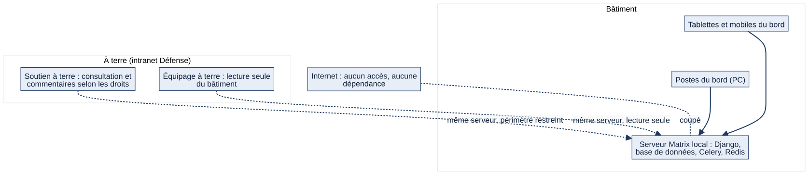
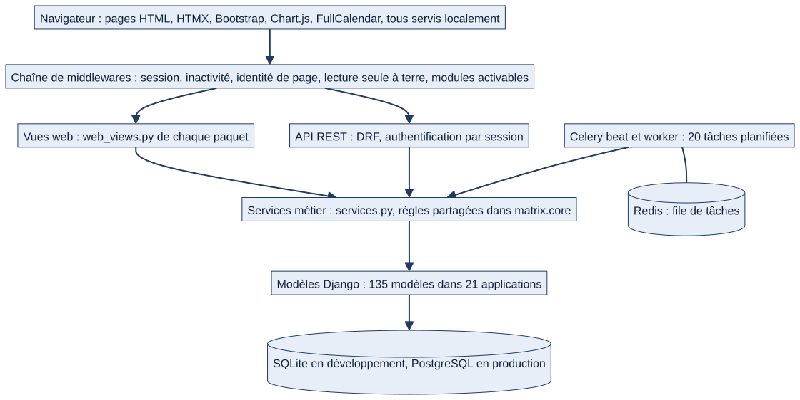
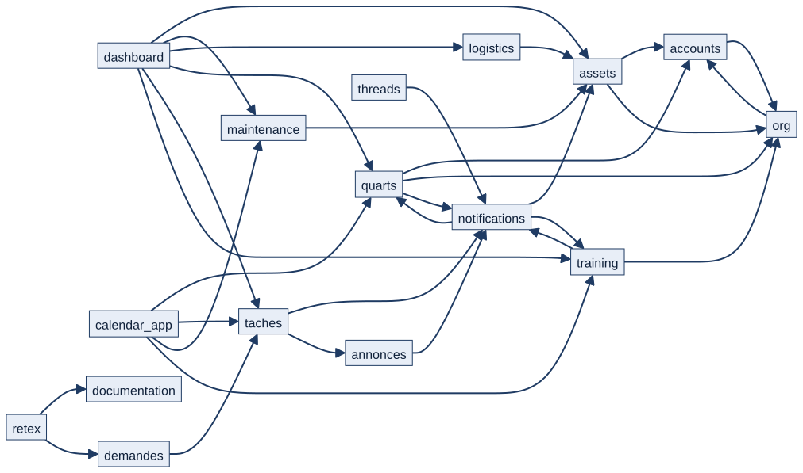

# Chapitre 18 — Architecture technique

> **Diffusion restreinte.** **État décrit :** état B (`6d6d0be`), non fusionné dans `main`.
> **Pour qui :** développeurs, administrateurs. **Ce que vous y trouverez :** de quoi Matrix est fait, comment le code est organisé, comment une page ou une requête d'API traverse l'application, ce que fait le noyau commun, comment les paquets dépendent les uns des autres, et ce qui tourne en arrière-plan. Un lecteur non développeur peut s'en tenir aux §18.1 et §18.2.

---

## 18.1 L'essentiel en un schéma

Matrix est une application web classique : un **serveur** qui fabrique des pages et répond à des demandes, une **base de données** qui garde l'information, et un **service d'arrière-plan** qui fait le travail planifié (rappels, alertes, application des relèves). Tout fonctionne **sur le réseau du bord**, sans Internet.



*Schéma S01 — Matrix sur le réseau du bord. Aucun accès à Internet n'est nécessaire ni utilisé.*

- Les marins se connectent avec un **navigateur** (PC, tablette, mobile) au **serveur du bord**.
- Le personnel à terre et l'équipage à terre utilisent le **même serveur** avec un périmètre réduit (chapitres 4 et 5). 🔵 Une architecture à serveurs distincts (bord et terre) avec synchronisation est un objectif de la phase 7, **non développé** : aujourd'hui, il y a un seul serveur.

## 18.2 La pile technique

| Fonction | Choix | Version (état B) | Remarque |
|---|---|---|---|
| Langage, cadre web | Python, Django | 3.12 ou plus ; Django 5.2.17 | Pages HTML générées côté serveur |
| API | Django REST Framework | 3.18.0 | Filtres : `django-filter` 26.1 |
| Interface | Gabarits Django, Bootstrap 5, HTMX, JavaScript léger | embarqués | Aucun CDN |
| Graphiques et calendrier | Chart.js, FullCalendar | embarqués | |
| Base de données | SQLite (développement et démonstration) ; PostgreSQL 16 (production) | `psycopg2-binary` 2.9.12 | Choix par variables d'environnement |
| Tâches planifiées | Celery 5.6.3 avec Redis (courtier et résultats) | `redis` 8.1.0 | 20 tâches périodiques |
| Notifications hors navigateur | Web Push (pywebpush 2.4.0), service worker | | Clés VAPID auto-hébergées |
| Exports | openpyxl (Excel), WeasyPrint (PDF, **facultatif**), `icalendar` | | Sans WeasyPrint, seul l'export PDF manque |
| Images, QR | Pillow, `qrcode` | | |

Bibliothèques **présentes dans les dépendances mais sans usage constaté dans le code** (recherche textuelle) : `boto3`, `requests` ; `django-storages` est déclaré parmi les applications installées, mais le stockage des fichiers est celui du système de fichiers local (`matrix/settings.py:398`). Aucune ne déclenche d'appel externe aujourd'hui ; le principe « Internet n'existe pas » est tenu par le code, et il est prudent de ne pas les installer sur une instance où elles ne servent pas. ⚪

Le courrier électronique est configurable (`EMAIL_*`) ; par défaut, les messages sont écrits dans la console (aucun envoi).

## 18.3 Organisation du dépôt

```
Matrix/
├── manage.py, requirements.txt, docker-compose.yml, README.md, CLAUDE.md
├── matrix/                    # projet : réglages, URL racine, Celery, gabarits et statiques communs
│   ├── core/                  # noyau commun (voir §18.5)
│   ├── templates/, static/    # gabarits de base, composants, CSS, JS, bibliothèques embarquées
│   ├── settings.py, urls.py, views.py (Réglages), celery.py
├── accounts/, org/            # personnes et organisation
├── quarts/, absences/, taches/, demandes/, programme/, postes/, dashboard/, calendar_app/
├── threads/, annonces/, notifications/
├── assets/, maintenance/, logistics/, rondes/
├── training/, documentation/, retex/, reports/
├── design/                    # sous-module : charte graphique (non initialisé dans cet environnement)
├── docs/                      # documentation (dont ce dossier)
└── scripts/                   # préparation d'instance de test, création d'administrateur
```

Chaque paquet applicatif suit, autant que possible, la même grammaire de fichiers :

| Fichier | Contenu |
|---|---|
| `models.py` | Modèles de données et règles qui leur sont propres |
| `services.py` | **Règles métier** réutilisables par les vues, l'API et les tâches |
| `views.py`, `serializers.py`, `urls.py` | **API REST** (préfixe `/api/…`) |
| `web_views.py`, `web_urls.py` | **Pages web** |
| `tasks.py` | Tâches Celery du paquet |
| `templates/`, `templatetags/` | Gabarits et balises propres au paquet |
| `management/commands/` | Commandes d'administration |
| `migrations/` | Évolutions du schéma de base (190 sur l'état B) |
| `tests/` | Tests automatisés |

Ce n'est pas uniforme : certains paquets n'ont pas de `services.py` (par exemple `assets`, `logistics`, `maintenance`, qui regroupent leurs règles dans des modules nommés par sujet), `rondes` ne garde que ses modèles et ses migrations (plus de vue, de route, de service ni de tâche), et `reports` n'a pas de modèle.

## 18.4 Les couches et le trajet d'une requête



*Schéma S08 — Les couches de Matrix.*

1. Le navigateur envoie une requête (page ou API).
2. Elle traverse la **chaîne de middlewares** (`matrix/settings.py:115`), qui pose le contexte (version de configuration, session, bâtiment courant) et refuse d'emblée ce qui ne doit pas passer : déconnexion par inactivité, mot de passe provisoire à changer, module désactivé, écriture d'un équipage à terre, page ouverte pour un autre marin. Le détail est au chapitre 22 (schéma S11).
3. La **vue** (page ou API) vérifie le rôle, le seuil de l'action et le périmètre.
4. Elle délègue à un **service métier** : validation, transaction, enchaînements vers les autres modules, trace dans le journal d'audit.
5. Les **modèles** lisent et écrivent la base.
6. La réponse est une page, un fragment HTML (HTMX met à jour une zone sans recharger la page) ou du JSON.

Le service d'arrière-plan (Celery) appelle les mêmes services métier ; il ouvre et ferme le même contexte de configuration que les requêtes web (`matrix/celery.py`).

## 18.5 Le noyau commun `matrix.core`

Le noyau n'a qu'un modèle (`Brouillon`) et porte surtout les règles partagées par tous les paquets.

| Domaine | Modules | Ce qu'ils font |
|---|---|---|
| Rôles et droits | `roles`, `permissions`, `role_thresholds`, `ecriture_service`, `commandants_adjoints`, `confirmations` | Niveaux, seuils par action, écriture bornée de l'état-major, routage des visas par commandant adjoint, confirmation explicite des validations critiques |
| Périmètres | `scopes`, `mixins`, `contexte_batiment`, `organisation` | Filtres de périmètre, bâtiment courant, vocabulaire adapté au niveau d'organisation |
| Équipage | `equipage`, `fuseau` | Relève, lecture seule à terre, fuseau horaire du bâtiment |
| Modules et configuration | `modules`, `config_version`, `navigation` | Registre des modules, cohérence multi-processus des réglages, menu |
| Sécurité | `middleware`, `inactivite`, `medias`, `validators`, `checks`, `instance_demo` | Chaîne de contrôles, inactivité, service protégé des fichiers, validation des fichiers, garde-fous de démarrage, verrou de démonstration |
| Confort de saisie | `brouillons`, `saisie`, `retour` | Brouillons automatiques, lecture défensive des paramètres, lien « Retour » logique |
| Recherche et export | `recherche`, `export` | Recherche globale par catégorie, exports CSV et Excel |
| Interface | `balises_composants`, `balises_icones`, `icones` | Composants et icônes de l'interface |
| Planification | `tasks` | Purge des sessions et des brouillons, application des relèves échues |

## 18.6 Les dépendances entre paquets

Les paquets ne sont pas indépendants : une donnée créée dans l'un alimente les autres (chapitre 21). Le schéma ci-dessous montre les liaisons principales ; **l'inventaire complet, mesuré sur le code, est dans `couverture/etat_B/INVENTAIRE.md`** (nombre d'imports entre paquets, hors tests).



*Schéma S09 — Liaisons principales entre paquets (extrait).*

Ce que l'inventaire montre :
- **`accounts` et `org` forment le socle** : 19 et 14 paquets dépendent respectivement d'eux. Ils se référencent mutuellement (le profil pointe vers l'organisation ; l'organisation compte ses marins), ce qui impose des imports différés dans le code.
- **`notifications` est le carrefour** : 14 paquets lui envoient des notifications ; en retour, il importe 15 paquets pour construire des alertes (retards, échéances, stocks).
- **`dashboard` et `calendar_app` sont des agrégateurs** : ils lisent 13 et 9 paquets pour composer l'accueil et le calendrier.
- **`assets` est le centre du matériel** : maintenance, logistique et notifications s'y appuient.

## 18.7 Le serveur d'arrière-plan

Deux processus Celery doivent tourner **en plus** du serveur web : un *worker* (exécute) et un *beat* (planifie). **Sans eux, aucune alerte automatique n'est produite** : ce n'est pas un défaut, c'est leur fonction. Redis est nécessaire comme courtier.

Les 20 tâches planifiées (liste complète : annexe E et `INVENTAIRE.md`) se répartissent ainsi :

| Domaine | Tâches | Cadence |
|---|---|---|
| Nettoyage | purge des sessions, purge des brouillons | quotidienne |
| Équipage | application des relèves échues | chaque minute |
| Quarts | signalement des divergences de feuilles, traitement des échéances d'activation | 15 min ; chaque minute |
| Maintenance | génération des occurrences (matériel et installations), calcul des retards | quotidienne ; horaire |
| Notifications | formations qui expirent, occurrences en retard, échéances proches, stock bas, dérive d'installation, tâches en retard, « Ma journée » du matin et du soir | quotidienne, horaire ou chaque minute selon la tâche |
| Annonces | diffusion planifiée, rappel d'accusé de lecture | horaire ; quotidienne |

Certaines tâches s'exécutent **chaque minute** et décident elles-mêmes, par marin, s'il est temps de notifier (heure du matin et du soir propre à chacun) : leur nom contient « daily » ou « minute » sans que cela reflète toujours la cadence réelle de planification. ⚪ Le détail est traité au chapitre 21.

## 18.8 Une interface sans dépendance extérieure

- Les bibliothèques d'interface (Bootstrap 5 et ses icônes, HTMX, Chart.js, FullCalendar) sont **dans le dépôt** (`matrix/static/vendor/`) ; aucune police ni script distant ; une recherche de références à des CDN dans les gabarits n'en trouve aucune.
- Le **service worker** (`matrix/static/js/service-worker.js`, servi à la racine pour couvrir tout le site) ne gère que la réception des notifications Web Push ; il n'y a pas de mode hors ligne complet. Le fichier `manifest.json` permet l'installation comme application.
- **Web Push** : clés VAPID générées une fois (`generate_vapid_keys`) et conservées en variables d'environnement ; sans elles, le Web Push est simplement désactivé ; l'envoi est borné à 3 secondes (`WEBPUSH_DELAI_MAX`) pour ne jamais bloquer une action métier. Il suppose HTTPS en production.

## 18.9 Fonctionnement cible 🔵

| Sujet | Décision | État |
|---|---|---|
| Serveur bord et infrastructure à terre avec synchronisation et gestion de conflits | Cahier des charges §27-28, phase 7 | Non développé |
| Fonctionnement partiellement hors ligne selon l'architecture retenue | Cahier §28 | Non développé |
| API d'interopérabilité (SSF, outils de la Marine) sur identifiants techniques stables | Notion « Décisions », phase 7 | Non développé |
| Génération automatique de répartition des quarts | **Écartée** par décision du PO | — |
| QR codes et inspections mobiles | Non prioritaires, reportés, existant conservé (`DEC-PRE-04`) | — |

## 18.10 Limites et éléments non vérifiés

- ⚪ Versions : lues dans `requirements.txt` de l'état B ; non vérifiées par une installation à neuf dans cet environnement (l'installation de `pywebpush` y a demandé l'option `--use-pep517`, comme l'indique le README).
- ⚪ PostgreSQL 16 : version de l'image `docker-compose.yml` ; le moteur n'a pas été exécuté ici.
- 🟢 La génération de QR codes existe dans le code (`assets/views.py:23`) : conforme à la décision `DEC-PRE-04`, qui reporte les QR et les inspections mobiles sans supprimer l'existant (la route QR reste).
- ⚪ Aucun test de charge ni mesure de performance n'a été trouvé ou réalisé.

---

**Sources (état B).** `requirements.txt`, `docker-compose.yml`, `matrix/settings.py:115` (middlewares), `:208` (base), `:239` (API), `:273` (planification), `:398` (stockage), `matrix/celery.py`, `matrix/core/*.py` (docstrings d'en-tête), `matrix/static/vendor/`, `matrix/static/js/service-worker.js`, `matrix/urls.py:21`. Inventaire généré : `couverture/etat_B/INVENTAIRE.md` (135 modèles, 721 routes, 190 migrations, 20 tâches planifiées).
