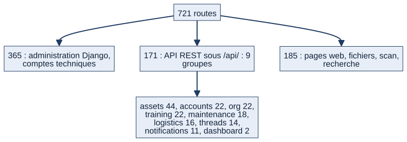

# Chapitre 20 — API REST, intégrations et interfaces web

> **Diffusion restreinte.** **État décrit :** état B (`6d6d0be`), non fusionné dans `main`. Légende : 🟢 réel vérifié, 🔵 cible validée par le PO, ⚪ non vérifié.
> **Pour qui :** développeurs, administrateurs, interlocuteurs SIC. **Ce que vous y trouverez :** ce que Matrix expose (pages, API, fichiers), comment l'accès est contrôlé, ce qui sert d'intégration aujourd'hui et ce qui reste cible. Le catalogue complet des routes est l'annexe C (générée).

---

## 20.1 Trois surfaces

*Schéma S42 — Les 721 routes de l'état B.*

| Surface | Routes | Pour qui | Remarque |
|---|---|---|---|
| **Pages web** | 185 | Les marins, dans un navigateur | HTML rendu par le serveur, interactions partielles par HTMX |
| **API REST** `/api/…` | 171 | Intégrations et scripts ; une partie sert aussi aux pages | Neuf groupes : `accounts`, `org`, `assets`, `maintenance`, `logistics`, `training`, `threads`, `notifications`, `dashboard` |
| **Administration Django** `/admin/` | 365 | Comptes techniques | Interface d'administration standard ; n'est pas un parcours métier |

🟢 **Seuls neuf groupes ont une API.** Les modules **quarts, absences, tâches, annonces, demandes, programme, postes, documentation, RETEX** et **rapports** n'ont **aucune route `/api/`** : ils ne se pilotent que par les pages.

## 20.2 Les ressources de l'API

| Groupe | Ressources |
|---|---|
| `accounts` | grades, profils, disponibilité des rôles, spécialités, utilisateurs |
| `org` | navires (unités), services, secteurs, sections, configuration de secteur |
| `assets` | matériels, types, emplacements, gammes et lignes de gammes, surcharges de gamme, documents, articles et catégories du catalogue ; QR code d'une installation (SVG et PNG) |
| `maintenance` | plans, occurrences (dont démarrer et terminer), exécutions |
| `logistics` | tickets, demandes de pièces, lignes de pièces |
| `training` | formations, validations, référents, exigences, sessions |
| `threads` | discussions, messages, pièces jointes |
| `notifications` | notifications (dont « tout marquer comme lu »), clé publique, abonnement et désabonnement Web Push |
| `dashboard` | deux séries pour graphiques (tickets correctifs ouverts, préventif de la semaine) |

🟢 **Le stock de pièces et les anomalies n'ont pas de route API propre** (chapitre 13).

## 20.3 Authentification et contrôle d'accès

- **Authentification** (réglage `REST_FRAMEWORK`) : **session** (celle du navigateur) et **authentification HTTP « Basic »**. Aucun jeton, aucune clé d'API, aucune délégation : un client automatique s'authentifie avec un **compte nominatif**.
- ⚠ **« Basic » transporte l'identifiant et le mot de passe à chaque requête** : il suppose **HTTPS**. En production, la redirection vers HTTPS est activée par `SECURE_SSL_REDIRECT` (voir chapitre 23).
- **Droit de lecture** : toute personne authentifiée, **bornée par le périmètre** (`ScopedQuerySetMixin`, `matrix/core/mixins.py:101`) : bâtiment, service, secteur, section. Un modèle sans champ de périmètre direct **refuse de répondre plutôt que de répondre sans filtre**.
- **Droit d'écriture** : classe `RolePermission` (`matrix/core/permissions.py:9`) : seuil de rôle **par action**, résolu selon la configuration du bâtiment de l'appelant ; un état-major n'écrit que sur les services rattachés à sa fonction ; un assigné peut modifier sa propre occurrence de maintenance.
- **Suppression protégée** : supprimer une unité référencée renvoie **409** avec le détail et le nombre d'objets liés (`SuppressionRefuseeAPI`, `org/views.py:38`), jamais une suppression en cascade (lot L03).
- **Statut d'une occurrence** : non modifiable par une écriture générique ; seules les actions dédiées (démarrer, terminer) le changent, avec la **confirmation** des installations critiques.
- **Modules désactivés** : l'API **continue de répondre** même si le module est désactivé pour le bâtiment ; seules les pages sont bloquées. Ce choix évite de casser les enchaînements internes ; ⚪ il doit être connu de tout intégrateur.
- **Équipage à terre** : lecture seule appliquée par middleware, y compris sur l'API.

## 20.4 Conventions

- Format : **JSON**, avec suffixe de format (`.json`) accepté ; filtres, tri et recherche texte par les filtres standards (`django-filter`, `OrderingFilter`, `SearchFilter`).
- **Pas de pagination configurée** et **pas de limitation de débit** (⚪ non trouvés dans le code) : une grosse collection est renvoyée entièrement ; un intégrateur doit filtrer.
- Erreurs : codes HTTP standards (400 saisie, 401/403 droit, 404 hors périmètre, **409 suppression refusée ou conflit d'écriture**) ; les pages d'erreur web sont habillées, l'API renvoie du JSON.
- Identifiants : UUID pour le matériel, le ticket, les objets du catalogue et la feuille de service ; entiers pour la plupart des autres objets. Principe du projet : garder des **identifiants stables** pour de futures API ; les comptes, unités et tâches n'ont **pas** d'UUID (A5).
- **Pas de versionnage d'API** (pas de préfixe `v1`).

## 20.5 Exports et échanges de fichiers

| Besoin | Mécanisme | Disponibilité |
|---|---|---|
| Calendrier personnel dans un autre agenda | **iCal** `calendar/ical/my/` (`calendar_app/ical_views.py:13`) | 🟢 ; ⚪ sans tâches ni programme |
| Liste ou bilan dans un tableur | **CSV** toujours ; **Excel** si `openpyxl` présent (`matrix/core/export.py`) | 🟢 |
| Bilan imprimable | **PDF** par WeasyPrint | 🟢 facultatif : bibliothèques natives (GTK) absentes par défaut sous Windows ; ⚪ non rejoué |
| QR d'un équipement | SVG ou PNG par l'API ; scan web `assets/scan/<uuid>/` | 🟢 |
| Fichiers téléversés | `media/<chemin>` servi **après contrôle des droits** (`matrix/core/medias.py:110`) | 🟢 |
| Import du référentiel des bâtiments | commande `importer_referentiel_batiments` (idempotente) | 🟢 |
| Import de matériel | grille ou fichier Excel (matériel mobile) | 🟢 |

## 20.6 Intégrations avec d'autres systèmes

🟢 **Aucune intégration sortante ni entrante n'est active.** Matrix ne se connecte à **aucun système d'information de la Marine** (SIGLe, ODIN, annuaires, messageries). Les seuls flux vers l'extérieur sont : l'**e-mail** (si configuré ; par défaut, les messages vont dans la console), le **Web Push** (si les clés VAPID sont configurées) et les **exports** ci-dessus.

🔵 **Frontière validée par le PO** (Notion, feuille de route du 09/10/2026) : **SIGLe et ODIN restent les référentiels officiels pour la maintenance et la logistique** ; on vérifie les recouvrements avant de créer un processus concurrent ; aucun déploiement réel ni donnée sensible sans validation SSI.

🔵 **Cible (phase 7 « Écosystème »)** : synchronisation bord–terre, API, interopérabilité, déploiement multi-bâtiments. **Volontairement différée** : « prouver la valeur » (phase 2) avant l'architecture de déploiement réel. L'architecture bord–terre (mutation de personnel, synchronisation) reste à définir ; elle conditionne le lot L25 (chapitre 25).

## 20.7 Ce qu'un intégrateur doit savoir

1. Il s'authentifie avec un compte nominatif et ne voit que son périmètre.
2. Il ne contourne pas les circuits : proposer → valider → publier s'applique aussi par l'API ; une écriture sensible peut exiger une confirmation explicite.
3. Il ne peut pas piloter les quarts, les tâches ou les annonces par l'API.
4. Il doit prévoir l'absence de pagination et de limitation de débit.
5. Les routes d'administration Django ne sont pas une API.

## 20.8 Limites et éléments non vérifiés

- ⚪ Aucun appel HTTP réel n'a été rejoué sur l'API pour ce dossier ; la liste vient de l'inventaire des routes (annexe C) et de la lecture du code.
- ⚪ Pas de test de charge, pas de mesure de performance.
- 🟢 L'absence de pagination et de limitation de débit vient de la lecture du code, non d'un essai.
- 🔵 Les spécifications d'API de la phase 7 n'existent pas.

---

**Sources (état B).** `matrix/settings.py` (`REST_FRAMEWORK`), `matrix/core/permissions.py`, `matrix/core/mixins.py`, `*/urls.py`, `couverture/etat_B/ROUTES.md`. Décisions : feuille de route Notion (09–10/10/2026), cahier des charges (phase 7).
