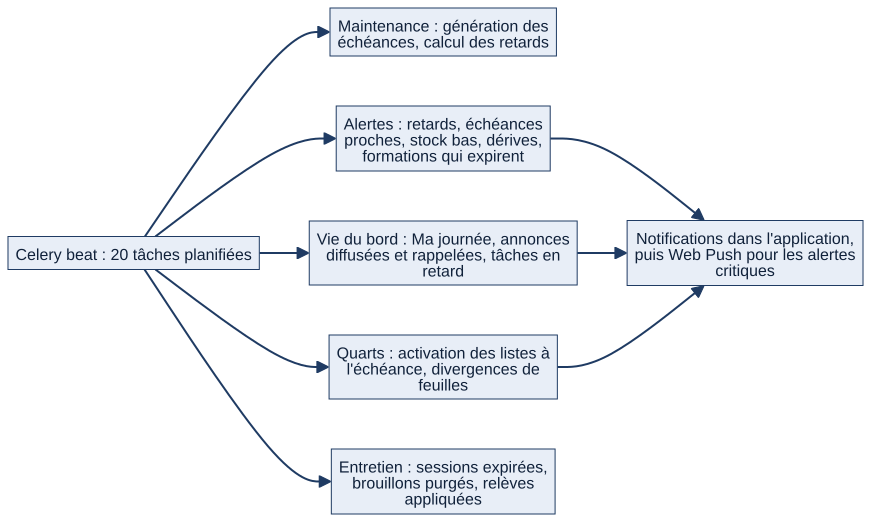

# Chapitre 21 — Interactions entre modules

> **Diffusion restreinte.** **État décrit :** état B (`6d6d0be`), non fusionné dans `main`. Légende : 🟢 réel vérifié, 🔵 cible, ⚪ non vérifié.
> **Pour qui :** développeurs, administrateurs. **Ce que vous y trouverez :** comment les modules se parlent — signaux, services partagés, notifications, tâches planifiées —, les enchaînements métier (anomalie → ticket, maintenance → ticket, RETEX → document et tâche…) et les couplages à connaître avant de modifier un module. La matrice des dépendances par paquet est au chapitre 18 (§18.6) ; les circuits métier détaillés sont aux chapitres 6 à 16.

---

## 21.1 Quatre mécanismes d'interaction

| Mécanisme | Principe | Exemples |
|---|---|---|
| **Services partagés** | Un module appelle une fonction d'un autre | Droits et périmètres (`matrix/core`), stock (`logistics/stock.py`), notifications (`notifications/services.py`) |
| **Signaux Django** | Un événement de base déclenche une réaction | Ticket créé quand une exécution est non conforme ; Web Push quand une notification critique est créée |
| **Relations génériques** | Un objet se rattache à n'importe quel autre | Discussions (`threads`), notifications, points d'appareillage, liens de documents |
| **Tâches planifiées (Celery beat)** | Un calcul périodique crée des alertes ou des échéances | 20 tâches (§21.4) |

## 21.2 Les signaux (15, état B)

| Signal | Où | Effet |
|---|---|---|
| Exécution de maintenance enregistrée | `maintenance/models.py:212` | Ticket correctif automatique si non conforme sur du **matériel mobile** ; notification des chefs |
| Notification créée | `notifications/signals.py:9` | **Web Push** uniquement pour le niveau **critique** ; les autres niveaux restent dans l'application |
| Message posté | `threads/mentions.py:25` | Notification des personnes **mentionnées** |
| Prérequis d'une formation modifiés | `training/models.py:308` | Contrôle d'absence de **cycle** entre formations |
| Réservations d'une session modifiées | `training/models.py:489` | Contrôle de la **capacité** et des prérequis ; liste d'attente |
| Présents d'une session modifiés | `training/models.py:536` | Contrôle des présences |
| Seuils de rôle / activation de module (avant et après sauvegarde, après suppression) | `org/models.py:354`, `org/models.py:365` | **Version de configuration** incrémentée : le cache des seuils et des modules est invalidé |
| Utilisateur créé | `accounts/models.py:226` | Création du profil |
| Connexion, déconnexion | `accounts/signals.py:9`, `accounts/signals.py:14` | Journal d'audit |

## 21.3 Enchaînements métier de bout en bout

| Enchaînement | Étapes | Chapitres |
|---|---|---|
| **Maintenance non conforme → ticket → pièces → remise en service** | Exécution non conforme (matériel mobile) → ticket créé, chefs alertés → diagnostic → demande de pièces → sortie de stock à la consommation → essais → remise en service (confirmation) → clôture (REX obligatoire) | 12, 13 |
| **Anomalie → ticket** | Signalement par un marin → un chef traite et convertit (lien dans les deux sens) | 12 |
| **Dérive détectée → alerte → appareillage** | Relevés → détection quotidienne → notification des chefs → point « dérive non résolue » à l'ouverture d'une session | 11, 12, 16 |
| **Stock sous seuil → alerte → appareillage** | Mouvement de stock → alerte quotidienne → point d'appareillage | 13, 16 |
| **Formation expirante → notification → « À faire »** | Qualification → alerte avant échéance → accueil | 14, 6 |
| **RETEX validé → document publié + tâche suivie** | Proposition → validation → document du bâtiment publié → action assignée → clôture quand les actions sont terminées | 15, 10 |
| **Difficulté signalée → fil → tâche** | Demande (bord → terre) → discussion contextuelle → action et échéance notifiées | 10, 9 |
| **Passation de relève → annonces, qualifications, listes** | Relève appliquée → synthèse figée | 4, 6 |
| **Liste de quarts publiée → calendrier → « Ma journée »** | Publication → événements du marin → notification du matin | 7, 8, 6 |
| **Échange de tour → contrôles → absences et habilitations** | Demande → vérification (absences, habilitations requises, délai) → décision | 8, 14 |
| **Accostage ou appareillage déclaré → mode du bâtiment → activation des listes** | Mouvement du bâtiment → mode MER/QUAI → activation par le chef de liste | 8 |

## 21.4 Tâches planifiées (annexe E : détail)

*Schéma S37 — Les cinq familles de tâches planifiées.*

🟢 **20 tâches** programmées dans `CELERY_BEAT_SCHEDULE` (`matrix/settings.py:273`). Rythmes : **chaque minute** (relèves à appliquer, activation des listes à l'échéance, « Ma journée » du matin et du soir, deux tâches de notification d'installations), **tous les quarts d'heure** (divergences de feuilles de service), **toutes les heures** (retards de maintenance, diffusion des annonces), **chaque jour** (génération des échéances, alertes, purges), à heure fixe pour trois d'entre elles (07:00 tâches en retard, 07:15 rappel d'accusés, 08:30 dérives).

⚠ **Sans worker Celery et sans beat, aucune alerte automatique n'est produite**, même si la donnée qui la déclenche est visible (README). Redis doit tourner. Une panne de ces processus ne produit **aucun message d'erreur côté application** (⚪ aucune supervision livrée).

🟢 Deux tâches nommées « …_daily » (notifications d'échéances d'installations) sont lancées **chaque minute** : la tâche compare l'heure courante à la **préférence de chaque marin** pour savoir qui notifier (même principe que « Ma journée »). Le nom ne reflète donc pas le rythme réel.

## 21.5 Notifications

Trois niveaux (information, avertissement, danger) et plusieurs **régimes** (`RegimeNotification`) ; création en masse par `creer_notifications_en_masse` ; **Web Push seulement pour le danger** ; déduplication (une alerte active par objet et par destinataire) et résolution automatique quand la situation redevient normale (exemple du stock, chapitre 13). L'envoi Web Push est **borné** (`WEBPUSH_DELAI_MAX`, 3 secondes) : un appareil injoignable ne bloque jamais l'action métier.

## 21.6 Couplages à surveiller

- **`dashboard` dépend de presque tout** (logistique 13 liens, maintenance 12, assets 10, training 8…) : tout changement de modèle d'un module appelle une vérification de l'accueil et des vues de pilotage.
- **`notifications` connaît les autres modules** (assets 10 liens, logistique 4…) pour produire les liens vers les objets : un nouvel objet notifiable doit y être déclaré.
- **`assets` ↔ `maintenance` ↔ `logistics`** forment le cœur technique ; un ticket vise un matériel **ou** une installation ; une pièce de stock peut viser l'un **ou** l'autre.
- **Relations génériques** : une suppression d'unité ou d'objet doit rester cohérente avec elles (⚪ cas « relations génériques vs suppression d'unité » non rejoué).
- **Modules désactivables** (14) : seule la couche web est bloquée ; signaux, tâches et API continuent (chapitre 20).

## 21.7 Interactions cibles 🔵

Notion « 03 — Formation » décrit une chaîne **« besoin de formation → demande → validations → places → session → résultat → qualification → couverture du poste → disponibilité RH »** et un **moteur de dossiers** réutilisable (acteurs, workflow, timeline, fil, échéances, pièces jointes) dont la formation serait le premier cas pilote. **Rien de tout cela n'est développé** (chapitre 14, A19). Le principe directeur reste : **« une information est saisie une fois, puis ses conséquences sont propagées »**.

## 21.8 Limites et éléments non vérifiés

- ⚪ Les enchaînements asynchrones n'ont pas été rejoués avec Redis et Celery réels ; ils sont décrits depuis le code et les tests unitaires.
- ⚪ Aucune mesure de performance des signaux ou des tâches.

---

**Sources (état B).** `couverture/etat_B/INVENTAIRE.md` (dépendances, signaux, tâches), `matrix/settings.py`, `notifications/`, `maintenance/models.py`, `training/models.py`, `org/models.py`.
