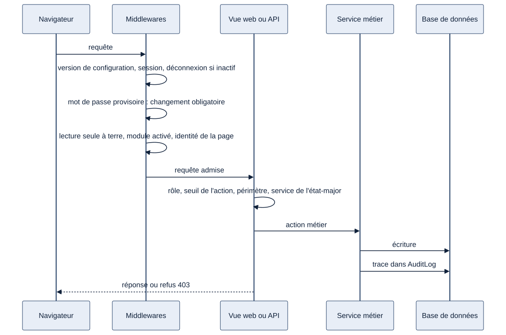
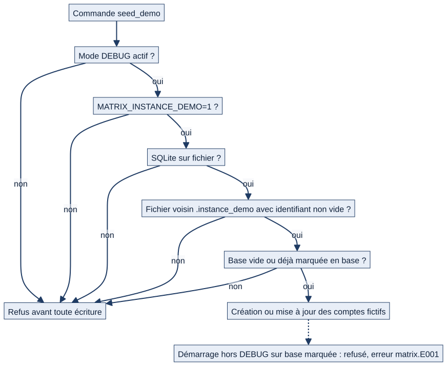

# Chapitre 22 — Sécurité

> **Diffusion restreinte.** **État décrit :** état B (`6d6d0be`), non fusionné dans `main`.
> **Pour qui :** développeurs, administrateurs. **Ce que vous y trouverez :** les mécanismes par lesquels Matrix protège l'accès, les données et la traçabilité — décrits comme des **mécanismes**, pas comme une liste de défauts. Les règles d'autorisation sont au chapitre 5 ; la mise en production au chapitre 23.
> **Rappel de cadre.** Matrix n'est ni un système officiel ni homologué. Ce chapitre décrit des protections techniques, pas une conformité.

---

## 22.1 La démarche : plusieurs barrières successives

Matrix ne fait pas reposer la sécurité sur un seul contrôle. Une action d'écriture franchit plusieurs barrières, dont **aucune n'est l'interface** : l'écran masque des boutons, c'est le serveur qui décide.

| Barrière | Rôle | Où |
|---|---|---|
| Authentification | Savoir qui est connecté | Session ; mot de passe contrôlé |
| Contrôles transverses | Refuser d'emblée les requêtes qui ne doivent pas passer | Chaîne de middlewares |
| Autorisation | Rôle, seuil d'action, périmètre, fonction exigée | Vues, services, permissions DRF (chapitre 5) |
| Intégrité des données | Empêcher une suppression qui détruirait de l'information | `PROTECT`, règles d'archivage (chapitres 4 et 19) |
| Fichiers | Ne livrer un fichier qu'à qui peut voir l'objet qui le porte | Service protégé des médias |
| Traçabilité | Garder la preuve de qui a fait quoi | Journal d'audit, versions |
| Garde-fous d'exploitation | Refuser de démarrer dans une configuration dangereuse | Contrôles de démarrage |

## 22.2 La chaîne de contrôles d'une requête

*Schéma S11 — Ce qui se passe entre le navigateur et la base de données.*

Les middlewares, dans l'ordre de `MIDDLEWARE` (`matrix/settings.py:115`), et ce que chacun garantit :

| # | Middleware | Garantie |
|---|---|---|
| 1 | `ContexteConfigurationMiddleware` | Les réglages en cache (seuils, modules) sont validés une fois par requête |
| 2 | Sécurité Django, session, commun, CSRF | Protection standard : redirection HTTPS hors DEBUG, jeton CSRF sur les formulaires |
| 3 | `SansNulMiddleware` | Retire le caractère NUL des paramètres (évite une erreur de base de données) |
| 4 | Authentification | Identifie l'utilisateur de la session |
| 5 | `InactiviteMiddleware` | Déconnecte après inactivité (15 minutes par défaut) |
| 6 | Clickjacking | Interdit l'affichage de Matrix dans une page tierce |
| 7 | `IdentitePageMiddleware` | Refuse une écriture si la page a été ouverte pour un autre marin (poste partagé) |
| 8 | `HabillageErreur400Middleware` | Présente proprement les requêtes malformées |
| 9 | `BatimentCourantMiddleware` | Borne les listes au bâtiment choisi, revalidé à chaque requête |
| 10 | `MotDePasseProvisoireMiddleware` | Impose le changement d'un mot de passe provisoire avant toute autre page |
| 11 | `ModuleActivationMiddleware` | Bloque les pages web d'un module désactivé sur le bâtiment |
| 12 | `EquipageATerreMiddleware` | Lecture seule de l'équipage à terre et du soutien à terre ; **refus par défaut** |
| 13 | `ErreurSaisieMiddleware` | Une saisie non contrôlée devient un message, pas une erreur 500 |

## 22.3 Authentification et sessions

- **Connexion** par identifiant et mot de passe (`/accounts/login/`). Les contrôles de mot de passe sont ceux de Django : longueur minimale, mot courant refusé, entièrement numérique refusé, trop proche de l'identité refusé (`matrix/settings.py:210`).
- **Création de compte sans mot de passe utilisable.** L'administrateur du bâtiment réinitialise ensuite : mot de passe provisoire de 14 caractères, affiché **une fois**, jamais journalisé, à changer à la première connexion (chapitre 5).
- **Déconnexion automatique** après 900 secondes d'inactivité par défaut, bornée entre 60 secondes et 8 heures, avec avertissement ; les requêtes automatiques ne comptent pas (`matrix/core/inactivite.py`). Les brouillons sont enregistrés avant déconnexion.
- **Cookies** de session et CSRF en mode « sécurisé » et **redirection vers HTTPS hors DEBUG** (`matrix/settings.py:422-424`). En développement local, HTTP simple reste possible.
- **API** : authentification par session et, en plus, par `BasicAuthentication` (bloc `REST_FRAMEWORK`, `matrix/settings.py:239`) ; l'accès à l'API reste soumis aux mêmes permissions que les pages, **sauf l'activation des modules** : un module désactivé pour un bâtiment ne bloque que les pages web, jamais l'API (chapitre 20, écart A25).
- Connexions et déconnexions sont tracées (`accounts/signals.py`).

## 22.4 Les fichiers téléversés

Les fichiers (photos de matériel, documents, pièces jointes, certificats…) **ne sont jamais servis directement** par le serveur web.

- Toute adresse `/media/…` passe par `servir_media` (`matrix/urls.py`), qui consulte un **registre** : `FichierProtege` (`matrix/core/medias.py:25`) associe chaque dossier de dépôt à son modèle, son champ et **la règle de consultation de l'objet qui porte le fichier** (périmètre du matériel, de l'installation, de la tâche, de l'anomalie, dossier de formation visible…).
- Un chemin **absent du registre** ou dont l'objet est **hors périmètre** répond **404**, sans indice sur l'existence du fichier.
- Quelques ressources communes à toute la flotte (silhouettes, photos du catalogue, barèmes) sont déclarées « tout utilisateur connecté ».
- En production, `MEDIA_ACCEL_REDIRECT` permet de déléguer l'envoi au serveur web après autorisation (le fichier est livré par le serveur web, la décision reste à Django).
- **À l'envoi**, `matrix/core/validators.py` contrôle l'extension autorisée, la taille maximale (`DOCUMENT_TAILLE_MAX_MO`, 20 Mo par défaut) et, pour les images, que le contenu est réellement décodable (on ne se fie ni au nom ni au type déclaré par le navigateur).

## 22.5 Le journal d'audit

`accounts.AuditLog` (`accounts/models.py:177`) enregistre : **qui** (acteur), **quoi** (action), **sur qui** (utilisateur cible), **détails** (texte), **quand** (horodatage). Il est alimenté par une vingtaine de modules du code.

Familles d'actions tracées (extraits) : comptes (`create_user`, `edit_user`, `delete_user`, `changement_role`, `reinitialisation_mot_de_passe`, `bulk_*`, connexion, déconnexion) ; équipage (`releve_*`, `changement_equipage`, `fuseau_horaire_modifie`) ; unités (`suppression_unite_refusee`, `delete_<type>`, archivage) ; quarts (`liste_service_*`, `feuille_service_*`, échanges) ; maintenance (`correctif_compte_rendu*`, `occurrence_status_change`, `create_ticket*`) ; formations, annonces, documents, programme, postes.

À connaître :
- **Les refus sont aussi tracés** pour les actions sensibles (par exemple `quarts/refus.py` : activation, mouvements, régularisation, remplacement, réglages ; suppression d'unité refusée).
- La confirmation explicite des **validations critiques** (clôture d'une maintenance critique, remise en service, clôture de la préparation à l'appareillage) est enregistrée avec le texte confirmé, sa version et le canal (web ou API) : `matrix/core/confirmations.py`. Ce n'est **pas une signature électronique** : la personne est déjà authentifiée, la trace atteste qu'elle a validé en connaissance de cause.
- Un compte rendu corrigé **conserve la saisie d'origine** ; chaque version d'une liste, d'une feuille de service, d'une annonce ou d'un document est conservée.
- ⚪ Le journal est une table ordinaire de la base : il n'est pas scellé contre une modification par quelqu'un qui aurait un accès direct à la base. Sa durée de conservation n'est pas définie (information manquante IM-10 du dossier V1.2).

## 22.6 Proposer, valider, publier

Le principe 7 (chapitre 1) se retrouve dans le code sous trois formes :
1. **Versions** : une modification d'une liste, d'une feuille, d'une annonce ou d'un document crée une version ; la publiée reste active jusqu'à validation.
2. **Circuits à deux acteurs** : la relève d'équipage (un commandant propose, l'autre équipage valide), les échanges de tours, les fiches et articles du catalogue.
3. **Confirmation explicite** pour les validations critiques (§22.5).

Aucune modification d'un objet validé n'écrase silencieusement l'ancien état.

## 22.7 Les mécanismes ajoutés par les lots L01, L05, L02 et L03

### L01 — Verrou des commandes de démonstration

Les commandes `seed_demo*` créent des comptes fictifs ; elles ne doivent jamais s'exécuter sur une vraie base.

*Schéma S12 — Les conditions cumulatives exigées par les commandes de démonstration.*

- **Conditions cumulatives** : mode DEBUG, variable `MATRIX_INSTANCE_DEMO=1`, base SQLite sur fichier, fichier voisin `<base>.instance_demo` contenant un **identifiant d'instance non vide** écrit par `scripts/preparer_instance_test.py`, base vide ou déjà marquée (table `accounts.InstanceDemo`). Un fichier voisin vide ou sans identifiant **n'est jamais une preuve**.
- **Mots de passe jamais prévisibles** : fournis (`MATRIX_DEMO_PASSWORD`, `MATRIX_DEMO_ADMIN_PASSWORD`) ou générés au hasard dans un fichier `<base>.identifiants` (droits 0600, jamais écrasé, lié à l'identifiant d'instance). Rien dans la sortie ni la ligne de commande.
- **Anciennes bases** de démonstration (mots de passe d'origine prévisibles) : refusées par défaut ; deux choix explicites (`--reinitialiser`, ou `--mettre-a-jour --adopter-ancienne-base` si **chaque** compte est un compte de démonstration encore protégé par un ancien mot de passe).
- **Production** : une base marquée **refuse de démarrer hors DEBUG** (contrôle `verifier_pas_de_base_de_demonstration_en_production` (`matrix/core/checks.py:88`), qui lève l'erreur `matrix.E001`, et refus à l'import de `wsgi.py` et `asgi.py`).
- **Contrôle avant mise en production** : `python manage.py verifier_instance` (lecture seule).
- Liste des comptes de démonstration : `matrix/core/instance_demo.py` (`COMPTES_DEMO`, vérifiée par un test).

### L05 — Configuration de production minimale

`erreurs_secrets_production` (`matrix/settings.py:49`), exécutée au démarrage **hors DEBUG**, refuse de démarrer (erreur en français, toutes les raisons cumulées) si :
- la clé secrète est absente ou vide, de moins de 32 caractères, ou égale à une valeur d'exemple (dont `dev-secret-key`, `change-me`, `changeme`, `secret`, `password`, `matrix`, `postgres`, `admin`, `pass`, casse ignorée) ;
- `DB_HOST` est défini (PostgreSQL) avec un mot de passe de base absent, vide ou d'exemple.

En développement (DEBUG), aucune vérification : l'installation locale fonctionne avec le fichier d'exemple tel quel. Limite assumée : la longueur ne mesure pas l'entropie ; les autres secrets (`EMAIL_HOST_PASSWORD`, `VAPID_PRIVATE_KEY`, mot de passe Redis) ne sont pas contrôlés.

### L02 et L03 — Intégrité de la structure

Archivage effectif et suppression sûre des unités (chapitre 4) : aucune unité occupée ne s'archive, aucune unité référencée ne se supprime, refus tracés, API en 409 pour la suppression.

## 22.8 Garde-fous de démarrage et de développement

`matrix/core/checks.py` : avertissement si des migrations sont en attente au `runserver` (`matrix.W001`), avertissement si DEBUG est actif hors `runserver` (`matrix.W002`), **erreur** si une base de démonstration démarre en production (`matrix.E001`). Côté équipe de développement, des hooks de commit lancent `manage.py check`, vérifient le français des messages et l'application des migrations (chapitre 24).

## 22.9 Fonctionnement cible 🔵

| Sujet | Décision | Lot |
|---|---|---|
| Sécurité d'accès (avec les SIC) | Exigences de sécurité des systèmes d'information à intégrer | L21 |
| Exclusion de l'administrateur technique des actes métier | Aucun visa métier | L06 |
| Désactiver plutôt que supprimer un compte | Conservation de l'historique | L04 |
| Chiffrement, segmentation, sauvegardes, conservation des journaux | Cahier des charges §29 | Non défini |
| Procédures officielles (PÉPIN, CRAT…) | Circuits, autorités et conservation **non validés** | — |

## 22.10 Limites et éléments non vérifiés

- ⚪ La page Notion « 07 — SIC, cyber, protection-défense et conformité » a été lue : elle définit des **principes** (utilisable = fonctionne + conforme + contrôlé + autorisé ; chaîne sécurité/protection : commandant en second, COMANAV adjoint sécurité, COMAEQ adjoint protection ; à distinguer des scénarios incendie et voie d'eau). Elle ne fixe pas d'exigences techniques d'hébergement ; **elles restent à obtenir auprès des SIC** avant toute mise en production.
- ⚪ Aucune limitation du nombre de tentatives de connexion, ni en-tête de politique de sécurité de contenu, ni HSTS n'a été trouvé dans la configuration. « Absent » signifie « non trouvé par recherche ».
- ⚪ `CSRF_TRUSTED_ORIGINS` est une liste fixe dans `matrix/settings.py:413` (localhost) ; un déploiement sous un autre nom d'hôte demande de l'adapter. À traiter au chapitre 23.
- ⚪ Le courrier est écrit dans la console par défaut : aucune réinitialisation par e-mail ; le mot de passe provisoire est affiché à l'administrateur.
- ⚪ PostgreSQL, Windows et navigateur n'ont pas été rejoués ; les risques résiduels déclarés par les comptes rendus L01 (Windows, acte volontaire d'un opérateur sur une base réelle) et L05 (valeurs triviales longues acceptées) restent valables.
- ⚪ Les relations génériques (chapitre 19) ne sont pas protégées par la base.

---

**Sources (état B).** `matrix/settings.py:49,115,210,239,413,422`, `matrix/core/middleware.py`, `matrix/core/inactivite.py`, `matrix/core/medias.py:25`, `matrix/core/validators.py`, `matrix/core/confirmations.py`, `matrix/core/checks.py:88`, `matrix/core/instance_demo.py:16,169`, `accounts/models.py:177`, `accounts/signals.py`, `quarts/refus.py`, `scripts/preparer_instance_test.py`. Comptes rendus : `N_LOT_L01_COMPTE_RENDU.md`, `O_LOT_L05_COMPTE_RENDU.md`, `P_LOT_L02_COMPTE_RENDU.md`, `Q_LOT_L03_COMPTE_RENDU.md`. Notion : « 07 — SIC, cyber, protection-défense et conformité ».
