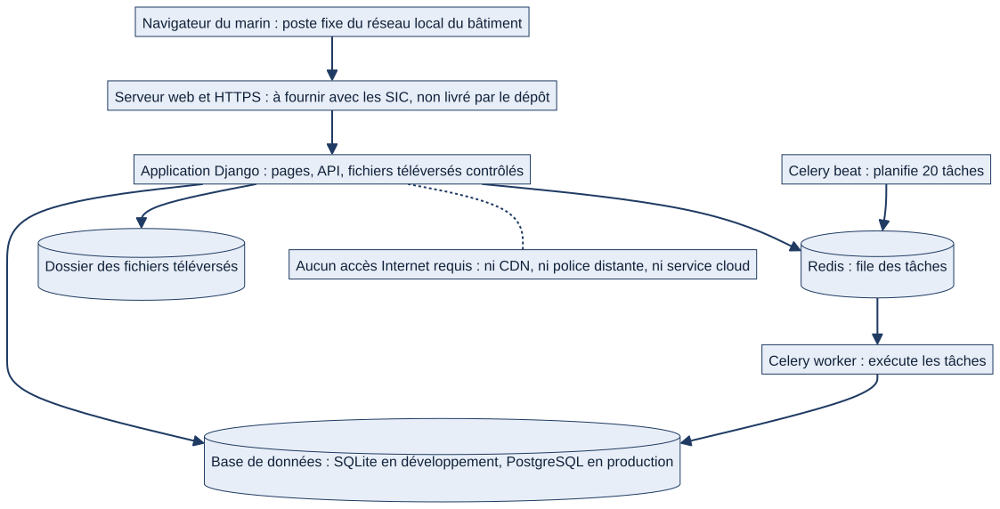
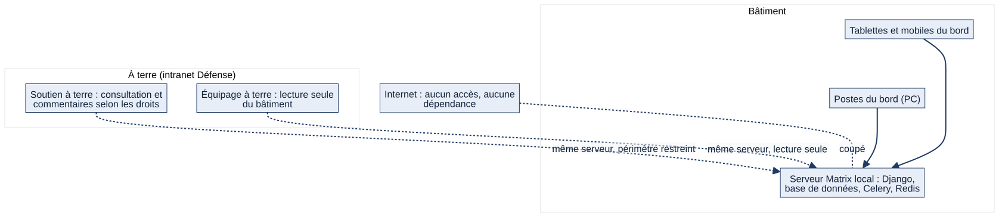
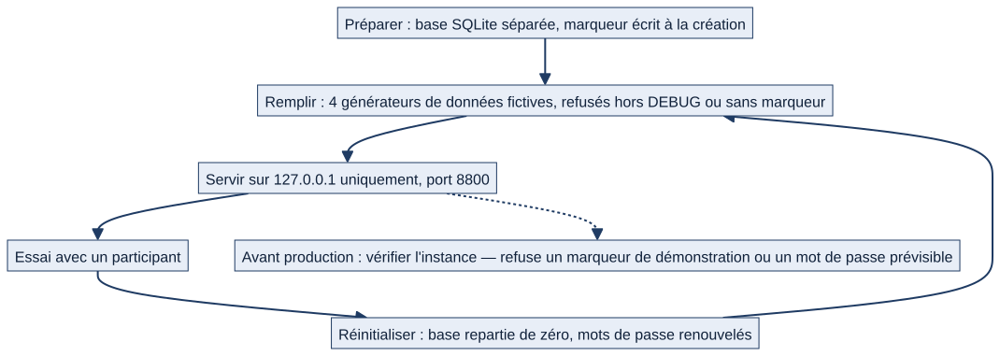

# Chapitre 23 — Configuration, déploiement, exploitation

> **Diffusion restreinte.** **État décrit :** état B (`6d6d0be`), non fusionné dans `main`. Légende : 🟢 réel vérifié, 🔵 cible ou décision du PO, ⚪ non vérifié ou **à fournir par les SIC / l'exploitant**.
> **Pour qui :** administrateurs, exploitants, interlocuteurs SIC, développeurs. **Ce que vous y trouverez :** les environnements, tous les réglages, les processus à lancer, le fonctionnement sur le réseau local du bord, la mise en production et ses garde-fous, la démonstration isolée, et — dit franchement — ce que le dépôt **ne fournit pas** : sauvegarde, restauration, supervision, journaux, serveur web. **Ce chapitre ne décrit pas une procédure d'exploitation validée.**

---

## 23.1 Position du PO sur le déploiement 🔵

Décision du PO (Notion, 29/10/2026) : **GO démonstration encadrée uniquement ; NO GO déploiement opérationnel, données réelles et homologation.** « La démonstration n'est connectée à aucun système d'information de la Marine et ne constitue pas une solution homologuée » (`docs/DEMO.md`). La **sécurité d'accès avec les SIC** (HTTPS, limitation des connexions) reste un lot à mener (L21, chapitre 25). Tout ce chapitre décrit donc **ce que le code permet et exige**, pas une autorisation de mise en service.

## 23.2 Les quatre contextes d'usage

| Contexte | Base | Mode | Qui, où |
|---|---|---|---|
| **Développement** | SQLite `db.sqlite3` (ou PostgreSQL via `DB_HOST`) | `DJANGO_DEBUG=1` | Poste du développeur ; `.env` local |
| **Démonstration / essais avec des marins** | SQLite **séparée** (`instance_test_marins/`), données fictives | DEBUG actif ; écoute **uniquement** `127.0.0.1:8800` | Poste isolé ; jamais sur un réseau opérationnel |
| **Tests automatiques** | SQLite en mémoire | DEBUG | Poste du développeur |
| **Production** | PostgreSQL recommandé | `DJANGO_DEBUG=0` : garde-fous au démarrage | ⚪ Non autorisée ; aucune instance décrite |

## 23.3 Réglages (variables d'environnement)

Le fichier `.env` (modèle : `.env.example`) est lu au démarrage (`MATRIX_ENV_FILE` pour en désigner un autre). Les variables déjà présentes dans l'environnement l'emportent.

| Variable | Défaut | Rôle |
|---|---|---|
| `DJANGO_DEBUG` | `0` | `1` = développement ; **sans elle, l'application démarre en production** |
| `DJANGO_SECRET_KEY` | vide (clé de développement) | **Obligatoire en production**, ≥ 32 caractères, ni valeur d'exemple |
| `DJANGO_ALLOWED_HOSTS` | `localhost,127.0.0.1` | Noms d'hôte acceptés |
| `MATRIX_SQLITE_PATH` | — | Force SQLite (démonstration) ; l'emporte sur `DB_HOST` |
| `DB_HOST`, `DB_NAME`, `DB_USER`, `DB_PASSWORD`, `DB_PORT` | `matrix`, `matrix`, `matrix`, `5432` | PostgreSQL ; **`DB_PASSWORD` réel obligatoire en production** |
| `CELERY_BROKER_URL`, `CELERY_RESULT_BACKEND` | `redis://localhost:6379/0` et `/1` | File des tâches |
| `MATRIX_MEDIA_ROOT` | `media/` | Dossier des fichiers téléversés |
| `MEDIA_ACCEL_REDIRECT` | vide | En production, délègue l'envoi des fichiers au serveur web (`X-Accel-Redirect`) |
| `EMAIL_BACKEND` et `EMAIL_*` | console | Messages sortants (par défaut : affichés en console) ; `DEFAULT_FROM_EMAIL` |
| `VAPID_PUBLIC_KEY`, `VAPID_PRIVATE_KEY`, `VAPID_ADMIN_EMAIL` | vides | Web Push (désactivé sans clés) ; générées **une seule fois** |
| `WEBPUSH_DELAI_MAX` | 3 s | Borne d'envoi Web Push |
| `INACTIVITE_DELAI_SECONDES`, `INACTIVITE_AVERTISSEMENT_SECONDES` | 900, 60 | Déconnexion automatique |
| `BROUILLONS_CONSERVATION_JOURS`, `BROUILLONS_TAILLE_MAX` | 30, 262 144 | Brouillons |
| `DOCUMENT_TAILLE_MAX_MO` | 20 | Taille des documents |
| `MATRIX_DEMO_PASSWORD`, `MATRIX_DEMO_ADMIN_PASSWORD` | générés | Démonstration seulement |
| `POSTGRES_DB`, `POSTGRES_USER`, `POSTGRES_PASSWORD` | `matrix`, `matrix`, **obligatoire** | Conteneur PostgreSQL (docker compose) |

🟢 Fuseau et langue : `Europe/Paris`, français. Réglages métier (seuils de rôle, modules, délais) : **dans l'application** (Paramètres), pas dans l'environnement (chapitre 17).

## 23.4 Les processus à lancer

*Schéma S35 — Ce qui tourne, et ce qui reste à fournir.*

| Processus | Commande | Remarque |
|---|---|---|
| **Application** | `python manage.py runserver` (développement) | ⚪ **Aucun serveur d'application de production n'est livré** : ni `gunicorn`, ni `uvicorn` dans les dépendances ; l'interface WSGI/ASGI existe (`matrix/wsgi.py`, `matrix/asgi.py`). Le choix est à faire avec les SIC |
| **Worker** | `celery -A matrix worker -l info` (`--pool=solo` sous Windows) | Exécute les tâches |
| **Beat** | `celery -A matrix beat -l info` | Planifie les 20 tâches |
| **PostgreSQL et Redis** | `docker compose up -d` | Images `postgres:16` et `redis:7` ; volumes nommés ; **ports liés à `127.0.0.1`** |

Scripts Windows livrés : `setup.bat` (environnement virtuel, dépendances, migrations, fichiers statiques), `start.bat` (migrations en attente, worker et beat en arrière-plan, serveur), `lancer_demo.bat` (démonstration isolée), `create_admin.bat`, `reset_admin.bat`.

⚠ **Sans worker ni beat, aucune alerte automatique** (chapitre 21). `start.bat` les lance mais **échoue silencieusement si Redis est absent**.

## 23.5 Fonctionnement sur le réseau local du bord

🟢 **Principe du projet : « Internet n'existe pas ».** Polices, icônes, graphiques, calendrier et scripts sont **embarqués** ; aucun CDN, aucune API distante, aucune télémétrie. L'application sert un réseau **fermé**.

*Schéma S01 — Contexte : bord, terre, aucun Internet.*

- **Clients** : navigateurs des postes fixes du réseau du bâtiment (et de l'intranet à terre) ; aucun client lourd.
- **Hôtes acceptés** : `DJANGO_ALLOWED_HOSTS` doit contenir le nom ou l'adresse sous lesquels les postes joignent le serveur.
- **Base et file** : joignables **depuis la machine du serveur seulement** (liaison `127.0.0.1`), pour ne pas exposer la base au LAN du bord (commentaire du fichier docker compose).
- **HTTPS** : en production, `SESSION_COOKIE_SECURE`, `CSRF_COOKIE_SECURE` et `SECURE_SSL_REDIRECT` sont **actifs** : toute requête HTTP est redirigée vers HTTPS, les cookies ne circulent qu'en HTTPS. **Aucun certificat ni serveur HTTPS n'est fourni** : à fournir avec les SIC.
- ⚪ **Non trouvés dans le code** : réglage d'un **proxy inverse** (`SECURE_PROXY_SSL_HEADER`), **HSTS**, configuration de **journalisation** (`LOGGING`), **limitation des tentatives de connexion**. Les origines CSRF de confiance sont **codées en dur sur `localhost`/`127.0.0.1:8000`** : à revoir selon l'architecture réelle (nom d'hôte, proxy).
- **Web Push** : exige HTTPS ou `localhost` côté navigateur ; **dégradé proprement** sans (les notifications dans l'application continuent).
- **E-mail** : par défaut en console ; un relais SMTP à bord est à fournir si l'on veut des messages.
- **Synchronisation bord–terre** : **inexistante** ; chaque instance est autonome (cible, chapitre 25).
- **Fichiers téléversés** : stockés sur le disque du serveur ; servis par l'application après contrôle des droits.

## 23.6 Mise en production : garde-fous et checklist

🟢 **Garde-fous au démarrage** (`DJANGO_DEBUG=0`) — lot L05 : le démarrage est **refusé** si `DJANGO_SECRET_KEY` est absente, de moins de 32 caractères ou égale à une valeur d'exemple (`dev-secret-key`, `change-me`, `secret`, `password`, `matrix`, `admin`, `pass`…), ou si `DB_HOST` est défini sans `DB_PASSWORD` réel (sauf SQLite explicite). Contrôles Django complémentaires (`matrix/core/checks.py`) : avertissement si des **migrations restent à appliquer** au lancement de `runserver`, et si **DEBUG est actif hors du serveur de développement local**.

🟢 **Contrôle avant mise en service** : `python manage.py verifier_instance` (lecture seule) **échoue** si la base est marquée « démonstration » alors que DEBUG est inactif, ou si des comptes actifs ont un **mot de passe prévisible** (lot L01).

**Checklist avant production** (déduite du code et du README ; ⚪ pas une procédure validée) :
1. Poste ou serveur dédié, `.env` propre (jamais copié d'une démonstration), `DJANGO_DEBUG=0`.
2. Clé secrète propre ; mot de passe PostgreSQL réel ; `DJANGO_ALLOWED_HOSTS` renseigné.
3. Base PostgreSQL et Redis **non exposés** au LAN.
4. Serveur HTTPS et serveur d'application choisis **avec les SIC** ⚪.
5. `python manage.py migrate` après **sauvegarde** de la base ⚪ (procédure à fournir) ; `collectstatic`.
6. `python manage.py verifier_instance` : aucun marqueur de démonstration, aucun mot de passe prévisible.
7. Clés VAPID générées **une fois** (`generate_vapid_keys`) et conservées si le Web Push est voulu.
8. Worker et beat lancés et **supervisés** ⚪ ; Redis disponible.
9. Comptes réels créés par l'administrateur ; **aucune commande `seed_demo*`** (elles refusent hors démonstration).
10. Validation SSI et autorisation du PO préalables : **non acquises**.

## 23.7 L'instance de démonstration isolée

*Schéma S36 — Préparer, servir, réinitialiser ; contrôle avant production.*

Script `scripts/preparer_instance_test.py` : **base SQLite séparée**, **marqueur** écrit à la création (sans marqueur, la base n'est jamais supprimée ni remplie), serveur lié à `127.0.0.1` **sans option pour en changer**, environnement **purgé** (seules quelques variables du poste sont transmises : pas de base, d'e-mail, de Redis ni de clés). Modes : `--reinitialiser` (repart de zéro et **renouvelle les mots de passe**), `--verifier` (contrôle sans écriture), `--mettre-a-jour` (migrations et complément sans rien supprimer), `--identifiants` (affiche les mots de passe d'un fichier réservé au propriétaire), `--servir [--port]`. Quatre générateurs de données fictives, **tous idempotents**, **refusés** hors DEBUG, sans marqueur, sur PostgreSQL ou si un compte non fictif existe (`seed_demo`, `seed_demo_mer_quai`, `seed_demo_dense`, `seed_demo_metier`). Compte d'exemple : 12 profils fictifs (équipier, BSC, chef de secteur, chef de service, COMAEQ, commandants…).

⚪ **Windows** : la recette Windows (`docs/recette/L01_recette_windows.md`) existe ; le kit a été testé sous **Linux**, pas sous Windows. **Safari/iPhone** : exige un environnement mobile isolé approuvé, sinon « non effectué ».

## 23.8 Migrations et mise à jour

- **190 migrations** ; `python manage.py migrate` ; `start.bat` applique les migrations en attente.
- Hook de relecture local `verifier-migration-retrocompatible.sh` : alerte si une migration ajoute un champ **sans valeur par défaut** (chapitre 24).
- Les lots L01 et L02 ajoutent des migrations additives (marqueur d'instance de démonstration, champs d'archivage) ; L03 n'en ajoute pas.
- ⚪ **Retour arrière** : aucune procédure fournie ; la restauration d'une sauvegarde est la seule voie sûre.
- Mise à jour du code : `git pull`, installer les dépendances, `migrate` (après sauvegarde) ; `matrix/core/checks.py` avertit au lancement si une migration manque.

## 23.9 Sauvegarde et restauration ⚪

🟢 **Constat : aucun outil, aucun script ni aucune documentation de sauvegarde ou de restauration n'existe dans le dépôt** (recherche des termes « sauvegarde », « backup », `dumpdata`, `pg_dump`).

**Ce qui contient l'état de l'instance** (inventaire factuel, à sauvegarder ensemble) :
| Élément | Contenu | Où |
|---|---|---|
| **Base de données** | Toutes les données métier, le journal d'audit, les abonnements Web Push | PostgreSQL (ou `db.sqlite3`) |
| **Fichiers téléversés** | Photos, documents, certificats de formation, pièces jointes | `MATRIX_MEDIA_ROOT` (défaut `media/`) |
| **Secrets** | `DJANGO_SECRET_KEY` (sessions), clés VAPID (**leur perte invalide tous les abonnements Web Push**), mot de passe de la base | `.env` ou environnement |
| **Volumes Docker** | Données PostgreSQL et Redis | `db_data`, `redis_data` |

Ce qui reste **à définir avec les SIC** : outil, fréquence, support, chiffrement, durée de conservation, essai de restauration, restauration depuis le bord vers la terre. **Aucune règle n'est inventée ici.** Redis ne porte que la file des tâches ; ⚪ la perte de Redis ne doit pas perdre de données métier, mais **l'effet d'une perte de la file n'a pas été testé**.

## 23.10 Supervision, journaux, traçabilité

- **Traçabilité métier** : `AuditLog` (connexion, déconnexion, actes critiques, refus de confirmation, mouvements de stock, transitions de circuits) ; consultable dans les Paramètres (journal) et par l'administrateur.
- **Journaux techniques** : aucune configuration de journalisation Django ; `start.bat` écrit `celery.log` et `celery-beat.log` à la racine ; ⚪ pas de rotation, pas de centralisation.
- **Durées de conservation** : brouillons 30 jours, sessions expirées purgées chaque jour ; **notifications, journaux et estimations ne sont pas purgés** (point B8, « à confirmer » par le PO : `IM-10`).
- **Supervision** de Redis, de Celery, de la base, de l'espace disque : ⚪ **rien de livré**.

## 23.11 Limites opérationnelles

1. Pas de **haute disponibilité** : un serveur, une base ; ⚪ aucun plan de reprise.
2. Pas de **synchronisation** entre bâtiments ou avec la terre.
3. Pas de **mode hors-ligne** côté client (chapitre 17) ; sans serveur, aucune saisie.
4. **Pas de limitation de débit** ni de blocage des tentatives de connexion trouvés.
5. **PDF** et **Excel** conditionnés à des bibliothèques optionnelles.
6. **Alertes automatiques** conditionnées à Redis, au worker et au beat.
7. Un module désactivé **n'arrête pas** l'API ni les tâches.
8. Rien n'a été **mesuré** (charge, volumétrie, temps de réponse).
9. **Windows** et **PostgreSQL** : décrits ; non rejoués dans ce dossier (les lots rapportent des essais PostgreSQL manuels).
10. La documentation d'installation contient **une incohérence** : `setup.bat` annonce « Python 3.8 ou supérieur » alors que le README et `requirements.txt` (Django 5.2) supposent **Python 3.12 ou plus** (A22).

## 23.12 Cible et à définir 🔵⚪

- **L21 — sécurité d'accès avec les SIC** : HTTPS, limitation des connexions (dépend des experts SIC).
- **L04 — désactivation des comptes** : non lancé.
- **Architecture bord–terre** (synchronisation, mutation) : à définir, conditionne L25.
- **CI hors Internet** : script local obligatoire, tests navigateur versionnés (L28).
- Sauvegarde, restauration, supervision, conservation des journaux : **à fournir par les SIC / l'exploitant**.
- Exigences de la page Notion « 07 — SIC, cyber, protection-défense et conformité » : elle décrit l'organisation (DIRISI, CMC2, logique d'incident, conformité « utilisable = fonctionne + conforme + contrôlé + autorisé »), **sans exigence technique chiffrée** pour Matrix ; ⚪ aucune exigence SIC opposable n'a été fournie.

---

**Sources (état B).** `matrix/settings.py`, `.env.example`, `docker-compose.yml`, `README.md`, `setup.bat`, `start.bat`, `lancer_demo.bat`, `scripts/preparer_instance_test.py`, `matrix/core/checks.py`, `matrix/core/instance_demo.py`, `matrix/core/management/commands/verifier_instance.py` ; Notion « Cap UX/UI » (29/10), « Recette UX V1.1 », « 07 — SIC… » ; `docs/DEMO.md`, `docs/recette/`.
