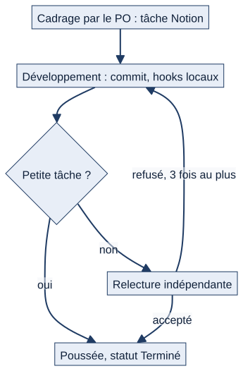

# Chapitre 24 — Qualité, tests et contribution

> **Diffusion restreinte.** **État décrit :** état B (`6d6d0be`), non fusionné dans `main`. Légende : 🟢 réel vérifié, 🔵 cible, ⚪ non vérifié.
> **Pour qui :** développeurs, relecteurs, responsable du projet. **Ce que vous y trouverez :** comment Matrix est testé et ce que les tests protègent — ou pas —, les contrôles automatiques qui bloquent un commit, la chaîne de travail (PO, Développeur, Relecteur) et les règles de contribution.

---

## 24.1 Les tests

🟢 **Suite de l'état B (comptes rendus de lots)** : **3 963 tests, OK, 20 ignorés, sur SQLite**. Cette suite complète **n'a pas été rejouée pour ce dossier** : seuls des sous-ensembles ont été rejoués (ensemble 1 : 360 tests ; ensemble 2 : 1 464 ; ensemble 3 : 1 491, sept paquets, tous OK).

**Répartition des fonctions de test par paquet (lecture du code, état B)** :

| Paquet | Fonctions de test | Paquet | Fonctions de test |
|---|---|---|---|
| `matrix` (noyau, transverses) | 947 | `calendar_app` | 124 |
| `quarts` | 609 | `taches` | 94 |
| `assets` | 493 | `reports` | 49 |
| `training` | 310 | `annonces` | 46 |
| `dashboard` | 261 | `demandes` | 41 |
| `logistics` | 228 | `threads` | 30 |
| `maintenance` | 178 | `absences` | 21 |
| `notifications` | 165 | `programme` | 10 |
| `org` | 163 | `documentation` | 9 |
| `accounts` | 159 | `postes` | 7 |
|  |  | `retex` | 5 |

⚠ **Couverture inégale.** `documentation` (9), `retex` (5), `postes` (7) et `programme` (10) sont **très peu testés** pour des modules qui portent des circuits de validation ; `rondes` n'a aucun test (module retiré). Les tests protègent surtout les droits, les périmètres, la maintenance, les quarts et la formation.

**Ce que les tests transverses vérifient** (`matrix/tests/`) : navigation, accès de l'équipage, **étanchéité d'équipage**, **fuites sans rattachement**, balayage de saisie, contrastes, brouillons, inactivité, identité de session, configuration de production, cohérence de configuration, modules activables, pages d'erreur, instance de démonstration, balises et composants. Quatre tests **JavaScript** exécutables avec Node (`grille`, `brouillon`, `compte_rendu`, `inactivite`).

## 24.2 Ce qui n'est pas couvert ⚪

- **PostgreSQL** : les lots rapportent des essais manuels ; la suite automatique tourne sur SQLite.
- **Windows** et **navigateurs réels** (Chrome, Firefox, Safari), **mobile**, **lecteurs d'écran**, **impression physique** : checklist `docs/COMPATIBILITE_CHECKLIST.md`, **non rejouée**.
- **Redis et Celery réels**, **Web Push réel**, **PDF** (bibliothèques natives).
- **Charge et performance**.
- **Test utilisateur à l'aveugle** : le protocole de recette UX (4 marins) est défini dans Notion ; ⚪ ses résultats ne sont pas dans ce dossier.

## 24.3 Les hooks de commit

Quatre contrôles dans `.claude/hooks/`, branchés dans `.claude/settings.json` :

| Contrôle | Quand | Effet |
|---|---|---|
| `verifier-tests-avant-commit.sh` | À chaque `git commit` | Bloque si `python manage.py check` échoue ; la **suite complète** ne tourne que si la commande est préfixée de `MATRIX_SUITE_COMPLETE=1`, une fois en fin de chantier |
| `verifier-francais-avant-commit.sh` (logique `verifier_francais.py`) | À chaque commit (y compris `commit -a`) | Bloque si une ligne **ajoutée** contient du texte probablement anglais dans une zone qui doit être en français (commentaires, docstrings, chaînes, gabarits, `.md`) ; le **code** n'est jamais examiné, ni l'existant |
| `verifier-migrations-appliquees-avant-commit.sh` | À chaque commit | Bloque si des migrations ne sont pas appliquées à `db.sqlite3` |
| `verifier-migration-retrocompatible.sh` | Après toute écriture de fichier | Alerte si une migration **ajoute un champ sans valeur par défaut** |

Complément au démarrage : `matrix/core/checks.py` (migrations en attente, DEBUG actif hors développement local). **Un hook qui bloque ne se contourne jamais** : on corrige.

⚠ Ces hooks sont des **protections du poste du développeur**, pas une intégration continue : **aucun pipeline CI n'existe** (pas de dossier `.github`). Une CI **hors Internet** (script local obligatoire, tests navigateur versionnés) est le lot L28 (cible).

## 24.4 La chaîne de travail : PO, Développeur, Relecteur

*Schéma S41 — Du cadrage à la poussée.*

Trois agents spécialisés (`.claude/agents/po.md`, `dev.md`, `relecteur.md`), orchestrés par un « Engineering Manager » (le rôle que tient l'assistant). **Chaque agent démarre sans mémoire : Notion est la seule source de vérité entre les étapes.**

| Étape | Agent | Statut Notion |
|---|---|---|
| Objectif flou, « [CADRAGE @po] » | PO | — |
| Tâche précise | Développeur | À faire → En cours |
| Vérification (grosse tâche) | Relecteur | En vérification → Terminé |

- **Petite tâche** (pas de migration, pas de rôles ni de permissions, pas de nouveau modèle, ≈ 50 lignes ou moins) : Développeur → commit (hooks) → poussée → Terminé.
- **Grosse tâche** : Développeur → commit (hooks) → **Relecteur indépendant** → poussée, ou renvoi. **Trois refus au plus** par tâche ; au-delà, on s'arrête et on demande à l'utilisateur.
- **Ne jamais deviner un choix métier Marine** : on relaie la question.
- **Dette groupée** : une dette hors périmètre s'ajoute à la tâche Notion « Dette — <app> », jamais une tâche par point.
- Quand un bug est corrigé, on **cherche le même défaut ailleurs**.

Le Relecteur vérifie notamment : aucun **système parallèle** aux existants (rôles, `RolePermission`, `scope_filters_for_user`, `Notification`, `AuditLog`, `threads`) ; périmètre respecté ; tout texte lu par un humain **en français** ; commentaires courts ; pas de code mort.

## 24.5 Règles de contribution (extrait de `CLAUDE.md`)

1. **Français** pour tout ce qui est lu par un humain (interface, commentaires, docstrings, `.md`, messages de commit, commentaires Notion) ; seul le code peut être en anglais.
2. **Plus rapide qu'Excel** ; **espace personnel** par marin ; **Internet n'existe pas** ; **visuel utile** ; **configuration plutôt que code** ; **proposer → valider → publier** ; **tout est traçable** (`AuditLog`) ; le **dialogue** est une fonction métier (`threads`) ; **administration distribuée** : étendre `RoleLevel`, `RolePermission`, `scope_filters_for_user`, `Notification`, **jamais un système parallèle**.
3. **Commentaires courts** (le pourquoi, jamais le quoi) ; pas de code mort ; pas de sur-ingénierie ; `git add <fichiers>`, jamais `git add .`.
4. Pendant le travail, tester **l'application touchée** ; la **suite complète une seule fois, en fin de chantier**.
5. Les décisions se conservent par **identifiant `DEC-…`** ; on ne rouvre pas une décision du PO.

## 24.6 Contradictions de documentation relevées

| Source | Affirmation | Réalité |
|---|---|---|
| `docs/REFERENCE.md` §4 et `CLAUDE.md` | « Les 14 apps Django » | **21 applications** plus le noyau (A6) |
| `setup.bat` | « Python 3.8 ou supérieur » | README et dépendances : **3.12+** (A22) |
| `README.md` | Rondes : « module retiré, seuls les modèles subsistent » | Conforme au code ; le cahier des charges (§20) les prévoit encore (A8) |

## 24.7 Cible 🔵

- **Lot L28 — dette documentaire et CI** : script local obligatoire (CI hors Internet), tests navigateur versionnés, correction de `CLAUDE.md`, **tests des modules secondaires** (documentation, RETEX, postes, programme), mise à jour de Notion par le PO.
- **Lot L24 — ergonomie** par petits lots indépendants (chapitre 17).

## 24.8 Limites et éléments non vérifiés

- ⚪ La suite complète n'a pas été rejouée ; les chiffres viennent des comptes rendus de lots.
- ⚪ Le nombre de **fonctions de test** (≈ 3 950) compté par lecture ne coïncide pas exactement avec le nombre de **tests** exécutés (3 963) : les tests paramétrés ou hérités expliquent l'écart.
- ⚪ Le fonctionnement réel des agents (PO, Développeur, Relecteur) est décrit d'après leurs fichiers de configuration, non observé dans ce dossier.

---

**Sources (état B).** `.claude/settings.json`, `.claude/hooks/`, `.claude/agents/`, `CLAUDE.md`, `docs/REFERENCE.md`, `docs/COMPATIBILITE_CHECKLIST.md`, `matrix/core/checks.py`, comptes rendus de lots (dossier V1.2).
